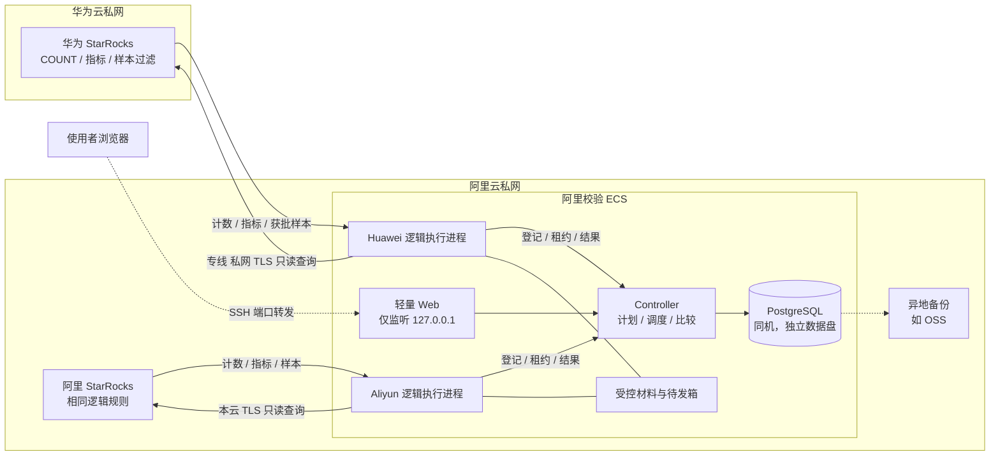
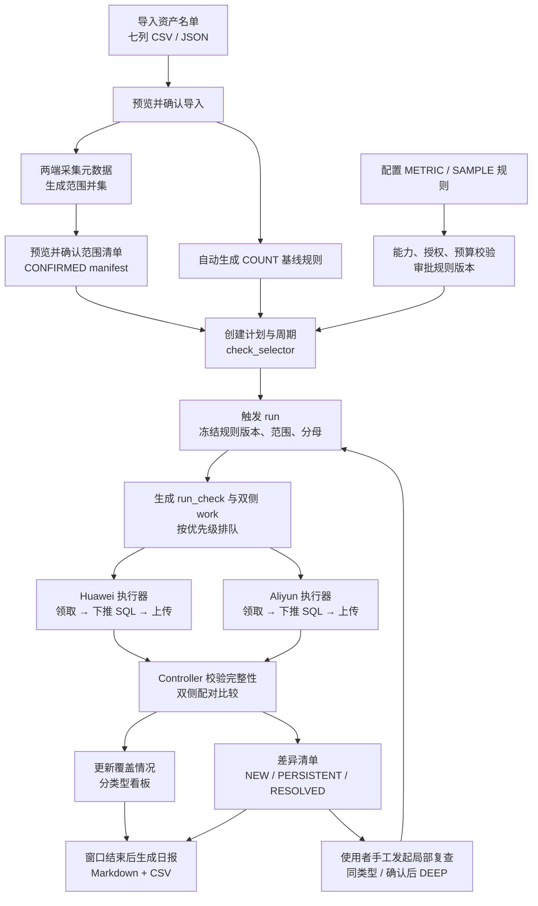

# StarRocks 双云数据校验 — 方案设计

| 项 | 内容 |
|---|---|
| 文档版本 | 基于设计基线 v1.3（2026-10-10） |
| 前置文档 | [01-需求说明](01-需求说明.md) |
| 后续文档 | [03-技术设计](03-技术设计.md) |

---

## 1. 方案概述

一句话概括：**所有表按分区 COUNT 打底，核心表增加分区指标，指定表做约 0.1% 的确定性抽样指纹；计算尽量下推到两端 StarRocks，由阿里云上一台 ECS 集中调度、收取结果、比对和留证。**

- **三档检查**：COUNT（全部表）、METRIC（指定核心表）、SAMPLE（指定表）。三者是可以叠加的独立检查，不是互斥的表等级。
- **集中执行（CENTRAL）**：阿里 ECS 上运行两个相互隔离的逻辑执行进程，分别读取华为 SR（经专线）和阿里 SR（本云）。
- **重计算留在数据库**：COUNT、SUM / GROUP BY、样本筛选都在各端 SR 完成。ECS 只接收计数、聚合结果和命中的样本。
- **华为 Worker 可选**：只有在样本不允许跨云、深查明细量大、或者跨云读取不可靠时，才在华为侧部署本云 Worker（LOCAL）。HYBRID 不在首期范围内。
- **单人工具**：只在一台阿里 ECS 上运行，只有一位使用者，不做登录和多租户；通过 SSH 端口转发访问 Web。
- **在线观察**：两端都在线写入，结论只代表"本轮观察"，没有共同快照保证。

---

## 2. 设计原则

1. **计算下推**：能在 SR 内完成的计数、聚合、筛选都不拉回明细。不能下推时宁可标为 UNSUPPORTED，也不全量拉取。
2. **证据分档**：COUNT、METRIC、SAMPLE、DEEP 各自产生自己类型的证据，独立统计，不相互冒充。
3. **不夸大**：任何"相同"都只在对应证据的边界内成立；结果不完整时不发布结论。
4. **分母只增不减**：失败、取消、样本不足、不支持都保留在分母中，不让完成率虚高。
5. **双侧配对**：每次比较都是同一观察下的双侧结果；需要重读时双侧一起重读。
6. **最小授权**：按规则申请数据外传类别；凭证按 side 隔离；只用只读 SQL 模板。
7. **用户决定深度和频率，程序如实记录**：查了什么、样本有多少、哪些结果完整、哪些范围还没完成。

---

## 3. 三档检查设计

### 3.1 三档对比

| 档位 | 适用对象 | 检查方式 | 跨云返回 | 能发现 | 可能漏检 |
|---|---|---|---|---|---|
| ① COUNT 分区行数 | 全部纳入表 | 每个逻辑分区执行精确 `COUNT(*)`，无分区表按 ALL | 每个范围一条计数 | 数量差异 | 缺行和多行数量抵消；字段被改错 |
| ② METRIC 分区指标 | 指定核心表 | 按分区 SUM，或 GROUP BY 有限维度后 COUNT / SUM | 每个范围的完整分组结果 | 聚合和分布差异、缺组 | 金额对调、正负抵消 |
| ③ SAMPLE 抽样指纹 | 指定表（需有可靠唯一键） | SR 端按稳定键筛选约 1/1000 样本，ECS 规范化后比较指纹 | 命中样本的键和约定列 | 命中样本的内容差异，以及单侧多出或缺少的样本键 | 未被抽中的记录 |
| DEEP 局部诊断 | 经另行审批的局部范围 | 完整读取共同键范围，计算内容摘要或精确比对 | 获批的明细或摘要 | 范围内逐行差异 | 仍然没有共同时点保证 |

### 3.2 组合方式

- COUNT 是基线，覆盖所有已确认的范围。
- METRIC 和 SAMPLE 可以独立叠加；配置了抽样的表不要求同时配置指标。
- 检查深度、业务优先级、执行频率是三个相互独立的维度。例如，重要表可以高优先级跑 COUNT、低频跑 SAMPLE。
- 不同检查可能在不同时间、用不同 SQL 执行，**不能拼成"同一时刻三项一致"**。COUNT 有差异时也不阻断 METRIC 或 SAMPLE 的执行。

### 3.3 指标示例

订单表按 `order_date` 日分区，统计每个分区的订单数和 `SUM(pay_amount)`；再按 `status` 分组，统计各组的订单数和金额。每个 SUM 字段同时记录 `COUNT(字段)`，用来区分"SUM 为 NULL"和"SUM 为 0"。

需要注意以下几点：

- 分组维度必须受控。如果按订单 ID 之类的字段分组，结果规模会接近全量明细。
- 比较时取双方分组键的**并集**，单侧缺少的组也必须被发现。
- 整数和 DECIMAL 不允许有任何差异；浮点必须显式配置容差。

---

## 4. 部署架构

### 4.1 默认：CENTRAL 集中执行



要点：

- **一台主机不等于一个逻辑侧**。同一台 ECS 上部署两个相互隔离的执行进程，各有自己的身份。两者代码版本相同，但连接池、证书、数据源白名单、租约、尝试记录、心跳和待发箱都各自独立。
- **职责分离**：Controller 不执行阻塞的 SR 查询；执行器不能写 PG，只能通过 Controller 的本机接口领取任务和上报结果。
- `worker.side` 表示"读哪一端"，`execution_location` 表示"进程在哪里"。不能把 side 设为 `both` 来绕过授权。
- 接受"一台主机故障会同时影响两侧"这一 PoC 故障域，不宣称高可用。

### 4.2 可选：LOCAL（HYBRID 后置）

| 模式 | 部署 | 适用场景 | 首期 |
|---|---|---|---|
| CENTRAL | 两个执行器都在阿里 ECS；华为样本字段经专线传到阿里 | 默认 | 实现 |
| LOCAL | 华为执行身份改为部署在华为专用主机上的同版本 Worker，阿里执行器不变 | 样本明细不允许跨云；跨云连接不可靠；局部深查明细量大；必须在本云完成规范化 | 预案：执行器代码与位置无关，需要时只改部署 |
| HYBRID | 按资产或规则选择已批准的执行池 | 只有部分表需要本云处理 | 后置，不实现 |

- 华为 Worker **主动拉取**任务，不需要 Controller 回连，也不需要通过 SSH 派单。
- LOCAL 模式下 SAMPLE 仍须在 SR 端选样。只有获批的 DEEP 才允许在本云读取全范围。
- 切换执行位置后重读时，双侧都要重新观察，不能把旧样本与新样本混用。
- 同一次观察中，同一侧的同一扫描单元只能有一个有效尝试。

### 4.3 数据外传分级

| 类别 | 可返回的内容 | 约束 |
|---|---|---|
| SUMMARY_ONLY | 批准的元信息、COUNT、范围级完整摘要、状态 | 默认不包含敏感分组值、行键或行哈希 |
| AGGREGATES_APPROVED | 完整分组键、指标、NULL 状态 | 维度和指标走白名单；高基数或敏感小分组需单独审批 |
| SAMPLE_VALUES_APPROVED | 命中样本的完整键和约定列 | CENTRAL 模式下 SAMPLE 必需 |
| DETAIL_APPROVED | 指定局部范围的原始值 | DEEP / EXACT / 字段诊断，需单独预算并设有效期 |

规则需声明所需的传输类别。**配置了 SAMPLE 不等于已获准传输样本**。缺少授权的任务在领取前就标为 `BLOCKED_AUTHORIZATION`。

**本项目的授权方式（第 3 轮已确认）**：

- 客户同意样本键与约定列、分组维度值与聚合值外传到阿里 ECS。
- 采用**全局一次授权**：配置中登记一次审批依据，允许 SUMMARY_ONLY、AGGREGATES_APPROVED、SAMPLE_VALUES_APPROVED 三级。规则的 `transfer_class` 由检查类型自动确定，不再逐条审批。
- DETAIL_APPROVED 不在全局授权内：每次发起 DEEP 时确认范围、字节上限和有效期。
- 撤销全局授权后，尚未执行的 METRIC / SAMPLE 立即进入 `BLOCKED_AUTHORIZATION`，已接受的结果保留。
- 原值保留 7 天：样本原值、分组原值、DEEP 明细到期自动删除；计数、摘要、行指纹、比较结论和差异记录保留到验收期结束。

以下 LOCAL + SUMMARY_ONLY 的规则只在启用 LOCAL 预案时适用。在该模式下，只上报样本计数和完整样本集合的摘要：

- 计数和摘要都一致时，判定为 SAMPLE 观察相同。
- 摘要不同时，只能报告"样本集合有差异"，不能伪造具体的差异键数量。
- 容差列的值不能传输比较时，该路径标为 UNSUPPORTED。

### 4.4 网络与凭证

| 发起方 | 目标 | 用途 |
|---|---|---|
| ECS 上的 Huawei 执行器 | 华为 SR 私网端点（经专线） | SELECT、必要元信息、取消本身发起的查询 |
| ECS 上的 Aliyun 执行器 | 阿里 SR 私网端点 | 同上 |
| 各执行身份 | Controller 的执行器接口 | 每个 side 一个独立凭证（CENTRAL 时走本机回环地址，LOCAL 时走私网 mTLS），用于登记、领取、心跳、上传 |
| Controller | PG | 受限的服务账号；执行器不能直连 PG |
| 使用者浏览器 | Web / API（仅监听 `127.0.0.1`） | 通过 SSH 端口转发访问，无登录 |

- 需要检查新主机的 DNS、路由、ACL、防火墙和数据库白名单。
- TLS 必须校验证书链、主机名和有效期。客户的 SR 版本不支持所需的安全连接时，先标为 BLOCKED，待批准适配方案后再进行。
- 凭证存放（第 3 轮已确认）：每个 side 一个本机凭证文件，权限 0600，属于该 side 执行器的系统用户。Controller、Web 和另一侧执行器都读不到。界面和配置中只用 `connection_ref` 引用，不允许输入任意 DSN，日志中不出现明文。
- PG 与校验程序同机自建（第 3 轮已确认）：
  - 使用独立数据盘，为 PG 预留内存和 CPU，防止执行器外排挤占。
  - 每日全量备份并持续归档 WAL，存到异地（例如 OSS）；同时做云盘快照。
  - 上线前和验收期中各做一次恢复演练。
  - 备份中也包含原值，备份保留期按"7 天 + 一个备份周期"设置。

```text
阿里 ECS（一台）
├─ srdq-web / srdq-controller   系统用户 srdq-ctl，可读 PG 凭证，不能读 SR 凭证
├─ srdq-exec-huawei             系统用户 srdq-hw，只能读 huawei 凭证
├─ srdq-exec-aliyun             系统用户 srdq-al，只能读 aliyun 凭证
├─ PostgreSQL                   独立数据盘，只监听本机地址
└─ 临时材料 / 待发箱             按 side 分目录、分配额
```

---

## 5. 端到端业务流程



---

## 6. 关键方案点

### 6.1 范围确认

- 处理顺序：表是否存在 → 逻辑结构 → 范围清单 → COUNT → 已配置的指标和抽样。缺表、无权限、未知范围都不能跳过后算作完成。
- 范围取**两端当前元数据与已登记历史范围的并集**。一侧缺失、NULL 分区、范围外、审批排除项都要显式登记。
- 分区类型和配对方式：

  | 分区类型 | 配对方式 |
  |---|---|
  | range 分区 | 按同字段、同类型的半开区间配对；两端边界不同时，拆成共享的原子区间 |
  | list 分区 | 按规范化值集合配对 |
  | 无分区 | 使用 ALL |

- 确认范围只是确认"查什么"，不代表"两端已同步"，也不要求提供停写证明。
- 结构门控按检查所需的列分别生效：某个复杂列不受支持时，只阻断需要这一列的 SAMPLE / DEEP，不影响 COUNT。
- 历史分区也可能被回刷，因此所有约定分区都要持续轮巡 COUNT。

### 6.2 指标比较

1. 两端 SR 各自完成过滤和分组聚合，返回完整的分组结果。
2. 执行器把分组键编码为规范字节（NULL 不替换成哨兵值，不做 trim 或大小写转换）。
3. Controller 取两侧分组键的并集，逐组比较组行数、非空计数和各项度量。
4. 缺组、度量不同、守卫值不同都记为 METRIC 差异。任何一个组、度量或守卫缺失，都不发布"完整相同"。
5. 分组数、键长、结果字节都有硬上限，超限时失败并取消查询，不截断结果。

### 6.3 确定性抽样（"每 1000 行抽 1 行"）

**口径**：抽取约 0.1% 的稳定键样本，**不是严格的等距抽行**。

**为什么不能各端各自抽**：

- 自然顺序、`RAND()`、`LIMIT/OFFSET` 都无法保证两端抽到的样本可以配对。
- 按序号每千条取一条时，一端缺一行就会让后续所有样本错位。
- 只从华为选出样本键、再到阿里用 `IN` 查询，会漏掉阿里一侧多出的键。

**做法**：

```text
概念规则（不是可直接执行的 SR SQL）：
  H(固定种子 + 规范化完整键) → 无符号 64 位整数 → mod 1000 == 0 即入样

华为 SR：在指定分区上执行该过滤，只返回命中行的键和约定列
阿里 SR：在自己的相同逻辑范围上独立执行同一规则
阿里 ECS：比较双方样本键的并集 → 对同键行规范化编码 → 比较行指纹
```

- 采用无歧义的规范编码（C1）：明确类型、NULL、长度、字段顺序、数值精度和时间精度。行指纹包含完整键和全部约定内容列。
- 首期统一在 ECS 上计算指纹，避免两端 SQL 序列化方式不同带来的差异。
- 抽样规则只基于键，与内容列无关，因此同一个键的内容被修改后，它是否入样不会改变。
- 需要先用固定测试向量在两端 SR 上验证编码、哈希和取模的结果完全一致，才能启用。验证不通过时标为 `UNSUPPORTED_SAMPLE_PUSHDOWN`。

**局限与处理**：

| 局限 | 处理 |
|---|---|
| 少量错误容易漏检 | 在键入样近似独立、均匀的假设下：1 条错误被抽中的概率约 0.1%；1000 条不同键的错误中至少抽中 1 条的概率约 63.2%。这是设计上的解释，不是对客户数据检出率的承诺 |
| 小分区可能抽不到样本 | 两侧都是 0 个样本时，结论为"样本不足"（INCONCLUSIVE），不算通过；可以另行批准对小范围全读 |
| 固定种子不会累积成全覆盖 | 反复执行抽中的都是同一批键；更换种子需要两端同步并生成新的规则版本 |
| 服务端过滤不一定减少扫描 | 哈希谓词可能仍需扫描整个分区的键列并消耗 CPU。1/1000 是预期的行比例，不代表扫描量或成本缩小 1000 倍 |
| 无可靠唯一键 | 唯一性只认表模型（第 4 轮）：Primary / Unique 模型的完整单列键才能用于 SAMPLE。Duplicate、Aggregate 表的 SAMPLE 标为不适用，保留 COUNT 和 METRIC |

**键类型（第 4 轮已确认）**：大多数抽样表是单列整数主键，首期另外支持单列字符串键。两种键使用同一套 C1 / S1 协议，只是类型标签和载荷不同：整数取十进制文本，字符串取原始 UTF-8 字节。字符串键要额外验证两端对字节长度、多字节字符和 CHAR 尾部空格的处理是否一致，不一致时为 UNSUPPORTED。复合键推迟。

### 6.4 局部诊断（DEEP）

- 入口：COUNT 差异、METRIC 差异组、SAMPLE 差异都可以一键发起"局部复查"，也可以手工指定范围。只能由使用者手工发起（第 5 轮），工具不自动执行，也不给候选列表。
- 默认用原检查类型复查。全字段指纹或 EXACT 必须走显式的 DEEP 审批，并具备明细授权和预算。
- 分片方式：
  - `KEY_RANGE`（优先）：适用于有经过验证的唯一整数键。由中央统一划定共享的半开区间（含无穷端点），各叶分片可以双侧并行。字符串键的区间受两端排序规则影响，首期改用 HASH_BUCKET。
  - `HASH_BUCKET`：每个范围每侧完整读取一次，在本地分桶外排；全部桶都完整后才原子采用。
- 数据来源：只有 `LIVE_REREAD`，双侧在同一个新观察里重新读取（第 6 轮去掉了使用留存材料的方式）。

### 6.5 调度与资源

- 排序：`检查类型(COUNT → METRIC → SAMPLE) → priority DESC → 层级 → FIFO`，同级时 ODS 优先，不设血缘屏障。类型分批不是硬屏障：COUNT 暂时派不出去时，空闲并发可以给其他类型使用。
- **同一资产同一时刻只允许一个 run 持有资产槽**，避免多个周期重复扫描同一张表；同一个 run 内的不同规则和分片可以在预算内并发。
- 并发预算按数据源集群计算，不随进程数增加而翻倍。
- 租约超时、ECS 重启、专线断开都**不意味着 SQL 已经停止**。在确认之前保持 CANCEL_PENDING，并持续占用资产槽。
- 防饥饿：同级同层 FIFO；同一计划的上一轮未完成时，不无限插入新轮次；跨计划的等待时长和超期情况直接展示，不偷偷提升优先级。

### 6.6 任务控制

- 两层控制：`task_node`（表 / 分区 / 分片的范围树）和 `run_check`（某个范围上的某条规则）。子级受祖先约束。
- 暂停采用"排空"语义：不再开启新观察。已经开始的观察（任一侧任一扫描单元已开始）允许按原契约完成剩余的双侧工作，但不新增成员，也不重试。需要立即停止时用 CANCEL。
- `THIS_AND_FUTURE` 绑定稳定的逻辑范围和 `check_selector`，因此对后续新的规则版本也生效。
- 所有操作都是先预览、再执行（PREVIEW → APPLY），带幂等键和版本号，执行时需要说明原因。

### 6.7 周期

- 三种类型：CRON、INTERVAL、CONTINUOUS。默认时区 Asia/Shanghai。
- 每个 schedule 带自己的 `check_selector`。首期目标是三类检查都每天覆盖全部分区，因此推荐 COUNT、METRIC、SAMPLE 各配一个 `CONTINUOUS` 周期，上一轮完成后立即开始下一轮。实际周期由容量决定，报告中如实显示。
- 由于同一资产跨 run 必须串行，同一张表上的 COUNT、METRIC、SAMPLE 三个 run 会相互等待，需要在 PoC 中实测。
- 规则未配置不算失败，但报告中要写明"未启用"；规则已配置却无法执行，则计为"未完成"。

### 6.8 执行窗口

两端 SR 不能单独配置资源组，所以校验只在低峰时段运行：

```text
20:00 窗口开始 ── 恢复派发；各 run 从未完成的范围接着跑
07:30 停派     ── 不再开始新观察，已开始的观察继续跑
08:00 截止     ── 取消所有在途查询，确认两端都已终止
                   被取消的观察作废，范围留到下一个窗口重读
08:00–24:00    ── 不派发任何业务查询（元数据预览也不派）
```

- 窗口是**全局派发门控**，与周期触发无关：周期决定什么时候生成一轮，窗口决定什么时候允许执行。
- 一轮在一夜内跑不完时，下一夜接着跑，已完成的范围不重跑。看板显示每轮的开始时间、已用窗口数和实际轮巡周期。
- 停派时刻之后不开新观察，是为了尽量让已经开始的观察在截止前完成，减少作废。可以进一步用该范围的历史耗时做预判：预计在截止前跑不完的，不派。
- 截止时刻的取消与普通 CANCEL 相同：未确认终止前保持 CANCEL_PENDING，并继续占用资产槽。观察作废后，双侧都要用新观察重读，不保留其中一侧已完成的结果用于拼接。
- 共用资源时，工具自身负责保护 SR：每个集群一个并发上限、单条查询超时、尽量设置会话级内存上限；SR 响应明显变慢或报错增多时自动降并发，必要时暂停派发。SR 侧的负载信号只取只读账号可查的系统视图，不访问 FE / BE 的 metrics 端口（第 7 轮）。

### 6.9 覆盖报告

参见 [01-需求说明 FR-11](01-需求说明.md#fr-11-覆盖看板)。核心口径：

- 按 COUNT / METRIC / SAMPLE 分开计算分母和完成率。
- 有完整结论的差异计入"完成"，但不计入"相同"。
- 抽样计划执行到 100%，只代表计划完成，不代表 100% 的行已经比较过。
- 清单中存在未知项时，不能报告全库 100%。

### 6.10 差异处理与报告（第 5 轮已确认）

**流程**：工具负责发现和如实呈现差异，解释和处理都在线下完成。

```text
观察到差异 ─→ 直接进入看板和当天日报（不自动复核）
            ─→ 按历次结果标出 NEW / PERSISTENT(连续 N 次) / RESOLVED
            ─→ 使用者线下与客户、运维沟通；需要时手工发起局部复查或 DEEP
```

- **为什么不自动复核**：自动复核要多占一次窗口里的查询，还会推迟上报。改为根据后续轮次的结果自然区分：写入时差造成的差异通常下一轮就变成 RESOLVED，持续存在的差异会显示连续次数。
- **不做分诊记录**：差异清单没有"已解释""已修复"之类的状态。代价是工具里看不到哪些差异已经处理过，需要在线下台账中跟踪。
- **疑似存储损坏**：SR 返回 tablet / 副本 / 校验类错误时，记为 ERROR 并单列为"疑似存储错误"，由使用者转运维处理。工具不暂停该表，也不下"已损坏"的结论。
- **通知**：只有看板（顶部告警栏）和日报文件，不向外发送消息。
- **日报**：每天窗口结束、在途查询确认终止后生成，包含进度与轮巡周期、差异清单、未完成与不支持项、负载与熔断记录四部分。格式是 Markdown 正文加 CSV 明细（Excel 可直接打开），需要 PDF 时在本机转换。选定日期区间可以生成阶段报告，作为给客户的材料。

---

## 7. 传输、扫描与成本

### 7.1 估算公式

```text
单轮跨云量 ≈ 华为 COUNT 结果 + 华为完整分组结果 + 华为命中样本键和列 + 协议与重试开销
传输时间下界 ≈ 跨云字节 ÷ 专线实际可用吞吐（不是线路标称带宽）
每端查询时间容量：查询数 × 平均耗时 < 并发 × 窗口 × 可用系数
```

### 7.2 样本量示例

| 分区行数 | 入样比例 | 每行返回字节 | 期望样本 | 期望字节 |
|---|---|---|---|---|
| 1000 万 | 0.1% | 1000 | 约 1 万行 | 约 10MB |
| 10 亿 | 0.1% | 1000 | 约 100 万行 | 约 1GB |

200TB 指单端压缩后的存储量，原始行数据量更大，**不能**直接推算为"传输 200GB"。

### 7.3 本项目容量粗算

以下按第 2 轮确认的规模计算，只用于判断量级，实际值以 PoC 为准。

| 项 | 假设 | 结果 |
|---|---|---|
| COUNT 查询数 | 30 万分区；每天一轮；有效窗口 7.5 小时（27000 秒） | 每侧约 11 条/秒；并发 8 时每条平均需 ≤ 0.7 秒 |
| METRIC 查询数 | 数百张表的全部分区，假设共 5 万个分区，每表 1 条规则 | 每侧每轮约 5 万次聚合查询，每次扫描度量列与维度列 |
| SAMPLE 扫描 | 数百张表的全部分区 | 每行都要在 SR 端计算 SHA-256 判断是否入样；CPU 开销与行数成正比，**很可能是最重的一项** |
| SAMPLE 传输 | 假设这些表的原始数据量为 300TB，入样 0.1%，只返回约定列 | 每轮最多约 300GB；1Gbps 专线（实际约 100MB/s）约需 50 分钟，传输不是瓶颈 |

结论：

- 三类检查都每天覆盖全部分区，在共用资源、每晚 8 小时的条件下**很可能做不到**。方案按"一轮可以跨多夜续跑"设计，报告中如实显示实际轮巡周期。
- 瓶颈预计在 SR 端（COUNT 的查询次数，以及 SAMPLE 的逐行哈希），而不在专线。
- PoC 必须测出两项数据：三类检查每 TB 的耗时，以及对业务查询延迟的影响。据此确定并发，并估算一轮全量需要几个窗口。

### 7.4 与其他方案对比

| 比较基线 | v1.3 的变化 | 结论 |
|---|---|---|
| 单机跨云拉取全量明细 | 改为 SR 端聚合和抽样，ECS 只接收结果与命中样本 | 通常能大幅降低跨云传输（前提是不先拉全量再抽样） |
| v1.2 双 Worker 本云全量指纹 | 旧方案多数情况下只传摘要；新方案可能需要跨云传输样本字段 | **新方案的传输量未必更少**。收益在于少部署一台主机、减少常态的全字段处理 |
| SR 生产资源 | COUNT、聚合、哈希过滤仍然消耗 SR 的 CPU 和 IO | 网络流量缩小不等于扫描量缩小；三类 SQL 还可能重复扫描，需要实测后错峰或合并 |

### 7.5 成本构成

阿里校验 ECS、PG 和备份、临时材料存储、两端 SR 的额外负载、专线实际计费、开发和运维投入。单端方案是一个简化候选，**尚未验证是否最便宜，也未验证容量是否足够**。

---

## 8. 方案取舍记录

| 决策 | 选择 | 主要理由 | 代价 |
|---|---|---|---|
| 默认校验深度 | 三档（COUNT + 可选 METRIC / SAMPLE），全量指纹降为 DEEP | 数千表、200TB 量级下，全字段指纹的成本过高 | 内容检出能力下降，需要在报告中明确边界 |
| 部署 | 默认 CENTRAL，华为 Worker 可选 | 少一台主机和一套运维 | 样本需要跨云传输；单主机故障域 |
| 抽样方法 | 基于键哈希的确定性抽样，SR 端下推 | 两端独立选样也能配对，并能捕获单侧多出的键 | 依赖 SR 函数兼容性；首期支持单列整数键和单列字符串键 |
| 唯一性依据 | 只认表模型（Primary / Unique 的完整单列键） | 证据可靠，不需要额外的全表核验 | Duplicate、Aggregate 表无法做 SAMPLE |
| 规则输入 | 业务方逐表填写 Excel 模板，导出 CSV 导入 | 业务方最懂口径；CSV 便于预览、校验和版本化 | 规则质量和进度依赖业务方；工具不做指标推荐 |
| 差异上报 | 直接上报，按历次结果派生持续情况 | 不额外占用窗口；上报及时 | 偶发的写入时差也会出现在日报中，需要靠 NEW / RESOLVED 解读 |
| 分诊记录 | 工具里不记录 | 单用户，线下台账足够；工具更简单 | 工具里看不到差异的处理进度 |
| 通知 | 只有看板和日报文件 | 不需要外网出口，没有数据外泄面 | 不能及时推送，要靠每天查看 |
| 报告格式 | Markdown + CSV | 实现简单，Excel 可打开，可转 PDF | 没有内置图表和 xlsx 格式 |
| 指纹计算位置 | ECS 统一计算 | 避免两端 SQL 序列化差异 | 原始样本值需要外传 |
| 快照语义 | 在线观察，`temporal_assurance=NONE` | 无法停写，也没有血缘 | 结论只代表观察，不代表验收 |
| 合并查询 | 首期每条规则独立执行 SQL | 正确性优先，协议简单 | 可能重复扫描 |
| 控制一致性 | 单活 Controller，控制事务全局串行 | 首期正确性优先；单用户下并发很低 | 吞吐上限，不支持高可用 |
| 使用方式 | 单用户、无登录、只监听本机地址 | 只有一位使用者，验收期专用 | 不能多人协作；访问依赖 SSH |
| 多租户 | 不做，去掉 owner | 只有一位使用者 | 以后如需多人使用，要改数据模型 |
| 运行时段 | 只在低峰窗口执行，到点取消 | SR 无专用资源组，与业务共用 | 一轮可能跨多夜；截止时被取消的观察要重读 |
| 夜间顺序 | 按检查类型分批：COUNT → METRIC → SAMPLE | COUNT 是全覆盖的底线 | COUNT 占满窗口时，METRIC 和 SAMPLE 的周期顺延 |
| 外传授权 | 全局一次授权，DEEP 按次确认 | 客户已统一同意，单用户无需逐条审批 | 授权粒度粗；撤销时整体阻断 |
| 原值留存 | 7 天后自动删除原值，保留摘要和差异 | 降低数据暴露面 | 较早的差异只能重读定位 |
| PG 部署 | 与校验程序同机自建 | 部署简单，无额外云资源 | 与执行器共享故障域和资源，依赖备份恢复 |
| 凭证存放 | 本机文件，按系统用户隔离 | 单机单用户，最简单 | 不支持集中轮换；ECS root 可读 |
| 实现语言 | Python（FastAPI + psycopg3 手写 SQL + PyMySQL） | 团队熟悉；编码协议只实现一份；流式读取和外排有成熟库 | 单进程 CPU 受 GIL 限制，大样本编码要靠多进程或分 side 进程 |
| Web 形式 | 服务端渲染页面 | 单用户内部工具，不需要前端工程 | 交互能力有限，复杂运行树的展示较朴素 |
| 控制库 | 全新 schema，32 表，不兼容 v1.2 | 去掉历史包袱；应验项、覆盖、导入行合并后表更少 | 合并后的 run_check 要靠触发器保护分母不可变 |
| 留存材料诊断 | 去掉 CAPTURED_MATERIAL，DEEP 只做双侧重读 | 原值只留 7 天，核对材料的逻辑复杂而收益小 | 每次诊断都要占用窗口内的查询 |

---

## 9. 风险与应对

| 风险 | 应对 |
|---|---|
| 两端 SR 版本不支持同语义的哈希过滤 | 用固定向量做能力探测；不通过时标为 UNSUPPORTED，保留 COUNT / METRIC；必要时评估 LOCAL 或插件 |
| 样本不允许跨云传输 | 客户已同意外传（第 3 轮）；授权变化时启用 LOCAL 预案，在华为 Worker 上本地计算并只上传摘要 |
| PG 同机，ECS 故障同时丢失控制库 | 独立数据盘、每日异地备份加 WAL 归档、云盘快照、恢复演练 |
| 原值 7 天后删除，较早的差异无法定位到字段 | 差异记录本身保留；需要时用 LIVE_REREAD 重新读取 |
| 检查负载影响生产 SR | 只在低峰窗口执行；分别设置并发、扫描时长、结果字节预算；SR 变慢时自动降并发；达到阈值时停止接收新任务 |
| 共用资源下一夜跑不完 | 一轮跨多夜续跑；按类型分批，先保证 COUNT；报告显示实际轮巡周期和最久未验证时长 |
| SAMPLE 逐行哈希过重 | PoC 实测每 TB 耗时；必要时减少 SAMPLE 表，或降低 SAMPLE 的轮巡频率（需要使用者确认） |
| 高基数分组接近明细量 | 设置 max_groups、max_key_bytes、max_result_bytes，超限即失败，不截断 |
| 取消查询后 SQL 实际仍在运行 | 通过 query_ref 确认取消；未确认前保持 CANCEL_PENDING 并占用资产槽 |
| 单台 ECS 故障 | 执行器有本地待发箱；PG 异机备份；恢复后生成新的控制代号，丢失期间标为 UNKNOWN |
| 用户把结果误读为验收通过 | 规范报告用语，必须显示证据类型和"共同快照保证：无" |
| 写入时差造成的偶发差异淹没真实问题 | 日报区分 NEW / PERSISTENT / RESOLVED，并按连续次数排序；报告中声明差异可能来自写入时差 |
| 没有推送，严重问题发现不及时 | 使用者每天查看日报；看板顶部集中显示熔断、CANCEL_PENDING、疑似存储错误 |
| 容量估算失真 | 200TB 口径已确认为单端压缩后存储量；仍用代表表 PoC 测每 TB 耗时，不凭表数确定并发和 ECS 规格 |
| 业务方的规则交付晚或质量差 | COUNT 不依赖规则，先行全覆盖；模板导入时逐行校验并给出错误原因；未交付规则的表在看板上单列为"无 METRIC / SAMPLE 规则" |
| 浮点列情况不明 | 保持 REQUIRE_POLICY：浮点列未给容差时规则为 UNSUPPORTED，预览中标出，由业务方补充容差 |
| 字符串键两端语义不一致（CHAR 尾部空格、字节长度、排序规则） | PoC 用专项向量验证；不一致的表 SAMPLE 标为 UNSUPPORTED，不在客户端修正 |
| 两端同为 3.x，但发行版或补丁版本不同导致函数语义有差 | 能力记录精确到补丁版本，逐项探测；任一端升级后能力审批失效，需要重新探测 |
| PoC 在生产上进行，影响业务 | 只在窗口内跑，从低并发开始，DBA 监控确认后再上调；已知真值用例只用隔离库 |
| 只读账号查不到系统视图，SR 侧负载信号缺失 | 自动只用校验查询自身的超时率、错误率和耗时放大倍数；DBA 的监控作为外部补充 |
| 疑似存储错误的关键字匹配误报或漏报 | 初始关键字较宽；PoC 中汇总两端实际的错误消息后修订；只影响报告分类，不影响结论 |

---

## 10. PoC 计划

### 10.1 范围与环境（第 7 轮）

- **环境**：直接在生产两端、执行窗口内进行，能测到真实的耗时和对业务的影响。两端同为 SR 3.x，都支持可校验的 TLS。
- **代表表**：10～20 张，覆盖大分区和小分区、宽表、各种表模型、有键和无键、核心指标、历史回刷。
- **并发**：从保守初值（例如每集群 2）开始，DBA 对比业务查询延迟后逐步上调，找到可接受的最大并发。
- **隔离表**：已知真值的用例（构造差异、边界值、重复键等）需要可写的表。由 DBA 在两端生产集群中各建一个专用的隔离库并写入数据，校验账号对它仍然只读。

### 10.2 验证项

| 验证项 | 验证方法 | 放行标准 |
|---|---|---|
| ① 规则与范围 | 导入名单，验证分区并集、单侧缺表或缺分区、NULL、未知、新增范围 | 范围可解释；失败和未知不被当作 0，也不从分母中消失 |
| ② 指标正确性 | 在隔离表中构造 NULL、金额变化和抵消、缺组、高基数分组 | 应检出的差异都被检出；抵消盲区有说明；超预算时不截断通过 |
| ③ 确定性抽样 | 两端用相同键数据验证命中集合一致；整数键覆盖负数、0 和边界值，字符串键覆盖 ASCII、多字节 UTF-8、空串、最大长度和 CHAR 尾部空格；覆盖重复键、空键、空样本，以及 Duplicate 表被拒绝；分别构造入样和未入样的错误 | 两种键类型的编码都兼容；样本键并集和入样错误能被检出；未入样错误允许漏检并有说明 |
| ④ 负载与传输 | 在低峰窗口实测三类检查每 TB 的耗时、扫描量、返回字节、专线吞吐、业务延迟；验证停派与截止取消 | 没有出现全量拉回后再抽样；业务延迟在 DBA 可接受范围内；能给出一轮全量所需的窗口数；到截止时刻所有查询确认终止 |
| ⑤ 控制与恢复 | 测试优先级、暂停、取消确认、超预算、中断重试、重复结果、PG 恢复 | 半成品结果不报相同；重采成对留下新证据；取消不复活；旧证据可追溯 |

已知真值的用例和安全负测都使用隔离库中的表，**不修改真实数据来制造差异，也不中断生产专线**；断网演练只在 ECS 本机用防火墙规则阻断。

### 10.3 通过门槛（第 7 轮）

以下四项全部通过，才进入正式验收使用（对应 03 §17.10 的 V92～V95）：

| 门槛 | 通过条件 |
|---|---|
| S1 采样两端一致 | 参考向量逐阶段一致；代表表上数据一致的范围内，两端选中的键集合完全相同；整数键和字符串键都覆盖 |
| COUNT 全量 ≤ 1 夜 | 按实测的每分区耗时和可接受的最大并发推算，COUNT 一轮全量不超过 1 个窗口（约每侧 11 条/秒） |
| 对业务影响可接受 | DBA 根据自己的监控书面确认；同时定下正式的并发和熔断阈值 |
| 取消与恢复可靠 | 截止取消、手工取消、进程重启、本机断网后，两端 SQL 都确认终止，结果不重不漏 |

METRIC 和 SAMPLE 的轮巡夜数只实测、如实报告，不作为门槛。

### 10.4 PoC 后的三种决策

1. **采用单端执行**：只读和 TLS 可用，SR 端抽样结果一致，样本获准外传，资源和覆盖窗口可接受。
2. **对部分表启用 LOCAL**：部分表需要在本云规范化、不能外传样本，或深查量大。
3. **先调整，不扩大**：降低并发或频率，调整指标维度或列集合；不支持的表明确登记。COUNT 全量超过 1 夜时，不调低门槛，而是减少 METRIC / SAMPLE 表、拉长它们的周期，或由使用者确认接受 COUNT 跨夜并在报告中写明。

PoC 通过只证明这条路径可用，**不**证明全库逐行一致，也不代表允许切流。

---

## 11. 实施阶段

一次性交付（首期 3 个月以上）。P0～P4 完成开发，P5 的 PoC 通过后才正式投入验收使用；验收期在工具就绪后开始。

| 阶段 | 工作 | 退出条件 |
|---|---|---|
| P0 | 确认窗口准确起止、三档名单和规则、权限与外传授权（口径、频率目标、带宽已确认） | 安全前提可达成；不需要血缘、生产任务或停写证明 |
| P1 | 生成并验证 `srdq` 的 32 表 DDL（全新 schema）；实现资产、范围、规则审批、运行模型 | 多规则、分母、版本约束的测试通过 |
| P2 | CENTRAL 模式的两个逻辑执行身份；COUNT 和 METRIC | 下推正确；精度、缺组、超限测试通过 |
| P3 | S1 适配器的双端向量验证；SAMPLE / C1 / D1 | 服务端筛选、可靠键、空样本、额外键的边界测试通过 |
| P4 | Web、本轮与后续策略、周期、局部诊断、恢复 | 状态竞争、取消确认、证据完整性测试通过 |
| P5 | 生产两端窗口内，10～20 张代表表和最大分区上的 PoC | §10.3 四项门槛全部通过；定下正式并发和熔断阈值；决定采用 CENTRAL 还是可选 Worker |

项目到期时：停止 schedule；排空在途任务并确认取消；对账待发箱；保留清单、规则和证据；按审批停用执行身份。默认不转为长期平台。
