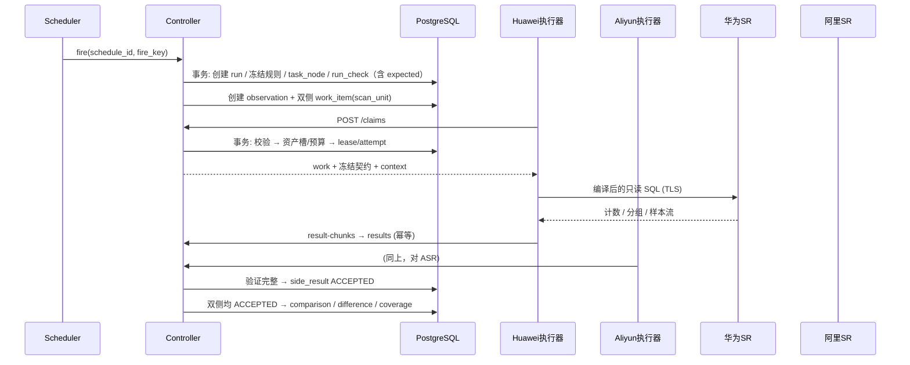
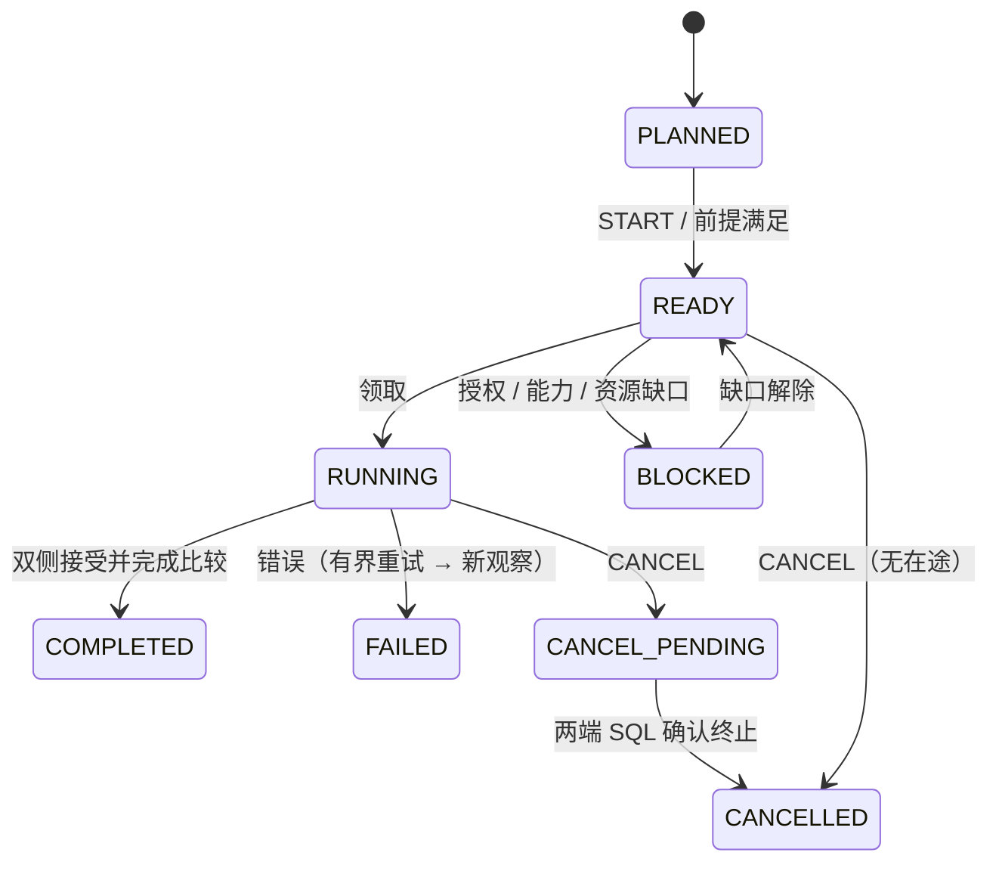

# StarRocks 双云数据校验 — 技术设计

| 项 | 内容 |
|---|---|
| 文档版本 | 基于设计基线 v1.3（2026-10-10） |
| 前置文档 | [01-需求说明](01-需求说明.md)、[02-方案设计](02-方案设计.md) |
| 原始依据 | `StarRocks双云数据校验程序_详细设计_v1.3.md`（第 1～20 章及附录） |
| 状态 | 设计规范。**已有首版实现**（`srdq/`，72 项自动化测试通过，使用本地 PG 和模拟 SR）。尚未在真实 SR 上验证；实现与本文的差异见 §1.1 |

---

## 1. 文档范围与当前状态

本文是研发实现所依据的技术规范。在 v1.3 研发稿的基础上，按"系统 → 模型 → 协议 → 算法 → 调度控制 → 接口 → 存储 → 一致性 → 运维 → 测试"的顺序重新组织；第 2 章的模块划分是本文新增的建议。

当前进度：

| 项 | 状态 |
|---|---|
| v1.3 设计规范 | 已完成（本文） |
| C1 / S1 / D1 本地参考测试 | 53 项通过，使用合成数据（研发稿记录） |
| 本地 SQL / 模型 / 计算检查 | 20 项通过，基于内存 SQLite，不代表真实 PG 约束（研发稿记录） |
| v1.3 PG DDL（32 表，全新 schema，不兼容 v1.2） | **已生成**：`srdq/db/migrations/0001_init.sql`，在 PostgreSQL 16（pgserver）上验证约束和冻结列触发器 |
| Controller / 执行器 / Web / CLI / systemd unit | **已实现**首版，72 项 pytest 通过（协议向量、编码性质测试、controller–executor 端到端、Web 安全和页面、CLI）；四个真实进程的本地演示见仓库根目录 README |
| 真实 SR、PG、网络、权限、并发、性能测试 | **未执行**。SR 适配器（PyMySQL）只经过编译单元测试，端到端测试使用模拟集群；PoC（§17.10）待做 |
| v1.2 31 表 DDL | 曾在 PGlite 0.5.8 / PG18.3 上验证，仅作历史记录，不能作为 v1.3 的证据 |
| 讨论第 1 轮简化（已确认） | 单用户、无登录，Web 只监听 127.0.0.1；去掉多 owner；首期只实现 CENTRAL，LOCAL 作预案，HYBRID 后置；预算结算保留原设计 |
| 讨论第 2 轮（已确认） | 单端约 200TB（压缩后），数十万分区；三类检查都以每天覆盖全部分区为目标；只在 0–8 点窗口执行，到点取消；按 COUNT → METRIC → SAMPLE 分批；SR 无专用资源组；专线 ≥1Gbps。见 §8.1、§8.4、§8.5 |
| 讨论第 3 轮（已确认） | 样本和分组值可以外传，全局一次授权，DEEP 按次确认；原值保留 7 天（§14.3）；PG 同机自建；凭证存为本机文件，按系统用户隔离 |
| 讨论第 4 轮（已确认） | SAMPLE 支持单列整数键和单列字符串键，唯一性只认表模型（§4.4）；METRIC 规则和 SAMPLE 比较列由业务方用 CSV 模板逐表给出（§4.6）；浮点列未摸清，保持 REQUIRE_POLICY，无容差时 UNSUPPORTED |
| 讨论第 5 轮（已确认） | 差异直接上报，不自动复核，不在工具内记录分诊；按历史结果派生 NEW / PERSISTENT / RESOLVED（§7.10）；疑似存储错误单列、线下处理（§7.11）；DEEP 只手工发起；只用看板和日报通知，日报为 Markdown + CSV（§11.5） |
| 讨论第 6 轮（已确认） | Python（FastAPI + Jinja2 服务端渲染 + psycopg3 手写 SQL，§2.4）；全新 schema `srdq` 共 32 表，不兼容 v1.2；expected 和 coverage 并入 run_check，import_row 并入 import_batch（§12.2）；去掉 CAPTURED_MATERIAL，DEEP 只做 LIVE_REREAD |
| 讨论第 7 轮（已确认） | 两端同为 SR 3.x，仍逐项做能力探测（§7.5）；两端都支持可校验的 TLS；PoC 直接在生产两端的窗口内做；负载信号只用只读账号可查的系统视图（§8.5），熔断阈值 PoC 实测后与 DBA 商定；STORAGE_SUSPECT 先用关键字初始列表，PoC 中补充（§7.11）；PoC 门槛见 §17.10，其中 COUNT 全量一轮 ≤ 1 夜 |


### 1.1 首版实现与本文的差异

以下是实现时做出的取舍和细化，均已有测试覆盖。如果与客户或 DBA 的期望不符，需要再调整。

**调度与周期**

1. 周期错过多次触发（misfire）时，只补一次，并记录被合并的次数。
2. CONTINUOUS 周期的休息时间，从 Controller 观察到上一轮结束时开始计。
3. CONTINUOUS 周期上一轮异常结束后，不会自动再触发，需要手工 RESTART。

**报告**

4. 只为 Controller 实际看到开放过的窗口生成日报。每个报告文件在 artifact 表中对应一行。
5. 零长度窗口也生成日报（内容为空），不会让每个调度轮次都报区间错误。
6. 日报中的 RESOLVED 只列自上一份日报以来转为相同的差异。

**局部诊断（DEEP）**

7. 手工 DEEP 的规则用 rule_key `deep_<hex16>`，以 detail_approval_ref 作为批准依据。
8. DEEP 每个分片的读取上限取以下两项中较小的一个：范围读取预算 ÷ 分片数，本轮传输预算 ÷ 叶子数。

**清理**

9. 清理只推迟仍被 OPEN 观察引用的材料。
10. METRIC 分组值的清理和 artifact 的清理互相独立。

**Web**

11. 写请求做同源校验：Origin（没有 Origin 时用 Referer）的 host:port 必须与请求的 Host 一致。两者都不带的非浏览器请求（如 curl）放行，因为浏览器发 POST 时总会带 Origin。
12. Host 接受任何本机地址加任何端口，以便 SSH 转发到其他本地端口。
13. 看板进度的"应验"数不含 EXCLUDED 的检查项（例如没有任何分区落入的 `(-inf, …)` 范围）。
14. 导入确认的原因字段可以不填。
15. 浏览器的 `/favicon.ico` 返回 204。

**CLI 与部署**

16. `srdq import --confirm` 遇到有 ERROR 行的批次时不确认，并以非零退出码结束。在 Web 上可以只确认有效行。
17. 执行器启动时如果连不上 Controller，按指数退避重试，上限 60 秒；被拒绝（例如令牌无效）时仍然直接退出。
18. Controller 和 Web 启动时，如果当前系统用户能读到任一侧的 SR 凭证文件，就拒绝启动（开发机用 `--dev` 跳过）。执行器能读到另一侧凭证时同样拒绝。
19. 凭证文件必须是本用户所有的普通文件，且组和其他用户无任何权限。
20. Controller 只读取 PG 凭证文件 `pg.json`：内容为 `dsn` 字段，或者 host / port / dbname / user / password / sslmode 等字段。开发时可以用环境变量 `SRDQ_PG_DSN` 覆盖。
21. 执行器的 worker token 默认取 side 凭证文件中的 `worker_token` 字段，也可以用 `--token-file` 指定。只有 `--sim` 模式允许用环境变量 `SRDQ_WORKER_TOKEN`。
22. 实际的包结构比 §2.2 扁平：`srdq/controller/*.py`、`srdq/executor/*.py` 各为一个模块文件，功能边界与 §2.2 相同。

---

## 2. 系统组件与模块划分

### 2.1 进程与部署单元

| 进程 | 位置 | 职责 | 不允许 |
|---|---|---|---|
| Web / API | 阿里 ECS | 服务端渲染页面、REST API；只监听 127.0.0.1，经 SSH 端口转发访问，无登录 | 直接访问 SR；监听非本机地址 |
| Controller | 阿里 ECS（单活） | 导入、范围、规则、计划与周期、派工、结果接收、比较、覆盖、审计 | 执行阻塞的 SR 查询 |
| Huawei 执行器 | 阿里 ECS（CENTRAL）或华为主机（LOCAL） | 只读查询华为 SR，编码，上传 | 写 PG，读取阿里数据源 |
| Aliyun 执行器 | 阿里 ECS | 只读查询阿里 SR，编码，上传 | 写 PG，读取华为数据源 |
| PostgreSQL | 与校验程序同一台阿里 ECS，独立数据盘（第 3 轮） | 控制库 | 监听非本机地址；对公网开放 |

### 2.2 模块（建议）

按 Python 包划分（技术栈见 §2.4）。

```text
srdq/
├── common/
│   ├── protocol/        # srdq-v1.3 消息模型、枚举、校验
│   ├── canonical/       # C1 编码、S1 采样、D1 摘要、确定性 JSON
│   └── dsl/             # 范围 DSL、过滤 DSL、规则定义 schema
├── controller/
│   ├── importer/        # 资产 CSV/JSON、规则模板 CSV 的预览与确认
│   ├── manifest/        # 范围发现、并集、确认、版本
│   ├── rules/           # 规则版本、审批、能力与授权校验
│   ├── planning/        # plan / schedule / fire / run 创建与冻结
│   ├── queue/           # 优先级物化、领取、资产槽、预算
│   ├── control/         # 控制操作预览/应用、current-future、排空
│   ├── intake/          # 结果分块暂存、完整性验证、发布
│   ├── compare/         # COUNT / METRIC / SAMPLE / DEEP 比较器
│   ├── coverage/        # expected 投影、看板聚合、差异持续情况
│   ├── report/          # 日报与阶段报告（Markdown + CSV）
│   └── recovery/        # control_generation、租约回收、CANCEL_PENDING
├── executor/
│   ├── adapter/         # StarRocks 方言、SQL 编译器、能力探测、query_ref 取消
│   ├── runner/          # 领取、心跳、流式读取、预算上报
│   ├── encoder/         # C1/D1 流式编码、外排
│   └── outbox/          # 本地待发箱（每身份独立）
└── web/                 # Jinja2 模板与路由：资产、规则、范围、计划、运行树、结果、运维、审计
```

### 2.3 一次检查的组件交互



### 2.4 技术栈（第 6 轮已确认）

| 方面 | 选型 | 说明 |
|---|---|---|
| 语言 | Python 3.11+ | 全部进程同一语言；C1 / S1 / D1 只实现一份，Controller 和执行器共用 `common/` |
| Web / API | FastAPI + Jinja2 服务端渲染 | 不做前后端分离，不引入 Node 构建链；需要局部刷新时可以用 htmx |
| PG 访问 | psycopg3，手写 SQL | 不用 ORM；SQL 按模块集中存放，事务边界显式写出；领取用 `FOR UPDATE SKIP LOCKED` |
| SR 访问 | PyMySQL，SSCursor 流式读取 | 样本流逐行编码，不整体载入内存；取消时另开连接执行 `KILL QUERY`，并按 §9 确认终止 |
| 执行器并发 | 线程池 + 独立心跳线程 | 每条 SR 查询占一个线程；心跳不受查询阻塞影响 |
| 进程管理 | systemd | Web、Controller、两个 side 执行器各一个 unit，分别以 srdq-ctl / srdq-hw / srdq-al 运行 |
| 依赖 | venv + 锁定版本 | 离线安装包随版本交付；不在运行主机上联网安装 |
| schema 迁移 | 带编号的 SQL 文件 | 见 §12.7；不用 Alembic 的自动生成 |
| 测试 | pytest；C1 编码用 hypothesis 做性质测试 | 参考向量见附录 A |

---

## 3. 领域对象模型

### 3.1 对象关系

```text
资产 asset + 规则 check_rule（稳定 rule_key / 不可变的批准版本）
                    ↓
范围 manifest → plan → schedule（check_selector）
                    ↓
run（冻结规则版本、范围、授权、执行位置策略）
 ├─ task_node：TABLE → PARTITION → SHARD（只有一棵范围树）
 └─ run_check：范围 × rule_key；冻结列即应验分母（expected），可变列承载运行控制、进度和覆盖投影
          ↓
 observation（一个 run_check 的一次双侧配对）
      ↙                    ↘
华为 work/attempt       阿里 work/attempt
      ↘                    ↙
 side_result → comparison → difference；comparison 回写 run_check 的覆盖投影
```

### 3.2 对象职责

| 对象 | 职责 |
|---|---|
| check_rule | 资产内稳定的 rule_key；每个版本有独立 UUID、check_kind、定义摘要、审批信息 |
| plan | 引用确认后的清单和允许的规则；不再用单一 evidence 表示所有检查 |
| schedule | 规则选择器 + 时间规则 |
| run | 冻结本轮选中的批准规则版本、节点、expected、执行策略 |
| task_node | 范围控制；同一范围上的多条规则共用一个节点 |
| run_check | 某范围上某条规则：冻结的应验项（expected，分母），加上独立的状态、优先级覆盖和当前覆盖结论 |
| observation | 一类检查的一个冻结契约；规则变更或重读都产生新观察 |
| observation_member | 完整结果覆盖的叶成员；COUNT / METRIC / SAMPLE 通常只有一个分区成员 |
| worker | 逻辑执行身份，side 固定，物理地点另行记录 |
| work_item / attempt | 一侧的工作，以及一次租约领取；双侧绝不合并成一个 attempt |
| coverage | 不单独建表：每个 run_check 的覆盖投影列，看板按 check_kind 分别聚合 |

### 3.3 身份约束

- `check_kind` 描述请求的检查，`evidence` 描述实际取得的证据。对应关系为：COUNT→COUNT、METRIC→METRIC、SAMPLE→SAMPLE、DEEP→CONTENT_HASH 或 EXACT。
- SAMPLE 即使逐行比较了样本原值，也**不能**把 evidence 标为 EXACT。
- `scope_key` 只表示逻辑范围，不能把规则或 side 拼进去。多规则的唯一性由显式的 `rule_key` / `run_check_id` 保证。
- 规则序号、compute_revision、observation_seq 都不能代替规则身份。

---

## 4. 输入规格

### 4.1 资产名单（七列 CSV）

```csv
layer,source_db,source_table,target_db,target_table,priority,enabled
ODS,ods,orders,ods,orders,70,true
DWD,dwd,order_detail,dwd,order_detail,90,true
ODS,ods,debug_events,ods,debug_events,10,true
DIM,dim,shops,dim,shops,50,false
```

字段规则、预览确认流程见 [01-需求说明 FR-01](01-需求说明.md#fr-01-资产导入)。JSON `asset-list-v1` 与 CSV 进入同一个内部模型。

### 4.2 COUNT 基线规则

- 资产首次确认时自动生成 `rule_key=baseline_count`、`check_kind=COUNT`，业务过滤固定为空，只使用清单中的范围。
- METRIC 中的组行数只用于指标完整性校验，**不**自动覆盖 COUNT 基线。首期不同规则独立查询。

### 4.3 METRIC 规则定义

以下 UUID 为占位值。规则先进入 DRAFT，批准后不可原地编辑。

```json
{
  "format_version": "check-rule-v1.3",
  "asset_id": "00000000-0000-4000-8000-000000000020",
  "rule_key": "orders_by_status",
  "check_kind": "METRIC",
  "definition": {
    "group_by": ["status"],
    "filter": {"op": "TRUE"},
    "metrics": [
      {"id": "order_rows", "function": "COUNT_ROWS"},
      {"id": "pay_sum", "function": "SUM", "column": "pay_amount", "value_type": "DECIMAL", "scale": 2, "compare": "EXACT"}
    ],
    "include_group_row_count": true,
    "sum_non_null_guard": true,
    "max_groups_per_side": 10000,
    "max_group_key_bytes": 512,
    "max_result_bytes_per_side": "67108864"
  },
  "transfer_class": "AGGREGATES_APPROVED",
  "execution_policy": "CENTRAL",
  "enabled": true
}
```

约束：

- 每条规则只有一组 `group_by` 和一个 `filter`。
- 函数白名单：`COUNT_ROWS`、`COUNT_NONNULL`、`SUM`。
- 过滤 DSL 只支持类型化的 `AND / OR`、`EQ / NE / LT / LE / GT / GE`、`IN`、`IS_NULL`、`IS_NOT_NULL`、`TRUE`，并限制深度、节点数和 IN 列表长度。NULL 判断只能用显式的 NULL 运算，不能编译成 `= NULL`。
- 表、列、函数都来自批准的元数据白名单，值用参数绑定。不接受原始 WHERE、任意函数、表达式或 SQL。
- 每个 SUM 字段自动附带非空计数；每个组强制包含 COUNT_ROWS。维度列、过滤列、度量列都要通过结构兼容校验。
- `scale` 是两端共同的逻辑精度。聚合返回的精度由适配器验证，不能用输入列的精度截断 SUM 结果。

### 4.4 SAMPLE 规则定义

```json
{
  "format_version": "check-rule-v1.3",
  "asset_id": "00000000-0000-4000-8000-000000000020",
  "rule_key": "orders_sample",
  "check_kind": "SAMPLE",
  "definition": {
    "key_columns": ["order_id"],
    "compare_columns": ["order_id", "pay_amount", "status", "order_date"],
    "key_contract": "NON_NULL_UNIQUE_INTEGER",
    "sample_protocol": "SRDQ-SAMPLE-1",
    "seed_hex": "00000000000000000000000000000000",
    "bucket_count": 1000,
    "selected_bucket": 0,
    "min_sample_rows_per_side": 1,
    "max_sample_rows_per_side": 2000000,
    "max_result_bytes_per_side": "2147483648",
    "filter_location": "STARROCKS",
    "fingerprint_location": "EXECUTOR",
    "empty_sample_policy": "INCONCLUSIVE"
  },
  "transfer_class": "SAMPLE_VALUES_APPROVED",
  "execution_policy": "CENTRAL",
  "enabled": true
}
```

约束：

- 抽样比例由 `bucket_count=1000, selected_bucket=0` 派生，不使用浮点概率参数。首期固定这两个值；以后要改比例，需要新的协议能力和新的规则版本。超出预算时也**不能**自行降低采样率。
- 种子不是秘密，但必须固定、可复现，并写入契约。每条规则都必须显式给出种子，不能在运行时随机生成。
- 首期内置两种键契约（第 4 轮）：
  - `NON_NULL_UNIQUE_INTEGER`：完整的单列、非空、唯一整数键。大多数 SAMPLE 表属于这一种。
  - `NON_NULL_UNIQUE_STRING`：完整的单列、非空、唯一字符串键（VARCHAR / CHAR / STRING）。C1 tag 4，按原始 UTF-8 字节编码，不 trim、不改大小写、不做 Unicode 归一化；允许空串，NULL 视为违反契约；单个键的字节长度上限由 `checks.sample.max_key_bytes` 限制。
- 唯一性**只认表模型**（第 4 轮）：
  - 只有 Primary / Unique 模型、且规则键恰好是其完整的单列主键或唯一键时，才能使用 SAMPLE。两端的表模型和键列都要满足。
  - Duplicate 模型（以及 Aggregate 模型）的表不做 SAMPLE。导入预览直接标为"不适用"，COUNT 和 METRIC 照常执行。
  - 不接受外部提供的唯一性核验结果；只检查样本内无重复，也不能证明全表唯一。
  - 复合键推迟到后续版本，需要登记新的协议能力和双端测试后才能使用。

### 4.5 规则版本与选择器

- `rule_key` 在资产内保持稳定，`id` 标识具体版本。修改列、维度、过滤、容差、种子、比例、预算、执行位置或传输类别，都生成新版本，旧版本标为 SUPERSEDED。
- 启停意图（enabled）与版本状态（status）分开管理。旧的 run 继续使用冻结的定义；权限撤销后，立即阻断尚未执行的任务和尚未接受的数据。
- schedule 使用稳定的 `check_selector`（kinds，可选 rule_keys），不绑定临时的 run_check UUID。创建 run 时只解析当前已批准且启用的版本。
- 选择器命中了不支持或缺少授权的规则时，保留对应的 expected，并标为 BLOCKED 或 UNSUPPORTED，**不从分母中消失**。

### 4.6 规则模板（CSV，第 4 轮）

METRIC 规则和 SAMPLE 比较列由业务方逐表给出。业务方用 Excel 填写模板，导出为 UTF-8 CSV 后上传；工具只解析 CSV，不直接读 xlsx。模板中的表以 source 侧库表名定位，并且必须已存在于资产名单中。

**`metric_rules.csv`**：一行一个指标，同一张表的同一个 `rule_key` 的多行合成一条 METRIC 规则。

```csv
source_db,source_table,rule_key,group_by,filter,metric_id,function,column,scale,compare,rtol,atol
dwd,order_detail,by_status,status,,order_rows,COUNT_ROWS,,,EXACT,,
dwd,order_detail,by_status,status,,pay_sum,SUM,pay_amount,2,EXACT,,
dwd,order_detail,by_status,status,,weight_sum,SUM,weight_kg,,TOLERANCE,1e-9,0.001
```

| 列 | 规则 |
|---|---|
| `group_by` | 维度列，多列用 `;` 分隔；为空表示不分组 |
| `filter` | 为空表示 `TRUE`；否则是 §4.3 过滤 DSL 的 JSON 片段（Excel 中整格填写） |
| `function` | `COUNT_ROWS` / `COUNT_NONNULL` / `SUM` |
| `scale` | DECIMAL 的 SUM 必填，是两端共同的逻辑精度 |
| `compare` | `EXACT` 或 `TOLERANCE`。浮点列必须写 `TOLERANCE` 并给出 `rtol` / `atol`，否则这条规则为 UNSUPPORTED |

- 同一表、同一 `rule_key` 的各行，`group_by` 和 `filter` 必须完全一致，否则整条规则报错。
- 规则中没有 `COUNT_ROWS` 时自动补上；每个 SUM 自动附带非空计数（§4.3）。
- `max_groups_per_side` 等预算使用 §15 的全局默认值，模板不开放。

**`sample_rules.csv`**：一行一张表。

```csv
source_db,source_table,key_column,compare_columns,float_rtol,float_atol
ods,orders,order_id,order_id;pay_amount;status;order_date,,
ods,users,user_code,user_code;nick;score,1e-9,0.0001
```

- `key_column` 必须是两端表模型中完整的单列主键或唯一键（§4.4）；`compare_columns` 必须包含键列。
- 比较列中有浮点列时，必须填写 `float_rtol` / `float_atol`，否则这条规则为 UNSUPPORTED。
- 种子使用项目统一的默认值（`checks.sample.default_seed_hex`），并在每条规则版本中显式记录（§4.4）。比例固定为 1/1000。

**导入流程**：与资产名单相同，先 PREVIEW 再 CONFIRM。

1. PREVIEW：逐行解析，并对照两端的元数据核对表是否在名单中、列是否存在、类型是否兼容、表模型和键列是否满足 §4.4、键类型是整数还是字符串、是否有浮点列缺少容差。逐行给出 OK / ERROR / UNSUPPORTED 及原因。
2. CONFIRM：只为 OK 的行生成 DRAFT 规则；同一 `rule_key` 已有批准版本且定义变化时，生成新版本。
3. 批准：用全局 `approval_ref` 统一批准为 APPROVED（单用户，按批次操作即可）。UNSUPPORTED 的规则也会登记，后续进入 expected 并标为 UNSUPPORTED，不从覆盖分母中消失。
4. 重复导入相同内容是幂等的：定义摘要不变时不生成新版本。

---

## 5. 范围清单

### 5.1 发现流程

```text
分层资产名单 → 两个逻辑执行器采集表、结构、分区
             → 两端逻辑范围并集 + 已登记的历史清单
             → Web 预览：包含 / 缺失 / 未知 / NULL / 范围外 / 排除
             → 审批与摘要 → CONFIRMED manifest → plan
```

### 5.2 配对规则

| 情况 | 处理 |
|---|---|
| range 分区 | 同字段、同类型的半开区间；两端边界不同时，拆成共享的原子区间 |
| list 分区 | 规范化值集合；单独验证互斥性和 NULL |
| 无分区 | `ALL`；COUNT / METRIC / SAMPLE 默认不人为拆分片 |
| NULL 分区值 | `NULL_SCOPE`，用 `IS NULL` 谓词 |
| 范围外 | `OUTSIDE`，显式登记 |
| 采集阻断 | `INVENTORY_BLOCKER` |

元数据状态分为：`PRESENT`、`ABSENT_CONFIRMED`、`ACCESS_DENIED`、`UNKNOWN`、`QUERY_FAILED`。

### 5.3 生命周期

- 清单状态为 DRAFT → CONFIRMED → SUPERSEDED。确认后不可原地修改范围。
- 新分区默认 `REQUIRE_CONFIRM`，可批准为 `AUTO_ADD_COMPATIBLE`。消失的分区保留缺失记录，不减少分母。
- 存在未知项时 `inventory_complete=false`。
- 元数据中的 RowCount 只是估算值，基线必须用精确的 `COUNT(*)`。分区 COUNT 之和与另一次全表 COUNT 不相等，在在线数据上只能作为线索。

---

## 6. 观察与证据语义

### 6.1 观察契约

每个 observation 只属于一个 run_check，冻结以下内容：

- manifest / scope；
- rule_id / rule_digest、check_kind；
- 逻辑列、维度、采样契约；
- 执行位置和授权快照；
- 扫描单元清单 `execution_units`。

双侧各自记录真实的 `read_started` / `read_finished`、`query_ref` 和 attempt。

| 字段 | 取值 |
|---|---|
| verdict | OBSERVED_EQUAL / OBSERVED_DIFFERENT / INCONCLUSIVE / ERROR / UNSUPPORTED |
| evidence | COUNT / METRIC / SAMPLE / CONTENT_HASH / EXACT |
| temporal_assurance | 固定为 NONE |
| read_mode | 固定为 ONLINE_ONLY |
| origin | 固定为 LIVE（第 6 轮去掉了 CAPTURED） |

### 6.2 完整性层次

| 层次 | 定义 |
|---|---|
| query_complete | 查询成功结束，协议 EOF，没有超限、隐藏截断或解码失败 |
| projection_complete | 所需的计数、指标、维度、比较列和辅助守卫全部返回 |
| result_complete | 已核验得到该查询预期的完整结果集合，而不是前 N 行 |
| evidence_sufficient | 证据满足判定条件，例如 SAMPLE 非空、达到最低样本量 |
| completed_for_coverage | expected 的全部成员都有有效、充分、可比较的证据 |

判定规则：

- 有完整结论的差异算"完成"，但不算"相同"。
- 两侧都没有样本：`query_complete=true`，但 `verdict=INCONCLUSIVE, reason=INSUFFICIENT_SAMPLE`，不算完成。
- 双方 COUNT 都为 0 时可以判定 COUNT 相同，但不能借给 SAMPLE 作为样本证据。
- 一侧样本为空、另一侧有键，且两侧查询都完整时，判定为 OBSERVED_DIFFERENT。最低样本量只限制"无差异 → 相同"这一方向。
- 查询半途失败时，已有线索只作为诊断保留，不发布完整的差异结论。

### 6.3 配对、重试与错误

- 只配对同一 observation、同一 member、同一 context、同一规则版本的结果。
- 启动偏差（`max_start_skew_seconds`）和最大观察时长（`observation_deadline_seconds`）只用来过滤明显陈旧的配对，不能证明快照一致。时间窗口不合规时，即使双侧结果完整也判为 INCONCLUSIVE。
- 原 payload 重传只查询幂等回执。**重新读库必须使用新的 observation_seq，双侧都重新采集**；并且要先确认双侧旧的服务端查询都已终止，不能根据租约到期推断 SQL 已停止。
- 只有两条有效结果才能建立 `dq_comparison`。单侧失败或预检不支持，记录在 attempt / run_check / incident 中，不能伪造另一侧的 0 结果。

---

## 7. 检查算法

### 7.1 COUNT

```sql
SELECT COUNT(*) AS row_count
FROM ods.orders
WHERE order_date >= ? AND order_date < ?;
```

- 无分区 ALL 不加过滤；NULL_SCOPE 使用 `IS NULL`。
- 每个范围必须**恰好返回一条**非 NULL、非负的整数，并带完整 EOF。超出 BIGINT 范围时报 ERROR，不转成浮点。
- 比较：相等为 OBSERVED_EQUAL，否则为 OBSERVED_DIFFERENT。保存 `signed_delta` 和 `abs_delta`；source 为 0 时 `relative_delta=NULL`。

### 7.2 METRIC

SQL 构造：

```sql
SELECT status,
       COUNT(*)          AS group_rows,
       COUNT(pay_amount) AS pay_non_null,
       SUM(pay_amount)   AS pay_sum
FROM ods.orders
WHERE order_date >= ? AND order_date < ?
GROUP BY status;
```

空结果语义：

| 情况 | 结果 |
|---|---|
| 无维度、空输入 | 一个全局组：group_rows=0，non_null=0，SUM=NULL |
| 有维度、空输入 | 0 组 |
| 有维度、维度值为 NULL | 一个 NULL 维度组（与 0 组、与全空求和组都不同） |

规则：

1. 过滤和聚合在 SR 端完成。
2. 每个组强制包含 group_rows；每个 SUM 字段配一个 `COUNT(column)`，校验 `0 ≤ non_null ≤ group_rows`，NULL 数 = group_rows − non_null。
3. 分组键使用规范编码 `KEY = ASCII("SRDQ-KEY-1\0") || U32(维度列数) || 有序的维度 VAL`。无维度时空组键为 `535244512d4b45592d310000000000`。NULL 不替换成哨兵值，不做 trim 或大小写转换。
4. 两端的分组等价语义（类型、collation、CHAR 补齐等）必须一致。客户端无法修复 SR 端分组口径的差异；不一致时标为 UNSUPPORTED。
5. 受 `max_groups`、`max_key_bytes`、`max_result_bytes`、SR 内存和超时等限额约束。

比较流程：

```text
分别完整收取两侧结果 → 解码 → 校验 canonical_group_key 唯一、辅助计数合法
K = union(华为分组键集合, 阿里分组键集合)
for g in K:
    只有一侧存在 → GROUP_SOURCE_ONLY / GROUP_TARGET_ONLY
    两侧都存在   → 比较 group_rows、non_null 守卫、每个度量
任意组、指标、守卫缺失，或键重复、超限、解码错误 → 不发布完整结论
```

数值比较：

| 类型 | 规则 |
|---|---|
| 整数 / DECIMAL | 用任意精度十进制精确比较，使用冻结的共同 scale，不舍入。溢出、转成 float、截断时报 ERROR |
| NULL | NULL 只等于 NULL，NULL 与 0 不同。两侧 SUM 都为 NULL 时，仍需比较 group_rows 和 non_null |
| FLOAT | 默认 REQUIRE_POLICY，没有策略时为 UNSUPPORTED。只比较有限值：`abs(a-b) ≤ max(atol, rtol×max(abs(a),abs(b)))`；出现 NaN 或无穷时为 UNSUPPORTED |

默认在受限内存内对齐；超出内存时可以使用批准的本地有界外排。完整核验后分批暂存、原子发布。

### 7.3 C1 规范编码

```text
VAL = type_tag:U16 || present:U8 || payload_length:U64 || payload
  NULL: present=0, length=0；非 NULL 空串: present=1, length=0
KEY = ASCII("SRDQ-KEY-1\0") || key_column_count:U32 || KEY_VAL_1 || ...
ROW = ASCII("SRDQ-ROW-1\0") || column_count:U32 || VAL_1 || ...
row_hash = SHA256(ROW)
```

- U16、U32、U64 都是无符号大端，长度以字节计。
- 列顺序采用冻结的 source 逻辑列清单，target 按映射投影。完整键在 ROW 的列清单中恰好出现一次。

| tag | 类型 | payload |
|---|---|---|
| 1 | BOOLEAN | ASCII `0` / `1` |
| 2 | 整数 | 精确的标准十进制 ASCII：无前导 `+` 或 `0`，零写作 `0`；不经过 float 或 JS Number |
| 3 | DECIMAL | 按冻结 scale 精确缩放后的整数 ASCII，不允许舍入 |
| 4 | STRING | 无损 UTF-8，不 trim、不改大小写、不做 Unicode 归一化 |
| 5 | DATE | `YYYY-MM-DD` |
| 6 | DATETIME | `YYYY-MM-DDTHH:mm:ss[.fraction]`，精度和时区语义写入契约 |
| 7 | BINARY | 原始字节 |
| 8 / 9 | FLOAT32 / FLOAT64 | 仅限 FLOAT_EXACT 且保真验证通过时使用：IEEE754 大端；±0 和 NaN 的规范位型需要明确定义 |
| 扩展 | JSON / 复杂类型 / 聚合状态 | 没有登记语义插件时为 UNSUPPORTED，**不静默丢弃列** |

### 7.4 S1 采样协议（SRDQ-SAMPLE-1）

```text
sample_input = ASCII("SRDQ-SAMPLE-1|") || ASCII(seed_hex) || ASCII("|") || ASCII(lowercase_hex(KEY))
sample_hash  = SHA256(sample_input)
u            = uint64_big_endian(sample_hash[0:8])
bucket       = u mod 1000
selected     = (bucket == 0)
```

- `seed_hex` 必须匹配 `[0-9a-f]{32}`，**直接使用这 32 个 ASCII 字符**，不解码成二进制。
- KEY 是 C1 编码的完整键字节，再转成小写 hex。不使用数据库隐式的字符串表示。
- `u` 是无符号数，取值 0～2^64−1。不能使用有符号溢出、`ABS(hash)` 或浮点取模。
- 抽样只依赖键，不依赖内容列。
- 种子、键列、键类型和编码、算法、模数和余数，都冻结在 rule 和 observation 中。

### 7.5 SQL 编译器契约与能力探测

编译器的中间表示（**不是 SR 内置函数，也不能直接执行**）：

```text
SELECT <批准的完整键及比较列>
FROM <批准的映射表>
WHERE <类型化逻辑范围>
  AND SAMPLE_S1_MATCH(<完整键>, <seed_hex>, 1000, 0)
```

- 适配器必须把 `SAMPLE_S1_MATCH` 编译成客户 SR 版本所支持的内置表达式组合（字节、hex、SHA-256、精确取模），**默认不安装 UDF**。
- 上线前用附录 A 的向量逐阶段核对 KEY hex、SHA 值、bucket 和 selected，再在隔离表上确认两端的命中集合一致。验证不通过时为 `UNSUPPORTED_SAMPLE_PUSHDOWN`，**禁止退化为全量读取后在客户端抽样**。
- 能力记录至少包括：两端版本和部署形态、driver 版本、编译器 release、模板摘要、键类型、会话语义、最大值测试结果、向量集摘要。以上任何一项变化，能力审批都失效，需要重新探测。
- 带业务行的能力测试需要单独批准 PoC 范围，不能借用 METADATA_PREVIEW 绕过业务读取开关。
- **两端版本（第 7 轮）**：两端同为 StarRocks 3.x。同版本只降低不一致的概率，不能代替探测：两端是不同云厂商的发行版，补丁版本、部署形态（存算一体 / 分离）和会话变量默认值都可能不同。能力记录中的版本号精确到补丁版本，任一端升级后能力审批失效。
- 能力探测至少覆盖：`sha2(…, 256)`、`hex`、`conv`、`substr`、`lpad`、字节长度函数、LARGEINT 取模；`KILL QUERY` 及其确认方式；会话级 `query_timeout` 和 `query_mem_limit`；TLS 握手与证书校验；只读账号对 §8.5 所列系统视图的权限。

**单列键的 KEY hex 拼接**（第 4 轮，两种键契约共用一个模板，只有 tag 和 payload 不同）：

```text
key_hex = '535244512d4b45592d3100'          -- ASCII("SRDQ-KEY-1\0")
       || '00000001'                        -- key_column_count = 1
       || <tag_hex>                         -- 整数 '0002'，字符串 '0004'
       || '01'                              -- present = 1（键不允许 NULL）
       || lpad(hex(<payload 字节长度>), 16, '0')
       || lower(hex(<payload>))
  整数 payload：CAST(col AS VARCHAR) 的十进制 ASCII
  字符串 payload：col 的原始 UTF-8 字节
selected = CAST(conv(substr(sha2(concat('SRDQ-SAMPLE-1|', seed_hex, '|', key_hex), 256), 1, 16), 16, 10)
                AS LARGEINT) % 1000 = 0
```

- 以上是示意，实际函数名和语义以客户 SR 版本为准。需要 PoC 核对的点有：`hex()` 对字符串按字节输出；"字节长度"使用字节数而不是字符数（如 `length()` 与 `char_length()` 的区别）；`conv` 对 64 位无符号值不溢出；CHAR 列的尾部空格在两端的表现是否一致；整数转字符串没有前导零或科学计数法。
- 每一项都要用附录 A 的向量逐阶段核对，再加入多字节 UTF-8、空串、最大长度、负数和整数边界值的专项向量（V76～V77）。
- 字符串键超过 `max_key_bytes` 时，该行属于违反契约：报 ERROR，不截断。

### 7.6 SAMPLE 比较

1. CENTRAL 模式下，SR 先完成过滤，执行器只接收命中行的键和比较列。遇到重复键或 NULL 键时，说明违反了键契约，报 ERROR，不做 DISTINCT 去重。
2. 执行器流式进行 C1 编码，统计样本数和字节数，并按 **C1 KEY 字节字典序**排序（注意：这与数学上的数值顺序不同，两侧必须使用同一种排序）。
3. 双侧完整后，求样本键的并集：只出现在一侧的键记为 `SAMPLE_KEY_SOURCE_ONLY / TARGET_ONLY`；同键时比较 row_hash。
4. row_hash 不同即为样本内容差异。字段级定位要使用本次的完整样本材料，或另建一次 LIVE_REREAD。
5. 结果完全相同，且双侧样本数都不少于 `min_sample_rows`，才判定为 OBSERVED_EQUAL；两侧都为 0 时为 INCONCLUSIVE。
6. 达到行数、字节或磁盘上限时，取消查询并标为 `BUDGET_EXCEEDED`。样本上限不是 SQL 的 LIMIT。

### 7.7 D1 摘要

```text
D = SHA256(
  ASCII("SRDQ-SHARD-1\0") || context_bytes_32
  || ordered_row_hash_1 || ... || ordered_row_hash_n
  || ASCII("END1") || U64(n)
)
```

- 排序方式：SAMPLE 按 C1 KEY 字节序，DEEP 按冻结的排序协议。不使用 XOR、简单求和或 DISTINCT 替代。
- 样本键集合摘要使用同一公式，但 context 是单独的 key_projection，序列为 `SHA256(KEY)`。

**context（`SRDQ-OBS-2`）**至少包括：observation UUID、run_check、check_kind、rule_key、规则版本和摘要、scope 和 manifest、逻辑列和类型、投影用途、排序协议、采样协议和种子以及模数余数（仅 SAMPLE）、成员。

- 用确定性 JSON 表示：键按字典序、UTF-8、无多余空白，大整数和精确值用字符串。取其 SHA-256 得到 32 字节的 context，并保存原文。
- **context 不包含** side、worker、attempt、实际时间、物理 ID、control_generation。
- 双侧使用 Controller 下发的同一个 context，不各自生成。

**FLOAT_TOLERANT 列**：

- 不进入精确摘要，但必须对**全部共同样本键**（DEEP 时为全部共同范围键）逐个比较，全部检查完才算 `column_complete`。
- 无键的通用容差多重集比较，首期不支持。

### 7.8 检出概率

假设哈希近似均匀、错误涉及不同键且入样近似独立，则 d 条错误中至少命中 1 条的概率为 `1-(1-0.001)^d`：

| d | 概率 |
|---|---|
| 1 | 约 0.1% |
| 1000 | 约 63.2% |

固定种子不会随着轮次增加而累积覆盖。

### 7.9 DEEP 局部诊断

**请求示例**：

```json
{
  "request_key": "manual-v13-example-001",
  "plan_id": "00000000-0000-4000-8000-000000000010",
  "asset_id": "00000000-0000-4000-8000-000000000020",
  "manifest_id": "00000000-0000-4000-8000-000000000030",
  "origin_comparison_id": null,
  "check_kind": "DEEP",
  "requested_evidence": "CONTENT_HASH",
  "source_mode": "LIVE_REREAD",
  "transfer_class": "DETAIL_APPROVED",
  "selector": {
    "partition": {"kind": "RANGE", "column": "order_date", "lower": "2026-10-01", "upper": "2026-10-02"},
    "shard": {"kind": "KEY_RANGE", "columns": ["order_id"], "lower": ["10000000"], "upper": ["20000000"], "lower_inclusive": true, "upper_inclusive": false}
  },
  "granularity": {"target_rows": 100000, "max_depth": 8, "max_leaf_count": 2048},
  "priority": 90,
  "limits": {"max_seconds": 1800, "max_read_bytes": "10737418240", "max_transfer_bytes": "1073741824"}
}
```

确认请求时，生成该次专用的、不可变的 DEEP 规则版本和 run_check，不复用 SAMPLE 的 expected。边界值用精确字符串表示，无穷端点用显式的 unbounded。

**发起方式（第 5 轮）**：DEEP 只能由使用者手工发起，可以从差异详情页一键带入范围，也可以手工指定。工具不自动执行 DEEP，也不生成候选列表。每次确认时都要填写范围、字节上限，并登记 DETAIL_APPROVED 的依据。

METRIC 差异组转为行范围时，按同一 group DSL 和原过滤条件编译；无法证明组语义一致时，拒绝自动展开。

**数据来源**：首期只有 `LIVE_REREAD`，即新建 run 和 observation，双侧重新读取。

第 6 轮去掉了 `CAPTURED_MATERIAL`（用已留存的材料做诊断）。原因：原值只保留 7 天，而核对材料的摘要、范围、授权和有效期的逻辑较多，收益有限。请求中出现其他 source_mode 时返回 422。代价是每次诊断都要占用窗口内的查询。

**分片方式**：

| 方式 | 适用 | 规则 |
|---|---|---|
| KEY_RANGE | 已验证的唯一整数键 | 由中央划定共享的半开区间（含无穷端点）；不独立 LIMIT 取页；SQL 显式 ORDER BY 完整键，执行器校验严格递增。字符串键的区间边界依赖两端的排序规则，首期不用 KEY_RANGE，改用 HASH_BUCKET |
| HASH_BUCKET | 获批的 DEEP | 每个范围每侧完整读取一次，在本地分桶外排。有键时按 SHA256(KEY) 前缀分桶、按 KEY 字节排序；无键时按 row_hash 分桶，并保留重复次数 |

**扫描单元与成员**：

- Controller 在创建 observation 时冻结 `contract.execution_units=[{scan_unit_id, member_node_ids, selector_digest}]`。
  - COUNT / METRIC / SAMPLE：一个单元对应一个成员。
  - DEEP KEY_RANGE：每个叶片一个单元，可以双侧并行。
  - DEEP HASH_BUCKET：一个单元覆盖全部桶成员。
- 每个成员恰好属于一个单元，单元之间不重叠，并覆盖全部预期成员。
- 每侧每单元一个 work，唯一键为 `(observation, side, kind, scan_unit_id)`。
- KEY_RANGE 单个单元成功就可以接受其成员的结果，但 expected 要等同一观察的全部成员都比较充分后才算完成。HASH_BUCKET 必须全部桶原子采用。
- 某个分片失败时，不能修改原观察的成员清单来缩小范围。正式重读要新建整个 run_check 的观察；如果只想重读这一片，就另建一个局部 MANUAL run。

**细分**：控制树固定为 TABLE → PARTITION → SHARD，细分历史用 `refinement_path` / `supersedes_node` 记录。父范围细分时，必须证明子范围互斥且并集闭合；不能把不同时刻的父子结果拼成完整覆盖。

**定位**：

- 有键时，先按 KEY / row_hash 定位，再比较规范化后的原始列；无键时，按完整规范行及出现次数比较。
- EXACT 路径必须比较原始值，以排除理论上的哈希碰撞。
- UI 最多展示 100 条，未完整枚举时数量标为 AT_LEAST 或 UNKNOWN。"差异行"与"差异字段"分开统计。
- 重试、换执行器、细分都累计到同一预算中，不重新清零。

### 7.10 差异的上报与持续情况（第 5 轮）

**直接上报**：观察到差异后立即进入看板和当天的日报，不自动安排复核重读，工具也不记录分诊结论（例如"已解释""已修复"），解释和处理都在线下完成。由于两端都在线写入、没有共同快照，一部分差异可能只是写入时差造成的。报告中必须写明这一点，不把单次差异表述为数据错误。

**持续情况**：不增加查询，只根据已有的比较结果派生，用来区分"偶发"和"持续"的差异。

- 链的身份是 `(asset_id, 逻辑范围键, rule_key, rule_revision)`。逻辑范围键是分区的逻辑语义（例如 range 边界或 list 值），不使用每轮新建的 node / run_check UUID，因此可以跨 run 串联。
- 链上只计入"有完整结论"的观察，即 OBSERVED_EQUAL 和 OBSERVED_DIFFERENT。INCONCLUSIVE、ERROR、UNSUPPORTED、ABANDONED 既不计数，也不打断链。
- 规则版本变化后开始新链，旧链保留。

| 状态 | 条件 |
|---|---|
| NEW | 最近一次为 DIFFERENT，且上一次为 EQUAL 或没有上一次 |
| PERSISTENT | 最近一次和上一次都为 DIFFERENT；同时显示连续不同的次数 |
| RESOLVED | 最近一次为 EQUAL，上一次为 DIFFERENT。只在当次日报中列为"已消失"，之后不再列出 |
| — | 其余情况不进入差异清单 |

- 每条链显示：首次发现时间、最近一次结果时间、连续不同的次数、最近一次的差异摘要（例如 COUNT 差值、缺组数、样本差异键数）。
- 首期在查询时根据 `dq_comparison` 的历史派生，需要 `(asset_id, scope_key_digest, rule_key, rule_revision, compared_at)` 索引。数据量太大时再改为物化，是否增加表在第 6 轮一并讨论。

### 7.11 错误分类：疑似存储损坏（第 5 轮）

- 执行器把 SR 返回的错误归类，写入 `attempt.error_class`：`TIMEOUT`、`CANCELLED`、`ACCESS_DENIED`、`NETWORK`、`QUERY_ERROR`，以及 `STORAGE_SUSPECT`。
- `STORAGE_SUSPECT` 指 tablet 或副本不可用、数据校验失败、段文件读取失败一类的错误。按错误消息的关键字匹配（不区分大小写），模式列在 `error_classification.storage_suspect_patterns` 中。初始列表（第 7 轮）：`tablet`、`replica`、`checksum`、`corrupt`、`segment`、`no queryable replica`。PoC 期间把两端实际出现的、被归为 `QUERY_ERROR` 的错误消息汇总出来，由使用者判断后补充；改动配置写审计，不追溯修改已有 attempt 的分类。
- 处理方式与普通错误相同：observation 为 ERROR，不发布结论，range 按退避策略在后续窗口重试；**不自动暂停该表**，也不自动发起 DEEP。
- 看板和日报把 `STORAGE_SUSPECT` 单独列出，带 side、库表、分区、错误码、首次和最近出现时间、累计次数。由使用者转给运维线下处理。
- 报告中只说"查询返回了疑似存储类错误"，不下"数据已损坏"的结论；反过来，没有这类错误也不说明存储健康（见 01 §3.2 第 5 条）。

---

## 8. 调度与资源

### 8.1 排序

```text
资源和门控都满足的 READY work：
kind_rank ASC → priority DESC → layer_rank ASC → ready_seq ASC → work_item_id ASC
kind_rank: COUNT=0, METRIC=1, SAMPLE=2, DEEP=3
layer_rank: ODS=0, DWD=1, DWS=2, ADS=3, DIM=4, OTHER=5
```

有效优先级的继承顺序：run_check 显式覆盖 > 叶节点显式覆盖 > 最近祖先节点覆盖 > 最具体的冻结 scope_policy > 资产默认值。

- 第 2 轮确认按检查类型分批，所以 `kind_rank` 是第一排序键，priority 只在同一类型内部起作用。
- 分批不是屏障：排序只决定"有空闲并发时先给谁"。COUNT 候选因资产槽、预算或门控暂时不可领时，跳过它们，继续领取后面的类型，不让并发空闲。
- DEEP 是使用者手工发起的诊断，排在最后；使用者可以对单个 run_check 设置高优先级，但不能越过 kind_rank。如果要让某次 DEEP 先跑，需要暂停其他类型。

### 8.2 优先级物化屏障

- 修改优先级不抢占在途查询。
- 所有受影响的 READY 候选，必须在 `ORDER BY / LIMIT` 之前刷新完毕。
- 批量更新时递增 `queue_revision`，物化完成后才推进 `queue_materialized_revision`。两者不相等时，拒绝领取并返回 `QUEUE_REFRESHING`。

### 8.3 资产槽与并发

- 同一 asset 首期只允许一个 run 持有 `asset_slot`。同一个 run 内的不同规则或分片，可以在两端各自的并发预算内执行。
- 并发预算按数据源集群计算。
- 所有旧的服务端查询都确认结束后才释放资产槽。在此之前状态为 CANCEL_PENDING，与之冲突的扫描被阻塞，其他资产不受影响。
- METADATA_PREVIEW 不占用业务资产槽，但有独立的低并发预算和权限预算。

### 8.4 执行窗口

两端 SR 都不能单独配置资源组，所以业务查询只在低峰窗口内派发。窗口状态保存在 `dq_control_state` 中，领取事务第一步加锁读取。

| window_state | 时段（示例） | 领取行为 |
|---|---|---|
| OPEN | 00:00 ≤ t < 07:30 | 正常领取 |
| DRAINING | 07:30 ≤ t < 08:00 | 不开始新观察；已开始的观察可以领取剩余的既定单元（规则与 §9.3 的排空相同） |
| CLOSED | 08:00 ≤ t < 次日 00:00 | 拒绝所有业务领取和元数据预览，返回 `WINDOW_CLOSED`；心跳、取消、结果上传照常 |

- 由 Controller 按 `execution_window` 配置（IANA 时区）推进状态，每次变更递增 `window_generation`。时钟以 Controller 所在主机为准，需要 NTP。
- **截止处理**：进入 CLOSED 时，对所有在途 attempt 发起取消，记录 `cancel_reason=WINDOW_CLOSED`，走 §14.1 的确认流程。
  - 两端 SQL 确认终止之前，attempt 保持 CANCEL_PENDING，并继续占用资产槽。
  - 这些观察标为 `ABANDONED(WINDOW_CLOSED)`，不发布任何结论；即使其中一侧已经完整返回，也不保留它用于拼接。
  - 对应的 run_check 回到 READY（不是 CANCELLED），下一个窗口用新的 `observation_seq` 双侧重读。
- **截止前预判（建议）**：在 OPEN 状态下，如果某观察按同一范围、同一规则的历史耗时估算（取 P90 × 1.5），会超过截止时刻，则不派该观察，留给下一个窗口；没有历史数据时正常派。
- **一轮跨多夜**：run 不会因窗口关闭而失败或结束，只会停在 READY 的范围上。run 记录 `windows_used` 和首末窗口时间，看板据此显示实际轮巡周期。
- 窗口外的触发：schedule 照常按触发时间生成 run，但 run 中的 work 要等窗口打开才能被领取。
- 使用者可以手工"立即关闭窗口"（效果等同到达截止时刻），也可以临时延长当天窗口；这两个操作都要求预览并记录原因。

### 8.5 共用资源下的负载保护

SR 与业务共用资源，工具只能从自己这一侧限流：

- 每个数据源集群设置并发上限 `concurrency_per_cluster`，按窗口内时段可以配置不同的值。
- 每条查询设置超时；如果两端版本支持，在会话中设置 `query_timeout` 和 `query_mem_limit`，具体在 PoC 中验证。
- **自适应降级**：Controller 按集群滑动统计校验查询的超时率、错误率，以及"实际耗时 ÷ 同范围历史耗时"的放大倍数。任一项超过阈值时，并发减半，最低为 1；连续一段时间正常后逐步加 1，最多恢复到配置上限。触发降级和恢复都写审计与告警。
- 达到硬阈值（例如连续 N 次超时）时，该集群自动进入暂停派发状态，需要使用者确认后才恢复。
- **SR 侧信号（第 7 轮）**：校验程序不访问 FE / BE 的 HTTP metrics 端口，只用只读账号查询系统视图，作为降级的补充信号。候选项是当前运行和排队的查询数、BE 存活状态；具体用哪些视图或 `SHOW` 语句、只读账号是否有权限，在能力探测中确认。没有权限的信号不启用，只靠校验查询自身的超时率、错误率和耗时放大倍数。采集本身也是查询，频率不高于每分钟一次，计入并发上限。
- 阈值在 PoC 中实测后与 DBA 商定：先用保守初值（低并发）跑，DBA 用自己的监控对比窗口内业务查询的延迟，逐步上调到可接受的最大并发。工具不读取 SR 主机的 CPU 或 IO 指标。

---

## 9. 任务控制

### 9.1 状态

`task_node` 和 `run_check` 都有两个状态维度：

- `control_state`：ENABLED / PAUSED / CANCELLED / ARCHIVED
- `execution_state`：PLANNED / READY / RUNNING / COMPLETED / BLOCKED / FAILED / CANCEL_PENDING / CANCELLED



规则级操作受节点祖先和全局资产控制的约束。用户只能通过动作 API 操作，不能直接把状态写成 OBSERVED_EQUAL 或成功。

### 9.2 操作语义

| 操作 | 行为 |
|---|---|
| START / RESUME | 合法前提满足后进入 READY；已完成项不重跑 |
| PAUSE | 不开启新观察；冻结 `drain_observation_ids` 并排空 |
| CANCEL | 请求终止两端 SQL，阻断尚未接受的结果；确认前为 CANCEL_PENDING；**没有排空例外** |
| ARCHIVE | 先取消在途任务，再逻辑隐藏；不删除数据，不减少分母 |
| RESTORE | 恢复后默认处于 PAUSED，不复活旧的 attempt |
| SET / CLEAR_PRIORITY | 修改显式覆盖，或恢复继承 |
| REGENERATE | 新建 run 或观察，记录 supersedes 关系 |

### 9.3 暂停排空

- 暂停事务冻结 `drain_observation_ids`，以及每个观察既定的 `execution_units`。
- 只要某个观察中任意单元的任意一侧已经开始，就允许该观察**全部既定单元的剩余双侧工作**按原契约完成，包括尚未开始的单元。
- 排空期间不新建观察、不增加成员、不重试失败的查询。
- 授权或资源不足时仍然阻断，不能以排空为由绕过。预览中需显示待排空的单元数、字节预算和预计耗时。

### 9.4 CURRENT_ONLY 与 THIS_AND_FUTURE

- `CURRENT_ONLY` 只修改本轮 run。
- `THIS_AND_FUTURE` 同时修改持久的 `scope_policy`，并保存 `check_selector`（ALL / kinds / rule_keys）。未指定选择器时，作用于该范围内所有规则；新的规则版本沿用 rule_key，因此继续受约束。
- future 规则绑定稳定的逻辑范围，不绑定临时的"第 17 片"。后续粒度与禁用范围相交时要安全拆分；无法证明拆分正确时为 `BLOCKED_POLICY_REVIEW`。

### 9.5 预览与应用

- PREVIEW 返回：受影响的 node / run_check、双侧在途观察、共享扫描、future 选择器、旧的 revision 和摘要。
- APPLY 需要 `Idempotency-Key`、`If-Match` 和 reason；数据有变更时返回 409，需重新预览。批量操作中任意一项越权，整体拒绝。
- 对大的范围树，先更新权威的祖先控制状态和撤销号，再物化子状态。领取、续租、采用结果时都检查权威状态。

---

## 10. 周期调度

| kind | 参数与语义 |
|---|---|
| CRON | `cron_expr`、IANA 时区、起止时间；预览未来 5 次；使用固定的解析器和夏令时策略 |
| INTERVAL | `interval_seconds ≥ 60`，从 `starts_at` 锚定 |
| CONTINUOUS | 本轮正常 COMPLETED 后，休息 `rest_seconds ≥ 60` 再启动 |

- 重叠策略：`SKIP` 不新建 run 并记录原因；`COALESCE` 最多保留一个待执行，并记录被合并的触发来源。
- 错过触发：`SKIP` 或 `LATEST`。
- `(schedule_id, revision, fire_key)` 唯一。fire、run、next_due 在同一事务内写入；一次 fire 最多产生一个 run，一个 run 可以包含多个 run_check。
- 连续轮巡只在 run 正常 COMPLETED 后触发。处于 PAUSED / CANCELLING / CANCELLED / ARCHIVED 的不会自动复活；执行 ERROR 时有界退避。
- `ends_at` 只停止产生新任务；`cancel_on_end` 明确是否取消在途任务。停用 schedule 不会自动取消当前 run。
- 每轮按清单策略发现新范围；看板分别显示 COUNT、METRIC、SAMPLE 的历史范围最久未复查时长。
- **首期推荐配置**：COUNT、METRIC、SAMPLE 各一个 `CONTINUOUS` schedule，`rest_seconds` 取最小值，目标是每天一轮。run 跨多个执行窗口续跑（§8.4），所以"每天一轮"是目标，实际周期 = 完成时间 − 开始时间，在看板上如实显示。
- 窗口关闭导致的停顿不算 ERROR，不触发退避。

---

## 11. API 与结果协议

URL 中的 `/v1` 是 API 主版本，payload 中的 `protocol_version=srdq-v1.3` 是协议版本。未知的协议版本或字段一律拒绝。

### 11.1 接口清单

| API | 要点 |
|---|---|
| `POST /v1/imports/preview`；`/{id}/confirm` | 七列导入、摘要、资产版本 |
| `POST /v1/manifests/discover`；`/{id}/confirm` | 先 DRAFT 预览再确认；元数据访问与业务行访问隔离 |
| `POST /v1/check-rules/preview`；`/{id}/approve` | 新规则版本；能力、语义、预算、授权校验 |
| `GET /v1/assets/{id}/check-rules` | 返回稳定的 rule_key 和具体版本 |
| `POST /v1/plans`；`PATCH /v1/plans/{id}` | If-Match；规则选择范围 |
| `POST /v1/schedules`；`/{id}/actions` | check_selector、周期、是否取消当前 run |
| `POST /v1/runs` | 冻结规则版本和 expected；用 request_key 保证幂等 |
| `GET /v1/runs/{id}/nodes`；`/checks` | 范围节点与 run_check 分开分页 |
| `POST /v1/operations/preview`；`/{id}/apply` | 目标为 RANGE_NODE / RUN_CHECK；current-future；revision |
| `POST /v1/manual-requests/preview`；`/{id}/confirm` | DSL、来源、检查类型、局部 DEEP 审批 |
| `GET /v1/comparisons/{id}`；`/{id}/differences` | 证据、时间、缺组、样本、差异总数口径 |
| `POST /v1/worker/registrations`；`/claims`；`/heartbeats` | 逻辑 side、物理地点、能力、控制代号、租约 |
| `POST /v1/worker/result-chunks`；`/results` | 先分块暂存，再完整发布；幂等回执 |
| `GET /v1/differences` | 差异清单（§7.10）：按 kind / layer / 表 / 持续状态筛选；分页 |
| `GET /v1/reports`；`POST /v1/reports`；`GET /v1/reports/{id}/files/{name}` | 日报列表；按日期区间生成阶段报告；下载报告文件（§11.5） |

### 11.2 结果封装（COUNT 示例）

```json
{
  "protocol_version": "srdq-v1.3",
  "control_generation": "00000000-0000-4000-8000-000000000001",
  "registration_id": "00000000-0000-4000-8000-000000000002",
  "work_item_id": "00000000-0000-4000-8000-000000000003",
  "attempt_id": "00000000-0000-4000-8000-000000000004",
  "lease_generation": 1,
  "run_check_id": "00000000-0000-4000-8000-000000000007",
  "observation_id": "00000000-0000-4000-8000-000000000005",
  "scan_unit_id": "00000000-0000-4000-8000-000000000009",
  "rule_id": "00000000-0000-4000-8000-000000000008",
  "side": "huawei",
  "result_kind": "CHECK",
  "check_kind": "COUNT",
  "scope_scan_complete": true,
  "members": [{
    "node_id": "00000000-0000-4000-8000-000000000006",
    "context_digest_hex": "0000000000000000000000000000000000000000000000000000000000000000",
    "evidence": "COUNT",
    "read_complete": true,
    "column_complete": true,
    "read_started": "2026-10-10T01:00:00+08:00",
    "read_finished": "2026-10-10T01:00:05+08:00",
    "payload": {"row_count": "10000000"}
  }]
}
```

- 示例中全 0 的摘要只是格式占位。
- side 由认证信息和工作关系校验，客户端不能修改。
- 正式结果还必须保存：query_ref、模板摘要、授权引用、实际结果字节和统计、final manifest。

### 11.3 各类 payload

| kind | 必需字段 |
|---|---|
| COUNT | `row_count`：精确的非负整数字符串 |
| METRIC | `group_count`、`group_manifest_ref`、`metrics_schema_digest`、`chunks_manifest`、`total_bytes`；每个组包含完整键、group_rows、各 SUM 的非空守卫、所有 metric_id 及其 value_state / value_text |
| SAMPLE | `sample_rows`、`sample_protocol`、`rule_digest`、`sample_key_digest`、`sample_row_digest`、`projection_digest`、`sample_manifest_ref`、`total_bytes` |
| DEEP | `row_count`、`digest`、`projection_digest`、排序方式和成员、可选的受控制品引用 |

- `value_state` 取值 FINITE / NULL / NAN / POS_INF / NEG_INF。NULL 时没有 value_text；FINITE 时 value_text 存规范的精确数字字符串。
- SAMPLE 的 `sample_rows` 是样本数，不是分区行数。
- 分块：`attempt + member + chunk_no` 唯一，每块带行数或组数、字节数和 SHA256；final 中列出完整的 chunk 清单和总摘要。暂存的记录不能被 coverage 查询读取。Controller 完成核验后才把结果标为 `validity=ACCEPTED`；不能只相信 `read_complete` 这个布尔值。

### 11.4 错误码与幂等

| 情况 | 响应 |
|---|---|
| 版本冲突或幂等 payload 冲突 | 409 |
| 越权 | 403 / 404（按安全策略隐藏对象） |
| DSL、协议或契约无效 | 422 |
| 能力不足 | 结构化的 UNSUPPORTED |
| 资源或授权缺口 | BLOCKED |
| 查询失败 | 写入 attempt.error，**不伪造 0 行结果** |

幂等键为 `control_generation + work + attempt + lease + member + result_kind`。

METADATA_PREVIEW 的约束：

- 需要 DRAFT 清单和 `purpose=METADATA_PREVIEW` 的 run；plan 和 fire 可以为空，不需要 observation 或 run_check，也不生成业务 expected。
- 只允许执行批准的元信息模板。
- 业务检查（COMPARE）必须有 plan 和 CONFIRMED 清单。

### 11.5 报告与导出（第 5 轮）

**通知方式**：只有看板和每日报告文件，不向外发送任何消息（不接钉钉、企业微信、邮件或 webhook），因此 ECS 不需要外网出口。文中提到的"告警"，都是看板顶部的告警栏和日报中的条目。

**日报**：

- 生成时机：窗口进入 CLOSED，并且所有 CANCEL_PENDING 都已确认终止之后。超过 `report.grace_minutes`（默认 15 分钟）仍有未确认的取消时照常生成，并在报告中列出这些查询。
- 统计区间是上一次日报之后到本次生成之间，与自然日无关。窗口内重启或从备份恢复时，报告中注明 UNKNOWN 的时间段。
- 生成是幂等的：同一窗口只生成一份。手工重新生成会得到新版本文件，旧文件保留。

| 部分 | 内容 |
|---|---|
| 进度与轮巡周期 | 每类检查的当夜完成数、本轮累计进度、本轮已用窗口数、按当夜速度推算还需几夜；最久未验证的范围 |
| 差异清单 | 按检查类型 → 层级 → 表列出 NEW / PERSISTENT / RESOLVED，带连续次数和差异摘要（§7.10） |
| 未完成与不支持 | ERROR（单列 STORAGE_SUSPECT）、BUDGET_EXCEEDED、UNSUPPORTED、INSUFFICIENT_SAMPLE、BLOCKED、ABANDONED 的范围及原因 |
| 负载与熔断 | 每个集群的降并发、恢复、硬熔断次数和时间点；截止取消的数量；查询耗时的 P50 / P95 / 最大值 |
| 固定声明 | 证据类型、比较的列范围、双端读取的时间区间、规则版本；"共同快照保证：无"；差异可能来自在线写入时差 |

**文件格式**：

- `report.md`：Markdown 正文，按上表分节，大清单只放前 100 条并附总数。需要 PDF 时，在本机用 pandoc 一类的工具转换，工具本身不内置 PDF 渲染。
- CSV 明细：`progress.csv`、`differences.csv`、`incomplete.csv`、`load.csv`，均为 UTF-8 带 BOM，Excel 可以直接打开。首期不生成 xlsx。
- 存放在 `report.dir/<报告ID>/`，用 `dq_artifact`（`material_scope=REPORT`）登记摘要和大小，保留到验收期结束。
- 报告只引用差异记录中保留的定位信息，不读取已过期的原值；CSV 的单元格做公式注入转义。

**阶段报告**：使用者选定日期区间后，用同样的格式生成汇总，用于给客户的阶段性验收材料。用语遵守 01 §9 的报告用语规范。

---

## 12. 数据模型（PostgreSQL）

> 本章是**拟议的数据字典**，不是已执行的 DDL。第 6 轮确认：v1.2 从未上线，因此**不兼容 v1.2**，直接设计全新的 schema `srdq`，共 32 张表，不需要迁移脚本。语法目标为 PG14+，尚未测试兼容性。DDL 和数据访问都手写 SQL（psycopg3），schema 变更用编号的 SQL 迁移文件管理。

### 12.1 通用约定

- 单租户，不设 `owner_id`。资源主键为 `id UUID`，由应用生成；关键运行关系用带 run_id / asset_id 的复合外键保证同属一轮、同一资产。
- `created_at` / `updated_at` 为 `timestamptz NOT NULL DEFAULT now()`；`revision bigint > 0`；`priority int 0..100`。
- 摘要为 32 字节的 bytea；canonical group key 不超过 512 字节，超限时标为 UNSUPPORTED 或 BUDGET_EXCEEDED，不截断。
- 行数用 BIGINT ≥ 0，API 中用十进制字符串；指标值用精确字符串，禁止先转成 float。
- budget 中的 limit / reserved / consumed 都是有限、非负的 NUMERIC。**DB 不强制 `consumed + reserved ≤ limit`**，该条件只在新增预留时由事务守卫检查（见 §13.5）。
- jsonb 只用于承载有版本的 DSL 和快照；状态、身份、关系、调度字段单独成列。
- 批准的定义、清单、expected、已接受的 payload 都不可原地修改；外键不级联删除历史数据。

### 12.2 按领域划分的 32 张表

| 领域 | 表 |
|---|---|
| 全局控制 | `dq_control_state` |
| 数据源与资产 | `dq_source`、`dq_asset`、`dq_import_batch`、`dq_check_rule` |
| 范围 | `dq_manifest`、`dq_scope_entry`、`dq_scope_policy` |
| 计划与周期 | `dq_plan`、`dq_schedule`、`dq_schedule_fire` |
| 运行 | `dq_run`、`dq_task_node`、`dq_run_check`、`dq_observation`、`dq_observation_member` |
| 执行 | `dq_worker`、`dq_worker_registration`、`dq_work_item`、`dq_attempt` |
| 结果 | `dq_side_result`、`dq_metric_group`、`dq_metric_value`、`dq_comparison`、`dq_difference`、`dq_artifact` |
| 诊断与操作 | `dq_manual_request`、`dq_operation`、`dq_outbox` |
| 资源 | `dq_budget`、`dq_asset_slot` |
| 事件 | `dq_incident` |

第 6 轮的简化（相对研发稿的 35 张表）：

| 变化 | 原因 | 代价与补偿 |
|---|---|---|
| `dq_expected_item`、`dq_coverage` 并入 `dq_run_check` | 三者一一对应；每轮数十万行，少两次 join，也少两类一致性约束 | 分母原来靠独立表的不可变性保护，现在改为"冻结列"：只在创建 run 时写入，之后由服务和触发器拒绝修改（见 dq_run_check） |
| `dq_import_row` 并入 `dq_import_batch.preview` | 逐行预览只在确认前使用，确认后只需留档 | 预览结果存为 jsonb，不再按行建索引；资产名单和规则模板共用 |
| 不兼容 v1.2 | v1.2 从未上线 | 不提供 v1.2 数据迁移；v1.2 的协议和结果格式一律拒绝（V65） |

其余合并（例如 worker 与 registration、plan 与 schedule、metric_value 并入 metric_group）经讨论不做，保持原设计。

### 12.3 核心表

#### dq_check_rule：规则及版本

| 字段 | 类型 | 约束 |
|---|---|---|
| id, asset_id | UUID NOT NULL | PK(id)；FK(asset_id) → dq_asset |
| rule_key | text NOT NULL | 1～64 个字符；保留值 `baseline_count` |
| revision | bigint NOT NULL | > 0；UNIQUE(asset, rule_key, revision) |
| check_kind | text NOT NULL | COUNT / METRIC / SAMPLE / DEEP |
| definition | jsonb NOT NULL | object；按 check_kind 校验 |
| definition_digest | bytea NOT NULL | 32 字节；批准后不可修改 |
| execution_policy | text NOT NULL DEFAULT 'CENTRAL' | CENTRAL / LOCAL；HYBRID 后置，首期不接受 |
| transfer_class | text NOT NULL | 四类之一，由 check_kind 自动确定（COUNT→SUMMARY_ONLY、METRIC→AGGREGATES_APPROVED、SAMPLE→SAMPLE_VALUES_APPROVED、DEEP→DETAIL_APPROVED）；前三类由全局授权覆盖，不再逐条审批 |
| enabled | boolean NOT NULL DEFAULT true | 变更需审计 |
| status | text NOT NULL DEFAULT 'DRAFT' | DRAFT / APPROVED / SUPERSEDED / ARCHIVED |
| approval_ref, approved_at | text / timestamptz | 线下审批依据（审批人、单号或说明）及工具内确认时间；状态为 APPROVED 时两者都必须非空 |
| supersedes_id | UUID NULL | 指向同 asset、同 rule_key 的前一版本；禁止成环 |

- `UNIQUE(id, asset_id, rule_key, check_kind)`，供下游复合外键使用。
- 部分唯一索引 `(asset, rule_key) WHERE status='APPROVED'`，保证每个 rule_key 至多只有一个当前批准版本。

#### dq_run_check：范围 × 规则的运行单元（同时是分母项和覆盖投影）

| 字段 | 类型 | 约束 |
|---|---|---|
| id, run_id, asset_id, node_id | UUID NOT NULL | node 与 run / asset 的复合外键一致 |
| rule_id, rule_key, check_kind | UUID / text / text NOT NULL | 外键指向同一 asset 的规则版本；同一个 run 内同一 rule_key 只允许一个版本 |
| scope_key, scope_key_digest | text / bytea NOT NULL | 与 node 一致；digest 用于跨 run 串联（§7.10） |
| **分母（冻结列）** | | |
| expected_evidence | text NOT NULL | COUNT / METRIC / SAMPLE / CONTENT_HASH / EXACT |
| expected_reason | text NOT NULL | IN_SCOPE / SOURCE_ONLY / TARGET_ONLY / UNKNOWN 等，来自清单 |
| rule_snapshot, execution_snapshot | jsonb NOT NULL | 冻结的定义、授权引用、side 到执行池的映射 |
| rule_digest | bytea NOT NULL | 32 字节 |
| frozen_at | timestamptz NOT NULL | 创建 run 时写入 |
| **执行状态（可变）** | | |
| control_state, execution_state | text NOT NULL | 默认 ENABLED / PLANNED |
| priority_override | int NULL | NULL 表示继承 |
| effective_priority, layer_rank, ready_seq | int / int / bigint NOT NULL | |
| revision, observation_seq | bigint NOT NULL DEFAULT 1 / 0 | |
| issue | jsonb NOT NULL DEFAULT '{}' | 不支持、授权缺失、样本不足等 |
| **覆盖投影（可变）** | | |
| coverage_state | text NOT NULL DEFAULT 'PENDING' | PENDING / COMPLETED_EQUAL / COMPLETED_DIFFERENT / INCONCLUSIVE / ERROR / UNSUPPORTED / BLOCKED / EXCLUDED |
| current_comparison_id | UUID NULL | 采用的那次比较；FK → dq_comparison |
| coverage_updated_at | timestamptz NULL | |

- `UNIQUE(run, asset, scope_key, rule_key)`；`UNIQUE(id, run_id, asset_id)`。
- **冻结列不可修改**：服务层只在创建 run 的事务中写入；另加 `BEFORE UPDATE` 触发器，冻结列有任何变化时报错，作为兜底。行也不允许删除，分母只增不减。
- 覆盖投影只由比较事务和控制操作事务更新，更新时同时检查 `current_comparison_id` 属于本 run_check 的当前观察。
- 索引：`(run, asset)`、`(run, check_kind, execution_state)`、`(control_state, effective_priority DESC, layer_rank, ready_seq)`、`(run, check_kind, coverage_state)`（看板聚合）。

#### dq_metric_group：单侧聚合组

| 字段 | 类型 | 约束 |
|---|---|---|
| id, side_result_id | UUID NOT NULL | 结果的 kind 必须为 METRIC（由服务校验） |
| canonical_group_key | bytea NOT NULL | 0～512 字节；无维度时使用规范空组键 |
| group_key_digest | bytea NOT NULL | 32 字节，用于加速定位 |
| group_values | jsonb NOT NULL | 类型、NULL、值序列；全局授权允许保存，7 天后随本行删除（§14.3） |
| group_rows | bigint NOT NULL | ≥ 0；有维度的真实组必须 > 0 |
| non_null_guards | jsonb NOT NULL | metric_id → 计数字符串；每项 ≤ group_rows |
| ordinal | bigint NOT NULL | ≥ 0，用于检查批次完整性 |

- `UNIQUE(side_result_id, canonical_group_key)`，用完整键而不是 hash 做唯一约束，避免碰撞导致误配。
- `UNIQUE(id, side_result_id)`。
- 索引：`(side_result_id, ordinal)`、`(side_result_id, group_key_digest)`。

#### dq_metric_value：组内度量值

| 字段 | 类型 | 约束 |
|---|---|---|
| id, side_result_id, group_id | UUID NOT NULL | FK(group_id, side_result_id) → dq_metric_group |
| metric_id | text NOT NULL | 1～64 个字符，必须出现在冻结定义中 |
| value_type | text NOT NULL | INTEGER / DECIMAL / FLOAT32 / FLOAT64 |
| value_state | text NOT NULL | FINITE / NULL / NAN / POS_INF / NEG_INF |
| value_text | text NULL | FINITE 时必须非空；其他状态必须为 NULL |
| scale | int NULL | DECIMAL 时为非负值；其他类型为 NULL |

`UNIQUE(group_id, metric_id)`；索引 `(side_result_id)`。

### 12.4 其余表的要点

| 表 | 要点 |
|---|---|
| dq_control_state | 单行。control_generation 及队列物化屏障字段；`window_state`、`window_generation`；按集群的当前有效并发与暂停标记；全局外传授权引用 |
| dq_source | 两行（huawei / aliyun）：connection_ref、capability_ref、TLS 策略版本引用；不存凭证 |
| dq_asset | 七列名单字段、revision；批准规则以 dq_check_rule 为准 |
| dq_import_batch | kind = ASSET_LIST / METRIC_TEMPLATE / SAMPLE_TEMPLATE；文件摘要、状态 PREVIEWED / CONFIRMED / REJECTED；`preview jsonb` 存逐行结果（OK / ERROR / UNSUPPORTED 及原因） |
| dq_manifest / dq_scope_entry | 清单版本与逻辑范围条目；范围条目带 scope_key 和 scope_key_digest |
| dq_plan | manifest、`check_selector jsonb`、`protocol_version` |
| dq_scope_policy | 持久的范围控制（THIS_AND_FUTURE），带 `check_selector` |
| dq_schedule / dq_schedule_fire | 周期定义与 `check_selector`；fire 记录选择器快照摘要，唯一键 `(schedule_id, revision, fire_key)` |
| dq_run | purpose = METADATA_PREVIEW / COMPARE / MANUAL；config_snapshot 冻结每个 asset / rule_key 的版本；`windows_used`、`first_window_at`、`last_window_at` |
| dq_task_node | 范围树；唯一键 `(run, asset, kind, scope_key)` |
| dq_observation | run_check_id、rule_id、rule_digest、check_kind；唯一键 `(run_check_id, observation_seq)`；状态含 `ABANDONED` 与 `abandon_reason`（如 WINDOW_CLOSED） |
| dq_observation_member | `scan_unit_id UUID NOT NULL`；context 使用 OBS-2 |
| dq_worker / dq_worker_registration | side 只有 huawei / aliyun；execution_location、pool_ref、capabilities；registration 带 boot_id、capability_digest |
| dq_work_item | run_check_id、scan_unit_id；kind = METADATA / CHECK / DIAGNOSIS；UNIQUE(obs, side, kind, scan_unit_id) |
| dq_attempt | lease_generation、query_ref、source_ref、execution_location；统计写入 progress；`error_class`（含 STORAGE_SUSPECT，§7.11）和 `error_code` |
| dq_side_result | check_kind、run_check_id、protocol_version、payload、result_complete、total_bytes、validity（STAGED / ACCEPTED / REJECTED）；唯一键 `(attempt, node)` |
| dq_comparison | run_check_id、rule_id、rule_digest、evidence、verdict；为持续情况冗余 `asset_id`、`scope_key_digest`、`rule_key`、`rule_revision`、`compared_at`，并建组合索引（§7.10） |
| dq_difference | type = COUNT_DELTA、GROUP_SOURCE_ONLY / TARGET_ONLY、METRIC_VALUE_DIFF / GUARD_DIFF、SAMPLE_KEY_SOURCE_ONLY / TARGET_ONLY、SAMPLE_FIELD_DIFF 等；group_ref、metric_id；定位值随差异保留 |
| dq_manual_request | check_kind、requested_evidence、rule_snapshot、DETAIL_APPROVED 依据；source_mode 首期只有 LIVE_REREAD |
| dq_operation | targets = RANGE_NODE / RUN_CHECK；冻结 check_selector；预览与应用的 revision |
| dq_outbox | 只追加的审计事件（规则更版、控制操作、授权变更、清理批次等）；没有对外投递 |
| dq_budget | RUN / NODE 两级；`budget_state=OPEN/EXCEEDED/CLOSED`、`overrun_amount`；允许真实 consumed 超过 limit |
| dq_asset_slot | 每资产一行，记录持有的 run |
| dq_artifact | rule_id、run_check_id、`material_scope=SAMPLE/GROUPS/FULL/REPORT`、projection_digest、transfer_class、purge 状态；REPORT 不受 7 天原值清理影响 |
| dq_incident | run_check_id、rule_key、check_kind；熔断、CANCEL_PENDING 超时、STORAGE_SUSPECT 等事件 |

### 12.5 关键约束

- `dq_run_check (run, asset, scope_key, rule_key)` 唯一，冻结列不可修改（§12.3）。
- `dq_observation (run_check_id, observation_seq)` 唯一。
- `dq_work_item (observation, side, kind, scan_unit_id)` 唯一。
- `dq_side_result (attempt, node)` 唯一；各 check_kind 的 payload 完整性用 CHECK 约束区分。
- `dq_comparison (run_check_id, revision)` 唯一。
- `dq_difference` 按 type 校验形状（哪些字段必填）。
- evidence 与 check_kind 匹配：COUNT → COUNT，METRIC → METRIC，SAMPLE → SAMPLE，DEEP → CONTENT_HASH / EXACT。
- budget 的 `consumed + reserved ≤ limit` **不**作为存储约束，只在新增预留时由事务守卫检查（§13.5）。

### 12.6 DB 与服务的校验分工

- **DB 负责**：运行关系、枚举、非空、正数、摘要长度、唯一性，以及 dq_run_check 冻结列的不可变（触发器兜底）。
- **服务负责**：
  - 规则与 asset / run_check 的身份一致，run 内版本一致；
  - 成员范围闭合；
  - side 和 source 正确；
  - canonical group 键与值一致；
  - 指标和样本投影完整；
  - 授权有效。
- 不使用 RLS 代替应用层鉴权；是否按时间分区，视容量验证结果决定。

### 12.7 schema 管理

- schema 名 `srdq`；变更用编号的 SQL 迁移文件（`migrations/0001_init.sql` 起），启动时检查版本，不自动降级。
- 不提供从 v1.2 的迁移。v1.2 的配置、协议和结果格式一律拒绝。
- 启用前在隔离 PG 中验证 32 张表、约束、服务状态机，以及备份恢复流程。

---

## 13. 事务与一致性

### 13.1 锁顺序

Controller 单活；API 和执行器可以并发访问。短事务按以下顺序加锁：

```text
dq_control_state（单行） → plan/schedule → asset_slot → run → 祖先 node（根到叶）
→ run_check → observation → work → budget
```

事务内**不**查询 SR、不计算 hash 或外排、不发 HTTP 请求、不解析大文件。控制事务全局串行执行，这是首期为保证正确性做的取舍；读报告不加总锁。

### 13.2 领取

```text
认证 worker 的 side 凭证与登记信息，确认 control 处于 ACTIVE
→ queue_revision == queue_materialized_revision
→ 检查 kind、规则能力、批准的执行位置池、数据传输授权
→ 按刷新后的优先级排序
→ 检查 run、祖先 node、run_check、future 策略、排空例外
→ 资产槽 + 数据源并发 + RUN/NODE 预算 + 规则 cap
→ 推进 lease 和 attempt，写入登记信息和查询模板引用
→ COMMIT 之后才连接 SR
```

- 同一台中央主机上的两个逻辑执行身份，也不能互相领取对方 side 的任务。
- METADATA 任务允许 plan 为空、没有 observation / run_check，在 `run_enabled=false` 时也可以执行已批准的预览，但不允许执行业务 COUNT 或抽样。

### 13.3 结果接收

1. 先按原幂等键查询历史接受记录：payload 相同则返回原回执，不同则返回 409。
2. 未命中时，校验 control、registration、未过期的 lease、观察和规则、side 和 source、node 和 run_check 的控制状态、授权以及时间窗口。
3. 大材料在事务外按 chunk 流式验证；发布用短事务，再次检查权威状态，并确认所有成员、组、列齐全。
4. 如果取消或归档先提交，结果不再被采用；如果接受先提交，保留历史事实，coverage 按当前控制状态和合法观察重新投影。
5. METRIC 的组和值、SAMPLE 的材料都在完整核验后才转为 ACCEPTED；DEEP 的共享桶一次性原子采用全部成员。
6. 计算 comparison 的事务再次检查双侧结果和权威控制状态。一个 expected 只能使用一个当前观察的完整成员集合。

### 13.4 其他原子边界

- 规则审批：旧版本标 SUPERSEDED、新版本标 APPROVED、写审计，在同一事务内完成。
- 创建 run：冻结选择器的解析结果、每个 asset / rule_key 的唯一版本、expected、范围树和 run_check，在同一事务内完成。
- schedule：fire、run、next_due 在同一事务内写入；manual 请求的确认、新规则快照和 run 一起写入；current-future 操作、scope_policy 和 outbox 一起写入。
- expected 分母只在创建 run 时冻结；之后的状态变化只改变完成或排除的解释，不删除分母。

### 13.5 预算准入与超支结算

- `available = max(0, limit − consumed − reserved)`，只用于准入判断。
- `overrun = max(0, consumed − limit)`，记录实际超支。

步骤：

1. 在同一个短事务中锁定 RUN 和 NODE 两级预算，仅当两者都为 OPEN、`consumed + reserved + new ≤ limit` 且规则 cap 允许时，才新增预留。
2. `attempt.progress` 保存每类预算的 `reservation_remaining`、`usage_report_seq` 和 `accounted_usage`。执行器上报累计用量，服务只入账新的差额，重复或乱序的上报不会重复扣减。超出原预留的部分也全额计入 consumed。
3. 最终结算前先确认查询已经结束，再释放剩余的预留。失联时保留未知部分的预留，不假填 0。
4. consumed 超过 limit 时，如实存储，`budget_state=EXCEEDED`，停止新预留，并请求取消仍在运行的重查询；不会自动提高 limit。
5. 调整配额需要单独审批并留审计，不修改历史的实际消耗。

示例：limit=100，某次尝试预留 80，实际扫描 110。结算后 consumed=110、reserved=0、overrun=10，并触发告警。

---

## 14. 执行器与恢复

### 14.1 租约与取消

- PoC 初值：租约 120 秒，心跳 30 秒。心跳线程独立于 SR 的阻塞查询；执行器用单调时钟计算剩余期限，最终以 PG 时钟为准。
- 专线断开时停止领取新任务，已有任务不超过授权期限运行；到期后停止读取并请求取消。已过期的租约拒绝迟到的续租。
- 关闭客户端游标**不能证明** SR 上的 SQL 已经停止，需要通过 `query_ref` 和取消能力确认。无法确认时状态为 CANCEL_PENDING，触发告警并继续占用资产槽。

### 14.2 本地待发箱与材料

- 每个逻辑执行身份使用独立的目录和本地事务库，**不共享同一个 SQLite 文件**。
- 待发箱保存原 payload 和摘要、attempt / control / member / 规则、回执；状态为 PENDING_ACK → ACKED / STALE_REJECTED / QUARANTINED。
- 样本和组材料、外排文件、待发箱、日志分别设置配额。存储文件名使用 UUID，放在固定根目录下，拒绝路径穿越和符号链接逃逸，加密存储并设置过期策略。
- 空间不足时停止接收新任务，不覆盖唯一一份尚未确认的材料。

### 14.3 原值留存与到期清理

第 3 轮确认：原值只保留 7 天（`retention.raw_value_days`）。

| 数据 | 位置 | 到期处理 |
|---|---|---|
| 样本行原值（键 + 比较列） | 执行器材料目录、`dq_artifact` 引用的文件 | 删除文件；artifact 标为 `PURGED`，保留 digest、行数、字节数 |
| 分组维度值与聚合值 | `dq_metric_group`、`dq_metric_value` | 删除行；`dq_side_result` 保留组数、完整结果摘要和 `result_complete` |
| DEEP 明细与外排文件 | 执行器材料目录 | 删除文件，处理方式同样本 |
| 计数、row_hash、D1 摘要、comparison、difference、coverage、审计 | PG | **保留到验收期结束**，不受 7 天限制 |

- 计时起点是原值被 Controller 接受的时间。清理任务每天在执行窗口外运行，按批次删除，每批写一条审计（类别、数量、时间范围）。
- 差异记录（`dq_difference`）中定位所需的键值和差异字段值属于差异记录，随差异保留；每个 comparison 最多保留 `max_difference_rows` 条明细，超出部分只保留计数。
- 原值删除后，字段级定位只能通过 DEEP 的 `LIVE_REREAD` 重新读取。
- 还没完成比较、或者被尚在执行的 DEEP 引用的材料，到期后推迟删除，等引用解除再删，并在看板上显示。
- 这是原设计中"不提供不可恢复清理"的唯一例外：只删除原值，不删除结论和审计。清理不提供手工入口，只能通过修改配置中的天数来调整。
- PG 备份中同样包含原值，备份保留期为 `raw_value_days + 一个全量备份周期`。

### 14.4 重启与恢复

| 场景 | 处理 |
|---|---|
| 执行器重启 | 使用新的 boot / registration；先对账待发箱；不延续旧游标或租约；需要重读时双侧新观察 |
| 同一 ECS 重启 | 两侧可能同时失联；恢复时仍按 side 逐一确认活跃的 SQL |
| Controller 普通重启 | PG 没有回退时，control_generation 不变 |
| 从旧备份恢复 | 进入 RECOVERY 状态，隔离旧 Controller，生成新的 control_generation；旧的未接受结果不采用；查询不到的旧回执返回 `UNKNOWN_RECEIPT_NOT_ADOPTED`；丢失的时间段标为 UNKNOWN |
| 异机恢复 | 达到批准的 RPO / RTO 后再启用 |

PG 与校验程序同机（第 3 轮）。备份方案：每日 `pg_basebackup` 全量，加持续 WAL 归档，存到异地（例如 OSS）；每日云盘快照作为补充。上线前和验收期中各做一次恢复演练，记录实际 RPO / RTO。

---

## 15. 配置

以下是 PoC 的初始值（生产窗口内从保守值起步），**不是现网 SLA**；正式值在 PoC 后与 DBA 商定。

```yaml
spec_version: srdq-config-v1.3
run_enabled: false
read_mode: ONLINE_ONLY
temporal_assurance: NONE
lineage_required: false
production_job_monitoring: false
deployment:
  mode: CENTRAL
  controller_location: ALIYUN
  logical_executor_sides: [huawei, aliyun]
  side_isolation: SEPARATE_PROCESS_AND_IDENTITY
  worker_on_huawei_required: false
scheduler:
  strategy: KIND_THEN_PRIORITY_THEN_LAYER
  kind_order: [COUNT, METRIC, SAMPLE, DEEP]
  layer_order: [ODS, DWD, DWS, ADS, DIM, OTHER]
  default_priority: 50
  implicit_aging: false
  same_asset_cross_run: SERIALIZE
execution_window:
  timezone: Asia/Shanghai
  open_at: "00:00"
  drain_at: "07:30"
  close_at: "08:00"
  on_close: CANCEL_AND_CONFIRM
  predict_overrun: true
  predict_factor: 1.5
load_guard:
  adaptive_concurrency: true
  min_concurrency: 1
  timeout_rate_threshold: 0.05      # 待与 DBA 商定
  slowdown_factor_threshold: 3.0    # 待与 DBA 商定
  hard_stop_consecutive_timeouts: 5 # 待与 DBA 商定
  sr_signals:                       # 只读账号可查的系统视图；无权限的项自动不启用
    enabled: true
    poll_seconds: 60
    running_queries_threshold: null # PoC 后与 DBA 商定
    pending_queries_threshold: null
scope:
  input_format: asset-list-v1
  rule_template_format: csv-utf8     # metric_rules.csv / sample_rules.csv，见 §4.6
  union_of_both_sides: true
  new_scope_policy: REQUIRE_CONFIRM
  unknown_inventory_blocks_full_coverage: true
  null_scope: explicit
  outside_scope: explicit
checks:
  baseline: COUNT
  optional: [METRIC, SAMPLE]
  deep_default_enabled: false
  rule_version: check-rule-v1.3
  default_check_selector:
    kinds: [COUNT]
  count:
    exact: true
    business_filter_allowed: false
  metric:
    compute_location: STARROCKS
    max_groups_per_side: 10000
    max_group_key_bytes: 512
    max_result_bytes_per_side: 67108864
    sum_non_null_guard: true
  sample:
    protocol: SRDQ-SAMPLE-1
    bucket_count: 1000
    selected_bucket: 0
    filter_location: STARROCKS
    fingerprint_location: EXECUTOR
    builtin_key_contract: [NON_NULL_UNIQUE_INTEGER, NON_NULL_UNIQUE_STRING]
    uniqueness_evidence: TABLE_MODEL_ONLY   # 只认 Primary / Unique 的完整单列键
    max_key_bytes: 256                       # 字符串键，待按实际表确认
    default_seed_hex: "00000000000000000000000000000000"  # 项目统一种子，写入每个规则版本
    min_sample_rows_per_side: 1
    max_sample_rows_per_side: 2000000
    max_result_bytes_per_side: 2147483648
    empty_sample_policy: INCONCLUSIVE
    fallback_full_fetch: false
comparison:
  canonical: SRDQ-C1
  digest: SRDQ-D1
  context_schema: SRDQ-OBS-2
  max_start_skew_seconds: 300
  observation_deadline_seconds: 1800
  retry_reads: BOTH_SIDES_NEW_OBSERVATION
  float_default: REQUIRE_POLICY
  non_finite_default: UNSUPPORTED
  complex_type_default: UNSUPPORTED
control:
  default_effect: CURRENT_ONLY
  pause_mode: DRAIN_STARTED_OBSERVATIONS
  archive_mode: LOGICAL_ONLY
  regenerate_mode: NEW_RUN
execution:
  concurrency_per_cluster: 2        # PoC 初值；全量每天一轮按粗算需要约 8，以实测为准
  lease_seconds: 120
  heartbeat_seconds: 30
  query_timeout_seconds: 300
  read_timeout_seconds: 60
  max_retries: 2
  executor_memory_bytes: 536870912
  batch_rows: 5000
  batch_bytes: 8388608
  max_value_bytes: 16777216
  max_row_bytes: 33554432
  local_material_quota_bytes: 21474836480
  local_outbox_quota_bytes: 1073741824
  require_pushdown_capability: true
  require_verified_eof: true
transfer:
  global_approval_ref: "<待登记：客户书面审批依据>"
  globally_approved_classes: [SUMMARY_ONLY, AGGREGATES_APPROVED, SAMPLE_VALUES_APPROVED]
  detail_requires_per_request_confirm: true
  central_sample_required_class: SAMPLE_VALUES_APPROVED
  metric_required_class: AGGREGATES_APPROVED
  max_cross_cloud_bytes_per_run: 10737418240   # PoC 初值；专线 ≥1Gbps，全量 SAMPLE 轮次需按实测上调
  max_result_bytes_per_run: 21474836480
  reset_budget_on_retry: false
diagnosis:
  source_modes: [LIVE_REREAD]        # 第 6 轮去掉 CAPTURED_MATERIAL
  default_check: SAME_AS_ORIGIN
  deep_requires_explicit_approval: true
  display_sample_limit: 100
  max_refinement_depth: 8
  max_leaf_count: 2048
  max_seconds_per_scope: 1800
  max_read_bytes_per_scope: 10737418240
  max_transfer_bytes_per_run: 1073741824
retention:
  raw_value_days: 7
  purge_outside_window_only: true
  max_difference_rows: 1000
  backup_retention: RAW_VALUE_DAYS_PLUS_ONE_FULL_CYCLE
difference:
  auto_recheck: false               # 第 5 轮：直接上报，不自动复核
  triage_records: false             # 第 5 轮：不在工具内记录分诊结论
  trend_basis: [OBSERVED_EQUAL, OBSERVED_DIFFERENT]
error_classification:
  storage_suspect_patterns:         # 不区分大小写的关键字；PoC 中补充
    - tablet
    - replica
    - checksum
    - corrupt
    - segment
    - no queryable replica
  storage_suspect_auto_pause: false
report:
  daily: true
  trigger: AFTER_WINDOW_CLOSED
  grace_minutes: 15
  dir: /var/lib/srdq/reports
  formats: [MARKDOWN, CSV_UTF8_BOM]
  top_n_in_markdown: 100
notification:
  channels: [DASHBOARD, DAILY_REPORT] # 不向外发送消息
credentials:
  huawei: {connection_ref: sr-huawei-ro, file: /etc/srdq/secrets/huawei.json, os_user: srdq-hw, mode: "0600"}
  aliyun: {connection_ref: sr-aliyun-ro, file: /etc/srdq/secrets/aliyun.json, os_user: srdq-al, mode: "0600"}
  controller_pg: {file: /etc/srdq/secrets/pg.json, os_user: srdq-ctl, mode: "0600"}
schedule_defaults:
  timezone: Asia/Shanghai
  overlap: SKIP
  misfire: SKIP
  continuous_rest_seconds: 300
  cancel_on_end: false
web:
  bind_address: 127.0.0.1
  authorization: NONE_LOCAL_ONLY
  worker_auth: SIDE_BOUND_TOKEN   # CENTRAL 走本机回环；LOCAL 预案改为 MTLS_SIDE_BOUND
  origin_check: true
  max_page_size: 200
  operation_preview_required: true
  default_masked_values: true
```

- 规则中的上限是"单侧、单范围"的上限；系统的 RUN / NODE / 进程 / 集群上限同时生效，取最严格的一个。
- `run_enabled=false` 时禁止 COUNT / METRIC / SAMPLE / DEEP，只允许获批的元数据预览。
- 缺少能力证据、使用占位引用、出现未知字段或协议值时，一律拒绝。

---

## 16. 安全设计

| 领域 | 措施 |
|---|---|
| SR 访问 | 只读账号；只读 SQL 模板；值参数化；标识符和 group_by 走白名单；拒绝危险的 DSN 参数 |
| 传输 | TLS 校验证书链、主机名和有效期；专线上也加密；不回退到公网 |
| 凭证 | 每个 side 一个本机凭证文件（0600），属于该 side 执行器的系统用户；Controller 只能读 PG 凭证。界面和配置中只用 `connection_ref` 引用，日志中不出现明文。启动时检查文件属主和权限，不符合时拒绝启动 |
| 执行器认证 | 每个 side 一个独立凭证，绑定 side，不与浏览器入口共用；CENTRAL 走本机回环，LOCAL 预案走私网 mTLS；执行器不能直连 PG |
| Web 访问 | 只监听 127.0.0.1，经 SSH 端口转发访问；单用户、无登录、无角色；ECS 的 SSH 访问即访问控制边界 |
| 请求防护 | 写请求校验 Origin / Host（防 DNS rebinding 与跨站提交）；不开 CORS；危险操作仍需"预览 → 确认" |
| 浏览器安全 | CSP 默认 self、禁止 unsafe-eval；nosniff；frame-ancestors none |
| 输出 | 表名、错误信息、差异值都作为不可信文本转义；CSV 防公式注入 |
| 数据 | 指纹不等于匿名化；键、分组值、小分组聚合、原始值外传都需要审批；默认脱敏显示 |
| 留存 | 逻辑归档不删除 SR 数据或审计。原值（样本、分组、DEEP 明细）7 天后自动清理，见 §14.3；这是唯一的自动删除，结论、差异和审计保留到验收期结束 |

---

## 17. 测试设计

以下是**实现时必须覆盖的验收用例**。验收按层次逐层进行：协议本地向量 → 隔离环境中的 v1.3 DDL 和约束 → 服务并发与状态机 → 真实 SR 的过滤与查询 → 网络与恢复 → Web。前一层通过不能代替后一层。

### 17.1 输入与范围

| ID | 用例 | 预期 |
|---|---|---|
| V01 | CSV / JSON / 按层多文件 | 得到同一模型；行级错误和冲突可定位 |
| V02 | 省略已有的 priority / target | 不覆盖人工值；更新需显式指定版本 |
| V03 | 范围并集 / NULL / OUTSIDE / 缺表 | 保留分母；存在未知项时不报 100% |
| V04 | 分区物理 ID 或边界不同 | 按相同的逻辑语义映射 |
| V33 | 新分区出现 / 旧分区消失 | 生成新清单；缺失项仍保留在分母中 |
| V37 | 空库导入 → DRAFT 发现 → 确认 | 无循环依赖；预览不能扫描业务行 |

### 17.2 调度与控制

| ID | 用例 | 预期 |
|---|---|---|
| V05 | 90 DWD / 50 ODS / 50 DWD | 按此顺序执行，无层级屏障 |
| V06 | node / run_check 的优先级继承 | 显式值优先；清除后恢复继承；不抢占 |
| V07 | 父节点暂停后恢复子规则 | 仍受祖先约束 |
| V08 | 单单元或多单元的部分 side 已启动时暂停 | 只排空冻结观察的全部既定双侧单元；不新建观察、成员或重试 |
| V09 | 取消或归档与结果采用并发 | 按提交顺序确定结果；SQL 状态未知时不释放资产槽 |
| V10 | CURRENT_ONLY / THIS_AND_FUTURE | 同一 rule_key 的新版本仍受 future 禁用约束 |
| V11 | RESTORE / REGENERATE | 产生新的 run 或观察；旧证据保留 |
| V12 | 对 DEEP 共享扫描桶的操作 | 联动影响明确；不会部分成功 |
| V31 | 同一 asset 跨 run | 资产槽排他；失联时不假装释放 |
| V38 | 优先级从 10 升到 90 但缓存尚未物化 | 返回 QUEUE_REFRESHING，之后重新排序 |
| V66 | 不同规则的周期冲突或饥饿 | 资产槽串行；超期可见；不偷偷修改优先级 |

### 17.3 周期

| ID | 用例 | 预期 |
|---|---|---|
| V26 | 周期重复或并发触发 | 一次 fire 一个 run；一个 run 含多条规则且不重复生成 |
| V27 | SKIP / COALESCE / misfire | 有记录；不会无限积压 |
| V28 | 连续轮巡中暂停、取消、到期 | 不会自动复活 |

### 17.4 观察与证据

| ID | 用例 | 预期 |
|---|---|---|
| V16 | 无观察的元数据预览 | 可以运行；不生成"数据相等"结论 |
| V17 | 在线条件下三类检查都相同 | temporal_assurance 仍为 NONE；不是共同快照，也不是验收通过 |
| V18 | 任意一侧重读 | 双侧新观察，不混用新旧结果 |
| V23 | 隐藏 LIMIT / 断线 / 解码失败 | 不发布完整结论，不产生假的 0 结果 |
| V24 | 大行 / 磁盘 / 结果超限 | 有界背压；失败时不截断后判通过 |
| V29 | 归档 / 拆片 / 样本不足 | 旧分母不减少；局部结果不冒充全表 |
| V34 | 展示 100 条样本后仍有差异 | 显示全量数或 AT_LEAST，不把 100 当总数 |
| V40 | 同一分区同时有 COUNT / METRIC / SAMPLE | 三个 run_check / expected；共用范围树；结果不冲突 |
| V59 | METRIC / SAMPLE 证据更新 coverage | 不能用 COUNT 或旧规则填充新分母 |
| V63 | COUNT 正常但未读取的列已损坏 | 不输出"全文件健康"的结论；深查另行审批 |

### 17.5 METRIC

| ID | 用例 | 预期 |
|---|---|---|
| V20 | 计数和 SUM 都相同，但金额对调 | COUNT / METRIC 可能相同；入样后的 SAMPLE 或 DEEP 能检出 |
| V41 | SUM 为 NULL 与为 0、全空组 | 区分状态，并比较 rows / non_null |
| V42 | 单侧缺组 / NULL 维度组 | 取分组键并集；NULL 组与 0 组不同 |
| V43 | 指标遗漏 / 组重复 / 守卫值非法 | 判为结果不完整，拒绝采用 |
| V44 | DECIMAL SUM 精度扩大或溢出 | 无损保留，或报 ERROR，不舍入 |
| V45 | FLOAT 容差 / NaN / 无穷 | 按规则处理；非有限值默认 UNSUPPORTED |
| V46 | GROUP BY 排序或等价语义不兼容 | 阻断适配，不在客户端假装修复 |
| V47 | 高基数下组数、键长、字节超限 | 失败或取消，不能靠 LIMIT 通过 |

### 17.6 SAMPLE 与编码

| ID | 用例 | 预期 |
|---|---|---|
| V19 | C1 编码：NULL / 空串 / 0 / 拼接 / 大整数 | 无歧义、精确 |
| V21 | 无键重复 / 模拟哈希碰撞 | SAMPLE 不支持；DEEP 用多重集或 EXACT 原值比较 |
| V22 | 精确哈希相同，但容差列不同 | 仍对全部共同键比较容差列 |
| V39 | 两侧返回顺序不同 | 按协议排序后 D1 相同 |
| V48 | S1 固定向量（含整数边界） | KEY / SHA / bucket 双端精确一致 |
| V49 | 双侧独立取样，且有额外命中键 | 不漏掉 target 一侧的额外样本 |
| V50 | 服务端不具备 S1 能力 | UNSUPPORTED，不全量拉回后筛选 |
| V51 | 无唯一键 / 空键 / 重复键 | SAMPLE 不支持或报 ERROR，不用 DISTINCT 掩盖 |
| V52 | 双侧都无样本 / 只有一侧有样本 | 前者 INCONCLUSIVE；后者在结果完整时可判 DIFFERENT |
| V53 | 修改入样行 / 修改未入样行 | 入样的能检出；未入样的允许漏检，且不宣称全表一致 |
| V54 | 固定种子 / 更换种子 | 重复执行结果稳定；更换后生成新观察，不累计成虚假的全覆盖 |
| V55 | 样本结果中断或超出上限 | 不采用局部摘要；不偷偷降低采样率 |
| V76 | 字符串键 S1 向量：ASCII、多字节 UTF-8、空串、最大长度、CHAR 尾部空格 | KEY hex 使用字节长度；两端 SHA、bucket 精确一致；CHAR 语义不一致时 UNSUPPORTED |
| V77 | 整数键边界：负数、0、INT64/LARGEINT 边界 | 十进制无前导零、无科学计数法；无符号取模不溢出 |
| V78 | Duplicate / Aggregate 表、非完整键、两端表模型不一致 | 预览标为 SAMPLE 不适用；COUNT / METRIC 照常 |
| V79 | 字符串键超过 max_key_bytes | 报 ERROR，不截断 |

### 17.6.1 规则模板导入

| ID | 用例 | 预期 |
|---|---|---|
| V80 | 模板引用不在资产名单中的表、不存在的列、类型不兼容 | 预览逐行 ERROR，不生成规则 |
| V81 | 同一表同一 rule_key 的多行 group_by / filter 不一致 | 整条规则 ERROR |
| V82 | 浮点列 SUM 或浮点比较列未给容差 | 规则 UNSUPPORTED，预览中标出；进入 expected，不从分母中消失 |
| V83 | 重复导入相同内容 / 修改一行后再导入 | 前者幂等，不生成新版本；后者生成新版本，旧版本 SUPERSEDED |
| V84 | CSV 含 BOM、Excel 导出的公式前缀、非 UTF-8 编码 | 能识别 BOM；拒绝非 UTF-8；导出时防 CSV 注入 |

### 17.7 DEEP

| ID | 用例 | 预期 |
|---|---|---|
| V13 | 手工 DSL / 复合键不支持 | 安全拒绝；不接受原始 SQL |
| V14 | 稀疏或倾斜的键范围 | 使用共享边界；不独立 LIMIT 分页 |
| V15 | DEEP 请求使用 LIVE_REREAD 以外的 source_mode | 返回 422；不使用留存材料，也不悄悄改为实时读取 |
| V35 | DEEP 桶半途失败 | 整个范围不采用 |
| V67 | 同一观察有多个 KEY_RANGE 单元 | 每侧每单元唯一派工；全部成员齐全才算完成；HASH_BUCKET 为一个单元多个成员 |

### 17.8 执行、恢复、安全与资源

| ID | 用例 | 预期 |
|---|---|---|
| V25 | 旧的 lease / 登记 / 控制代号 | 拒绝新的采用；旧回执不复活 |
| V30 | 跨站提交（Origin/Host）/ XSS / CSV / SQL / DSN 攻击，及非本机地址访问 | 拒绝或转义，不泄露信息 |
| V32 | 从旧 PG 备份恢复，且有待发结果 | 生成新的控制代号；丢失期间标为 UNKNOWN |
| V36 | 两云的驱动、权限、负载 | 以真实环境的适配证据为准，不由本地测试推断 |
| V56 | 中央主机上两个进程越权访问对方 side | 不能互相领取任务或读取对方数据源 |
| V57 | 全局外传授权未登记或被撤销；DEEP 未按次确认；TLS 能力未获批准 | 领取前 BLOCKED；不回退到公网或关闭校验 |
| V58 | CENTRAL → LOCAL 重读 / 主机重启 | 双侧新观察重采；租约仍各自独立 |
| V60 | 组和值的外键、版本约束 | 跨 run / rule / side 时拒绝 |
| V61 | 部分 chunk 已暂存时与 final 竞争 | 未 ACCEPTED 的不可比较；final 完整核验 |
| V62 | 规则 cap 与 RUN / NODE 预算 | 联合限制；重试和换规则不清零 |
| V64 | 与双 Worker 方案的传输估算对比 | 不宣称新的 CENTRAL 样本传输必然更省专线 |
| V65 | 把 v1.2 的 schema / protocol 输入给 v1.3 | 拒绝混用，不静默忽略字段 |
| V68 | 实际消耗超过预留或额度；重复上报用量 | 真实超支可以结算；重复上报不重复扣减；超支后禁止新增预留 |
| V69 | 窗口进入 DRAINING / CLOSED；CLOSED 时尝试领取 | DRAINING 不开新观察，已开始观察的剩余单元可领；CLOSED 返回 WINDOW_CLOSED；心跳、取消、上传不受影响 |
| V70 | 截止时一侧已完整返回，另一侧在途 | 两侧都确认终止前保持 CANCEL_PENDING 并占槽；观察 ABANDONED 不发布结论；run_check 回到 READY，次窗口双侧新观察 |
| V71 | 同一 run 跨三个窗口完成 | 已完成范围不重跑；windows_used=3；实际周期正确显示；窗口停顿不触发 ERROR 退避 |
| V72 | 混合 READY 队列：COUNT 被资产槽阻塞，METRIC / SAMPLE 可领 | 先领可领的 COUNT；COUNT 全部不可领时并发不空闲，按 kind_rank 继续领取 |
| V73 | 校验查询超时率或放大倍数超阈值；连续超时 | 并发减半并告警，恢复时逐步增加；达到硬阈值时该集群暂停派发，需手工恢复 |
| V74 | 原值到期；到期材料仍被未完成的比较引用 | 删除原值，保留摘要、差异和审计；被引用的推迟删除 |
| V75 | 凭证文件属主或权限错误；Controller 尝试读取 SR 凭证 | 执行器拒绝启动；Controller 无权读取 |

### 17.9 差异与报告

| ID | 用例 | 预期 |
|---|---|---|
| V85 | 同一范围依次为 EQUAL → DIFFERENT → DIFFERENT → EQUAL | 依次显示 NEW、PERSISTENT（连续 2 次）、RESOLVED；首次发现时间不变 |
| V86 | 两次 DIFFERENT 之间夹着 ERROR / INCONCLUSIVE / ABANDONED | 不计数、不打断链，仍为 PERSISTENT（连续 2 次） |
| V87 | 规则版本变化；分区跨 run 重建 node | 版本变化后开始新链；按逻辑范围键串联，不因 node UUID 变化断链 |
| V88 | SR 返回 tablet / 副本 / 校验类错误 | 归类为 STORAGE_SUSPECT；observation 为 ERROR；按退避重试；不暂停表；看板和日报单列 |
| V89 | 窗口截止时仍有 CANCEL_PENDING；超过 grace_minutes | 等待确认后生成日报；超时仍生成并列出未确认的查询；同一窗口不重复生成 |
| V90 | 日报内容与格式 | 包含进度、差异、未完成、负载四部分及固定声明；CSV 带 BOM 且防公式注入；不读取已过期原值 |
| V91 | 尝试配置外发通知渠道 | 配置校验拒绝；工具不发起任何外网连接 |

### 17.10 PoC 门槛（第 7 轮）

PoC 直接在生产两端的执行窗口内进行，选 10～20 张代表表，从保守并发开始逐步上调。四项全部通过，才进入正式验收使用。

| 编号 | 门槛 | 通过条件 |
|---|---|---|
| V92 | S1 采样两端一致 | 附录 A 向量逐阶段一致；在每张 SAMPLE 代表表的同一范围上，两端服务端选中的键集合完全相同（数据本身一致的范围）；整数键和字符串键都覆盖 |
| V93 | COUNT 全量 ≤ 1 夜 | 用代表表实测的每分区耗时和可接受的最大并发，推算全部已确认范围的 COUNT 一轮所需窗口数 ≤ 1（约每侧 11 条/秒）；推算方法和输入数据写入 PoC 报告 |
| V94 | 对业务影响可接受 | DBA 用自己的监控对比校验前后窗口内业务查询的延迟，书面确认可接受；同时确定 `concurrency_per_cluster` 和 `load_guard` 的正式阈值 |
| V95 | 取消与恢复可靠 | 在生产窗口内演练：到点截止、手工 CANCEL、执行器进程重启、在 ECS 本机用防火墙规则阻断到华为 SR 的连接（不动专线）；两端 SQL 都确认终止，结果不重不漏，CANCEL_PENDING 期间资产槽不释放 |

- V93 不达标时不调低门槛，而是按 02 §10.4 的决策：减少 SAMPLE / METRIC 表、拉长 METRIC / SAMPLE 的周期，或接受 COUNT 跨夜并在报告中写明，由使用者确认。
- METRIC、SAMPLE 的轮巡夜数只实测、如实报告，不设门槛。

---

## 18. 后续工作

按 [02-方案设计 §11](02-方案设计.md#11-实施阶段) 的阶段推进，研发侧的直接待办如下：

P1～P4 的代码已有首版实现（见 §1）。剩余待办：

1. **P3 补充**：在两端真实 SR 上运行 `srdq executor` 的能力探测，确认 S1 下推、`KILL QUERY` 取消和 TLS 校验；用真实表结构核对 SQL 编译结果。
2. **P4 补充**：在目标 ECS 上按 README 部署 systemd 服务，演练 PG 备份恢复和 `srdq recovery`。
3. **P5**：在生产两端的窗口内用代表表做 PoC，按 §17.10 的四项门槛（V92～V95）判定；依据扫描、传输和延迟数据确定正式并发和熔断阈值，并决定继续 CENTRAL 还是对部分表启用 LOCAL 预案。

---

## 附录 A：协议测试向量

> 以下数值转录自 v1.3 研发稿附录 B，研发稿记录为"已复算"。实现时应作为单元测试的期望值。

### A.1 C1 基础向量

| 输入 | VAL hex |
|---|---|
| STRING NULL | `0004000000000000000000` |
| STRING 空串 | `0004010000000000000000` |
| STRING "A" | `000401000000000000000141` |
| INTEGER 0 | `000201000000000000000130` |
| DECIMAL(18,2) 1.20 | `0003010000000000000003313230` |

SHA-256("abc") = `ba7816bf8f01cfea414140de5dae2223b00361a396177a9cb410ff61f20015ad`

### A.2 S1 固定种子向量

`seed_hex = 00000000000000000000000000000000`，KEY 为单列、tag=2 的 C1 完整键。

| 整数键 | bucket | selected |
|---|---|---|
| -9223372036854775808 | 510 | false |
| -1 | 121 | false |
| 0 | 639 | false |
| 1 | 733 | false |
| 9007199254740993 | 141 | false |
| 9223372036854775807 | 855 | false |
| 1570 | 0 | true |
| 2715 | 0 | true |
| 3949 | 0 | true |

在 1～20000 范围内枚举，共命中 23 个（不要求恰好 20 个）。

```json
{
  "seed_hex": "00000000000000000000000000000000",
  "vectors": [
    {
      "key": "-9223372036854775808",
      "key_hex": "535244512d4b45592d31000000000100020100000000000000142d39323233333732303336383534373735383038",
      "sample_digest": "81acc252ccc59e0ed84d8106877f5fb9302f4e1104e6b5a59fd6ae3577074887",
      "bucket": 510
    },
    {
      "key": "1570",
      "key_hex": "535244512d4b45592d310000000001000201000000000000000431353730",
      "sample_digest": "0540e835332c7d1001972b3e4b92fd01b21803dc43f25c39571bb19cb009c595",
      "bucket": 0
    }
  ]
}
```

SR 适配器必须逐阶段比较 KEY、完整 SHA 和 bucket，不能只比较 selected。

### A.3 D1 向量

空集合、context 为 32 个零字节时，摘要为 `e0e81fb9217e6a2d732789e74028f508b360b1855bd0528b07327ec22c158f72`。测试用的 context 不能作为真实的观察上下文。

### A.4 S1 参考实现（仅支持整数键）

```python
import hashlib
import re
import struct


def sample_s1(integer_key, seed_hex):
    if type(integer_key) is not int:
        raise TypeError("key must be an exact integer, not bool/float")
    if not isinstance(seed_hex, str) or re.fullmatch(r"[0-9a-f]{32}", seed_hex) is None:
        raise ValueError("seed must be 32 lowercase hex characters")
    payload = str(integer_key).encode("ascii")
    val = struct.pack(">HBQ", 2, 1, len(payload)) + payload
    key = b"SRDQ-KEY-1\0" + struct.pack(">I", 1) + val
    wire = b"SRDQ-SAMPLE-1|" + seed_hex.encode("ascii") + b"|" + key.hex().encode("ascii")
    digest = hashlib.sha256(wire).digest()
    bucket = int.from_bytes(digest[:8], "big", signed=False) % 1000
    return key.hex(), digest.hex(), bucket, bucket == 0
```

这个函数只验证协议的字节编码，不执行采样 SQL，也不证明唯一键、列类型或 SR 下推能力。

## 附录 B：v1.2 → v1.3 概念替换

| v1.2 | v1.3 |
|---|---|
| 默认双 Worker 物理部署 | CENTRAL：一台主机两个逻辑执行器；华为主机可选 |
| 全字段 CONTENT_HASH 为常态 | COUNT 基线 + 可选 METRIC / SAMPLE；全量指纹只用于获批的 DEEP |
| 单一的 plan.evidence | check_selector + 独立的 check_rule / run_check |
| 以 scope 为分母 | 以 scope × rule_key 为分母；范围树仍只有一棵 |
| 同一次全行流中计数和哈希 | COUNT 和指标下推到 SR，样本在 SR 过滤；不同 SQL 不视为同一快照 |
| 抽样只用于展示或辅助 | SAMPLE 是正式证据，有空样本守卫和独立的 coverage |
| SRDQ-OBS-1 上下文 | SRDQ-OBS-2：包含规则、类型、采样、排序和投影 |
| SUMMARY_ONLY 普遍适用 | CENTRAL 模式下的样本和分组需要对应的外传审批 |
| 31 表可执行 DDL | 32 表全新 schema（§12）；不兼容、不迁移 v1.2 |

继续保留的设计：ONLINE_ONLY / NONE、不依赖血缘和任务、优先级优先且同级 ODS 先、范围取并集、current-future、逻辑归档、周期防积压、查询取消确认、租约与恢复控制代号。

## 附录 C：参考资料

- StarRocks 官方文档：[表类型](https://docs.starrocks.io/zh/docs/table_design/table_types/)、[SHOW PARTITIONS](https://docs.starrocks.io/zh/docs/sql-reference/sql-statements/table_bucket_part_index/SHOW_PARTITIONS/)、[权限 FAQ](https://docs.starrocks.io/zh/docs/administration/user_privs/authorization/privilege_faq/)、[SQL 事务](https://docs.starrocks.io/docs/loading/SQL_transaction/)
- S1 是本项目自行设计的协议，不是 StarRocks 内置函数。实际的函数组合、驱动和类型，必须在客户双端的版本上验证。
