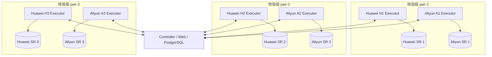

# StarRocks 多集群并行校验 — 设计说明

| 项 | 内容 |
|---|---|
| 文档版本 | v1.4（2026-10-12） |
| 前置需求 | [05-多集群并行校验需求](05-多集群并行校验需求.md) |
| 基线设计 | [02-方案设计](02-方案设计.md)、[03-技术设计](03-技术设计.md) |

---

## 1. 设计摘要

本次不把系统泛化为 N 方比较，而是在现有二元 SOURCE/TARGET 比较模型上增加三个固定校验组。资产继续保存两端库表映射；执行身份从固定云厂商 side 改为物理 `cluster_id`；比较时根据资产所属校验组恢复 SOURCE/TARGET 角色。

调度从单一“每 side 并发 + 全局类型优先级”改为“每 cluster、每 kind 独立并发”。Executor 为五类任务建立独立线程池和领取循环，Controller 在领取入口按类型过滤并计数，从结构上消除 COUNT 对 METRIC/SAMPLE 的饥饿。

## 2. 逻辑架构



Controller 是控制平面。每个 Executor 只持有一个物理集群凭证，Worker token 同样只绑定该集群。

## 3. 配置模型

配置版本升级为 `srdq-config-v1.4`，协议升级为 `srdq-v1.4`。

```yaml
physical_clusters:
  - id: huawei-1
    name: Huawei 1
    cloud: HUAWEI
    connection_ref: sr-huawei-1-ro
    credential_file: /etc/srdq/secrets/huawei-1.json
    os_user: srdq-huawei-1
    concurrency:
      COUNT: 40
      METRIC: 20
      SAMPLE: 10
      METADATA: 2
      DEEP: 2
  - id: aliyun-1
    name: Aliyun 1
    cloud: ALIYUN
    connection_ref: sr-aliyun-1-ro
    credential_file: /etc/srdq/secrets/aliyun-1.json
    os_user: srdq-aliyun-1
    concurrency: {COUNT: 40, METRIC: 20, SAMPLE: 10, METADATA: 2, DEEP: 2}

cluster_pairs:
  - id: pair-1
    name: Pair 1
    source_cluster_id: huawei-1
    target_cluster_id: aliyun-1
```

约束：

- ID 满足稳定、大小写敏感的安全标识格式；
- cluster ID 和 pair ID 分别唯一；
- 每个 pair 的 SOURCE/TARGET 不同；
- 每个 cluster 恰好属于一个 pair；
- 并发五项必填且为正整数；
- 凭证文件、连接引用和 OS 用户必填；
- 示例配置提供六个 cluster 和三个 pair，占位 ID 可由部署方替换。

配置解析对 `physical_clusters`、`cluster_pairs` 做专门验证，不使用旧版固定键递归合并。运行时代码通过 `clusters_by_id`、`pairs_by_id` 派生映射读取。

## 4. 数据模型

### 4.1 新表

`dq_physical_cluster`

| 字段 | 说明 |
|---|---|
| id | 配置中的稳定 text ID，主键 |
| name | 展示名称 |
| cloud | HUAWEI / ALIYUN / OTHER |
| connection_ref | Executor 连接引用 |
| enabled | 是否启用 |
| created_at / updated_at | 审计时间 |

`dq_cluster_pair`

| 字段 | 说明 |
|---|---|
| id | 稳定 text ID，主键 |
| name | 展示名称 |
| source_cluster_id | SOURCE 物理集群 FK |
| target_cluster_id | TARGET 物理集群 FK |
| enabled | 是否启用 |
| created_at / updated_at | 审计时间 |

通过唯一约束保证一个 cluster 只属于一个 pair。

### 4.2 资产

`dq_asset` 增加非空 `pair_id`。继续保留：

- `source_db/source_table`
- `target_db/target_table`

唯一约束调整为：

- `(pair_id, source_db, source_table)`
- `(pair_id, target_db, target_table)`

这允许不同校验组存在同名物理表。

### 4.3 执行链路

以下表的 `side` 迁移为 `cluster_id` 并引用 `dq_physical_cluster`：

- `dq_worker`
- `dq_worker_registration`
- `dq_work_item`
- `dq_attempt`
- `dq_side_result`
- `dq_artifact`
- `dq_incident`

结果表名 `dq_side_result` 暂不重命名，避免无业务收益的大范围迁移；其中的身份字段改为 `cluster_id`。

`dq_work_item` 由资产 `pair_id` 生成两个任务：SOURCE cluster 一条、TARGET cluster 一条。执行快照记录 `pair_id`、`cluster_id` 和 `pair_role`，使历史结果不受后续展示名称变更影响。

### 4.4 比较模型

每个 observation 仍只有一个二元 comparison。比较器：

1. 读取资产的 pair；
2. 获取 pair 的 SOURCE/TARGET cluster ID；
3. 确认两个集群结果齐全且无其他集群结果；
4. 将结果映射为 source/target 后复用 COUNT、METRIC、SAMPLE、DEEP 比较算法。

`dq_comparison` 的 source/target 字段语义不变，summary 中增加 `pair_id` 和两端 cluster ID。差异类型继续保留 SOURCE/TARGET 方向。

## 5. 数据迁移

新增连续迁移 `0002_multi_cluster.sql`，不得修改已经发布的 `0001_init.sql`。

迁移步骤：

1. 建立 physical cluster 和 pair 表；
2. 插入两个 legacy cluster 和一个 legacy pair；
3. 为现有资产回填 legacy pair；
4. 给执行链表增加 `cluster_id`，由旧 side 回填；
5. 建立 FK 和新索引；
6. 替换资产唯一约束；
7. 完成非空约束后移除旧 side CHECK/列；
8. 为 claim 建立 `(cluster_id, kind, check_kind, status, created_at)` 的部分索引。

升级命令需要 `legacy_pair_id` 显式配置。如果数据库已有业务数据但配置没有对应 legacy pair，启动应失败并给出操作提示，不能猜测归属。

## 6. 资产导入和计划选择

资产导入格式增加 `pair_id`：

```text
layer,pair_id,source_db,source_table,target_db,target_table,priority
```

预览阶段校验 pair 存在、启用、字段完整和组内唯一性。确认后写入 `dq_asset.pair_id`。

`asset_selector` 新增：

```json
{"pair_ids": ["pair-1", "pair-3"]}
```

- `{"all": true}` 表示全部；
- 一个元素表示单选；
- 多个元素表示多选；
- 未知 pair ID 返回 422；
- 与 asset_ids、layers 同时出现时取交集。

Web 计划表单使用多选控件，默认全部。资产、运行、差异和报告均展示 pair。

## 7. 调度设计

### 7.1 池与领取协议

定义五种 `claim_kind`：COUNT、METRIC、SAMPLE、METADATA、DEEP。

Executor 对每个 kind 建立：

- 独立 `ThreadPoolExecutor(max_workers=configured_limit)`；
- 独立领取循环；
- 独立 active 数统计。

共享：

- 单个 Worker registration；
- 单个 heartbeat 调度器；
- 单个 outbox flush 互斥区；
- 全局 attempt 索引，便于续租和取消。

claim 请求必须携带 `claim_kind`。Controller 只返回同 cluster、同 kind 的任务。旧协议或缺失 claim_kind 的请求被拒绝。

### 7.2 Controller 并发核算

业务池在途数：

```text
LIVE(cluster_id, check_kind) = LEASED + RUNNING + CANCEL_REQUESTED + CANCEL_PENDING
```

管理池按 work item kind 统计：

- METADATA：`kind=METADATA`
- DEEP：`kind=CHECK|DIAGNOSIS AND check_kind=DEEP`

可领取数为该池配置减去当前在途数，不再计算 cluster 总在途数。

### 7.3 消除饥饿和队首阻塞

- observation 物化按 kind 分批，每个 controller tick 对 COUNT/METRIC/SAMPLE 分别提供批额；
- claim SQL 在数据库层先过滤 claim_kind；
- 使用 keyset 分页或多批 `SKIP LOCKED` 扫描；
- 一批候选因控制状态、窗口预测、授权、能力、资产槽或预算被跳过时继续扫描；
- 扫描有明确上限，避免单次 claim 长事务；达到扫描上限时返回原因和计数用于监控。

已启动 observation 的另一端仍优先收尾，但只在同 kind 池内排序。

### 7.4 线程与租约安全

- 注册和重新注册使用进程级锁，禁止多个领取循环互相 supersede；
- active 状态读写使用锁内快照；
- 保存 Future 并注册完成回调，处理尚未启动即被取消的任务；
- heartbeat 超过 256 条 attempt 时分批发送，所有批次成功才更新时间；
- outbox flush 单飞，避免重复发送；
- shutdown 先停止领取，再请求取消/等待 Future，最后关闭线程池。

## 8. 负载监控

自动并发降级关闭，但保留信号采集和事件：

- 查询完成后记录 duration、状态、错误类别和字节数；
- 聚合维度为 cluster_id + check_kind；
- 超时率或慢化率超过配置阈值时写入 incident，不改变并发；
- StarRocks running/pending query 越限时写入 SR_SIGNAL，不改变并发；
- Web 提供 READY、最老队龄、live/limit、完成速率、平均/P50/P95/max、成功率、超时率和 ETA。

ETA 使用近期完成速率计算；无有效速率时显示不可估算，不使用虚假的零值。

## 9. API 和安全

Worker API envelope 中 `side` 改为 `cluster_id`。认证流程：

1. token 定位 worker；
2. worker 绑定 cluster_id；
3. registration 和 claim body 的 cluster_id 必须一致；
4. 领取 SQL强制使用认证得到的 cluster_id，不信任客户端传入值。

公开控制 API 增加：

- 集群和校验组列表；
- cluster × kind 队列和吞吐统计；
- 计划 pair selector；
- 资产 pair 字段。

凭证继续只由对应 Executor 读取。

## 10. 部署

systemd 使用六个实例：

```text
srdq-executor@huawei-1
srdq-executor@aliyun-1
srdq-executor@huawei-2
srdq-executor@aliyun-2
srdq-executor@huawei-3
srdq-executor@aliyun-3
```

安装脚本从配置枚举 cluster，创建用户、目录、token 和 drop-in，不再写死两个 side。升级顺序：停止六个 Executor，备份 PG，升级程序，执行迁移，检查配置，启动 Controller，再逐个启动 Executor 并验证注册。

## 11. 实施阶段

1. **文档和监控基线**：加入现有单组吞吐指标，采集一晚数据。
2. **配置与 Schema**：引入 cluster/pair，完成历史数据迁移。
3. **身份链路**：改造 Worker、任务、结果、比较和预算角色判断。
4. **独立池调度**：改造 claim 协议、Controller 限流和 Executor 五池。
5. **业务入口**：更新导入、计划、Web、报告和操作。
6. **部署与灰度**：单组验证，再启用三组。
7. **容量压测**：逐级提高各池并发，确认夜间目标和 20% 余量。

## 12. 测试设计

至少覆盖：

- 配置中重复 cluster/pair、缺失并发和 cluster 重复归组；
- 旧数据回填和迁移幂等性；
- 资产组内唯一、跨组同名允许；
- 单选、多选、全部和未知 pair selector；
- 六个 Worker 注册和跨 cluster 领取拒绝；
- COUNT 积压时 METRIC/SAMPLE 同时领取；
- 五类并发互不占用；
- 候选前 200 项不可执行时仍领取后续任务；
- heartbeat 超过 256 attempts；
- pair 内 SOURCE/TARGET 比较方向正确；
- 指标按 cluster × kind 聚合；
- 单组故障不影响其他组；
- UI 黄金路径：导入资产、建计划、选择多个组、启动运行、查看分组进度。

## 13. 发布验收

发布前先以较低并发跑通三组，再基于监控逐级调高。验收以真实数据完成时间、P95、超时率、生产集群负载和 READY 队列是否持续收敛为准。未经生产压测，不在配置中声称任何固定并发可以保证 07:30 前完成。
