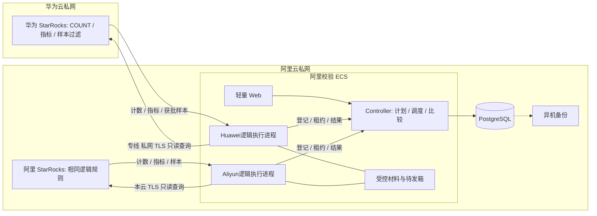

# StarRocks 双云数据校验程序详细设计

> **v1.3｜三档轻量化与集中执行版｜研发评审稿**  
> 修订：2026-10-10；首版：2026-10-08。  
> 华为StarRocks为对照，阿里StarRocks为目标；数千张表、约200TB（容量统计口径待确认）。  
> **所有表分区COUNT；指定核心表分区指标；指定表约0.1%确定性抽样指纹。默认阿里ECS集中执行，华为Worker可选。**  
> 只依赖SR数据与元信息。默认ONLINE_ONLY / temporal_assurance=NONE，不宣称共同快照、源完整性、加工任务正常或全表内容一致。

## 导航与配套文件

1～3章：目标、部署与对象；4～6章：输入、范围与观察语义；7～9章：COUNT/指标、抽样/编码、局部深查；10～14章：调度、控制、周期、Web/API；15～17章：PG设计、事务、恢复；18～20章：配置、容量、测试与实施。

- 本Markdown是**v1.3研发设计规范，不是已实现软件**。
- [v1.2研发存档](StarRocks双云数据校验程序_详细设计_v1.2.md)保留，不覆盖。
- [v1.2 PostgreSQL初始化脚本](StarRocks校验控制库_v1.2.sql)仍只创建`srdq_v12`的31张表，**不是v1.3初始化/升级脚本，不支持本文新增模型**。第15章明确v1.3拟议字段、主外键、CHECK、索引及升级边界；本次未生成或执行v1.3 DDL。
- [七列资产CSV示例](StarRocks分层表清单_v1.2.csv)格式继续兼容；指标/抽样规则按第4章独立JSON/API输入。
- [客户讨论版HTML](StarRocks双云持续验证方案.html)对应相同三档方向；技术落地细节以本研发稿为准。

| 版本 | 修订 |
|---|---|
| v1.0 | 统一表检查、分片、内容摘要和定位 |
| v1.1 | 双Worker、本云计算与专线通信 |
| v1.2 | 在线观察、移除血缘/生产任务依赖、优先级、Web控制、周期、31表DDL |
| **v1.3** | **三类独立检查；SR端计数/聚合/抽样过滤；阿里集中执行与可选本云Worker；规则级任务/分母；指标结果模型；采样协议与预算** |

v1.3整体替代v1.2的默认执行策略。C1行编码与D1摘要公式沿用，但摘要上下文升级为`SRDQ-OBS-2`，明确检查类型及规则版本。全量内容指纹/EXACT退为获批局部诊断，不再自动对所有表运行。v1.2配置、结果和DDL不能只改版本号后直接使用。

---

## 1. 本期目标与边界

### 1.1 三类检查，不是互斥表等级

| check_kind | 适用对象 | 执行位置与返回 | 证据边界 |
|---|---|---|---|
| COUNT | 全部已纳入、启用的表及约定分区 | SR端准确COUNT(*)，返回计数 | 同数仍可能缺行/多行抵消或字段改错 |
| METRIC | 指定核心表 | SR端按分区SUM，或GROUP BY后COUNT/SUM，返回完整分组结果 | 指标相同仍可金额对调/正负抵消 |
| SAMPLE | 指定表且键/类型/过滤适配合格 | SR筛选约1/1000样本；ECS收样本、规范化、指纹比较 | 只覆盖命中的样本及约定列 |
| DEEP | 另批的局部诊断，不是第四个默认档位 | 共同键范围完整读取或本云多重集计算 | CONTENT_HASH或EXACT，仍无共同时点保证 |

COUNT基础计划覆盖所有已确认范围；METRIC与SAMPLE可独立叠加，采样表不要求有指标。检查深度、业务优先级、执行频率是独立维度。暂停/排除的范围保留原因，不能继续声称它们已完成。

### 1.2 保留的能力

- 表存在性、逻辑结构、范围并集及未知/缺失识别。
- priority高先、同优先级ODS先，再FIFO；没有跨表血缘屏障。
- 表/分区/诊断分片控制，以及检查类型/规则级控制。
- 手工局部复查；启停、取消、逻辑归档、恢复、重新生成。
- CURRENT_ONLY与THIS_AND_FUTURE分开；CRON、INTERVAL和完成后轮巡。
- PG留存计划、规则、运行、尝试、原始结果、比较、分母和审计。

### 1.3 不承诺的能力

1. 不采集或推断Flink、DataX、Hera、DataWorks的任务成功率、漏跑和端到端延迟。
2. 不知道源MySQL业务真值；两端相同不证明业务正确。
3. 同时查询、同一观察ID、相同分区版本或连续多轮相同均不证明共同快照。
4. COUNT/SUM/样本指纹相同不证明全量逐行内容相同。
5. COUNT可只读部分列或受引擎优化影响；抽样也不覆盖全部数据页。**COUNT正常不排除其他字段文件损坏，也不证明全部物理副本健康。**疑似损坏需定向列读取及独立运维检查。
6. 不自动修复SR、重跑生产SQL、停写、切流或删除历史证据。

界面用“本轮数量相同 / 指标相同 / 样本相同 / 观察到差异 / 未完成”，显示证据种类、列范围、双端读取区间和“共同快照保证：无”，不用“迁移验收通过”。

---

## 2. 集中执行与可选Worker部署

### 2.1 默认 CENTRAL 执行



**一台主机不等于一个逻辑side。**首期在同一ECS部署两个隔离执行进程/身份：Huawei逻辑执行器仅使用华为数据源，Aliyun逻辑执行器仅使用阿里数据源。二者同版本代码、独立连接池、证书、source白名单、租约、attempt、心跳及待发箱。Controller本身不运行阻塞SR查询，执行器不能写PG。

这使现有`worker.side`单侧授权模型可以保留。业务side表示“读哪端数据”，`execution_location`表示进程在哪里；禁止通过把worker.side改为`both`绕过授权。主机故障可能同时影响两侧，这是明确接受的PoC故障域，不宣称高可用。

### 2.2 LOCAL / HYBRID 是批准的可选路径

- CENTRAL：两侧执行器位于阿里；华为样本字段经专线传阿里。
- LOCAL：华为执行身份改为华为专用主机上的同版本Worker，阿里执行器仍在阿里。华为Worker主动拉任务，不需要Controller回连或SSH派单。
- HYBRID：按资产/检查规则选择已批准执行池。**同一次观察的同侧、同扫描单元只能有一个有效尝试**；DEEP不同单元可并发。换位置重读必须双方新观察，不把旧样本与新样本混用。

适用回退条件：样本明细不准跨云、跨云连接可靠性不足、局部深查明细过大、必须本云规范化。LOCAL SAMPLE仍须SR端选样；不支持时标UNSUPPORTED，不静默全表拉取。获批DEEP才允许本云全范围读取。

### 2.3 数据传输授权

| transfer_class | 可返回 | 约束 |
|---|---|---|
| SUMMARY_ONLY | 批准元信息、COUNT、范围级完整摘要与状态 | 不默认包含敏感分组值、行键或行hash |
| AGGREGATES_APPROVED | 完整分组键及指标、NULL状态 | 按指标/维度白名单；高基数及敏感小分组需审批 |
| SAMPLE_VALUES_APPROVED | 命中样本的完整键与约定列 | CENTRAL SAMPLE必需；首期在ECS统一计算C1/D1 |
| DETAIL_APPROVED | 指定局部范围的原值材料 | DEEP/EXACT/字段诊断另行预算和有效期 |

规则需声明实际申请的传输类别，**选中SAMPLE不等于已获准传样本**。授权缺失在领取前BLOCKED_AUTHORIZATION。LOCAL SUMMARY_ONLY可上报采样计数与完整样本集合摘要：计数/摘要一致且完整时为SAMPLE观察相同；摘要不同只报告样本集合有差异，精确样本键并集/字段定位须更高授权，不伪造差异键总数。容差列若不能传获批值供比较，该LOCAL路径UNSUPPORTED。

### 2.4 网络与秘密

| 发起身份 | 目标 | 最小用途 |
|---|---|---|
| 阿里ECS上的Huawei逻辑执行器 | 华为SR私网端点 | SELECT、必要元信息、获批自身查询取消 |
| Aliyun逻辑执行器 | 阿里SR私网端点 | 同上 |
| 各执行身份 | Controller私网HTTPS | mTLS侧绑定登记、领取、心跳、上传 |
| Controller | PG | 受限服务身份；用户/执行器不可直连 |
| 浏览器 | 私网Web/API | SSO与对象授权 |

检查新主机DNS、路由、ACL、防火墙及数据库白名单。专线不替代加密；驱动必须验证TLS证书链、主机名、期限，不关校验、不回退公网。客户版本不支持所需安全连接时BLOCKED，先批准适配方案。

集中执行意味着两端秘密落在同一受控ECS但分进程授权保存，使用注册`connection_ref`与秘密管理系统，禁止输入任意DSN、CSV密码或日志明文。PG优先独立复用；临时同机须资源预留、持久卷、异机备份、恢复演练。执行主机不与SR FE/BE混部；本期不新增DataWorks/Kubernetes/消息队列。

---

## 3. 对象与身份模型

```text
资产asset + 规则check_rule（稳定rule_key / 不可变批准版本）
                    ↓
范围manifest → plan → schedule（check_selector）
                    ↓
run（冻结规则版本、范围、授权与位置策略）
 ├─ TABLE → PARTITION → SHARD（只有范围，不复制三套树）
 ├─ run_check（范围 × rule_key；运行控制与进度）
 └─ expected_item（范围 × rule_key；固定应验分母）
          ↓
 observation（一个run_check的一次双侧配对）
      ↙                    ↘
华为work/attempt       阿里work/attempt
      ↘                    ↙
 side_result → comparison → difference / coverage
```

| 对象 | v1.3职责 |
|---|---|
| check_rule | 资产内稳定rule_key；每版有独立UUID、check_kind、定义digest、审批 |
| plan | 引用确认清单及允许规则；不再用单个evidence表示所有检查 |
| schedule | 规则选择器＋时间规则；同一计划可COUNT每日、SAMPLE低频 |
| run | 冻结当轮选中的批准规则版本、节点、expected和执行策略 |
| task_node | 表/范围控制；同范围多规则共用一个节点 |
| run_check | 某范围某规则的独立状态/优先级覆盖，引用一个expected |
| observation | 一类检查一个冻结契约；规则变更或重读产生新观察 |
| observation_member | 完整结果覆盖的叶成员；通常COUNT/METRIC/SAMPLE只有一个PARTITION成员 |
| worker | 逻辑执行身份，side固定；物理地点另存，不等于必须两台机器 |
| work_item / attempt | 一侧工作及一次租约领取；双侧绝不合并成一个attempt |
| coverage | 每expected一行当前汇总；按check_kind分别聚合，不串证据 |

`check_kind`描述请求；`evidence`描述实际证据。COUNT→COUNT，METRIC→METRIC，SAMPLE→SAMPLE；DEEP→CONTENT_HASH或EXACT。SAMPLE即使逐行比较了样本原值，也不能把expected.evidence改为EXACT来暗示全范围精确比较。

`scope_key`只表示逻辑范围，不将规则/side偷偷拼进其中。多规则唯一性由显式`rule_key/run_check_id`承担。规则序号、compute_revision、observation_seq都不能代替规则身份。

---

## 4. 资产与校验规则输入

### 4.1 七列资产CSV继续兼容

UTF-8，可带BOM；RFC4180逗号/引号解析。可一个文件或按层拆文件；layer每行仍必填，文件名与layer冲突报错。

```csv
layer,source_db,source_table,target_db,target_table,priority,enabled
ODS,ods,orders,ods,orders,70,true
DWD,dwd,order_detail,dwd,order_detail,90,true
ODS,ods,debug_events,ods,debug_events,10,true
DIM,dim,shops,dim,shops,50,false
```

layer=ODS/DWD/DWS/ADS/DIM/OTHER；source库表必填，target默认同名；priority整数0～100默认50，enabled严格true/false默认true。数据源对在页面选注册对象，不在CSV里填地址或密码。JSON `asset-list-v1`与CSV进入同一内部模型。

1. PREVIEW记录逐行新增、重复、错误、冲突及越权；确认前不改资产。
2. 默认CREATE_OR_VALIDATE：已有映射/priority不隐式覆盖。UPDATE_EXPLICIT须update_fields与expected_revision。
3. 确认时检查文件digest、预览和资产版本；同批冲突拒绝，默认整批原子应用。
4. 新名单没出现的旧资产不自动归档；标识符不统一转小写。
5. 上传限格式、编码、行数/字节；导出防CSV公式注入。

### 4.2 COUNT基线规则

资产首次确认时生成保留`rule_key=baseline_count`、`check_kind=COUNT`规则；业务过滤固定为空，仅使用manifest范围。字段COUNT(column)不能代替COUNT(*)。禁用基线需明确标记范围排除/暂停并留审计，不能静默从“全部表COUNT”目标中删除。

METRIC内的组行数只服务指标完整性，不自动覆盖COUNT基线。首期不同规则独立查询，不跨SQL借用计数或宣称原子一致。

### 4.3 METRIC规则JSON

以下为拟建API输入示例，UUID是占位；定义进入DRAFT，批准后不可原地编辑。

```json
{
  "format_version": "check-rule-v1.3",
  "asset_id": "00000000-0000-4000-8000-000000000020",
  "rule_key": "orders_by_status",
  "check_kind": "METRIC",
  "definition": {
    "group_by": ["status"],
    "filter": {"op": "TRUE"},
    "metrics": [
      {"id": "order_rows", "function": "COUNT_ROWS"},
      {"id": "pay_sum", "function": "SUM", "column": "pay_amount", "value_type": "DECIMAL", "scale": 2, "compare": "EXACT"}
    ],
    "include_group_row_count": true,
    "sum_non_null_guard": true,
    "max_groups_per_side": 10000,
    "max_group_key_bytes": 512,
    "max_result_bytes_per_side": "67108864"
  },
  "transfer_class": "AGGREGATES_APPROVED",
  "execution_policy": "CENTRAL",
  "enabled": true
}
```

- 同一规则只允许一组group_by＋同一filter，多种维度拆不同rule_key。
- 首期函数白名单COUNT_ROWS、COUNT_NONNULL、SUM；过滤只支持类型化AND/OR、EQ/NE/LT/LE/GT/GE、IN、IS_NULL、IS_NOT_NULL、TRUE，限制深度、节点数和IN长度。NULL只能用明确NULL运算，不编译为`= NULL`。
- 表、列和函数来自批准元数据白名单，值绑定参数；不接受raw WHERE、任意函数、表达式脚本或SQL。
- SUM字段自动附带非空计数；COUNT_ROWS每个组强制存在。维度、过滤列、度量列都纳入结构兼容校验。
- `scale`是共同逻辑尺度；聚合返回精度由适配器验证，不用输入列精度截断SUM。

### 4.4 SAMPLE规则JSON

```json
{
  "format_version": "check-rule-v1.3",
  "asset_id": "00000000-0000-4000-8000-000000000020",
  "rule_key": "orders_sample",
  "check_kind": "SAMPLE",
  "definition": {
    "key_columns": ["order_id"],
    "compare_columns": ["order_id", "pay_amount", "status", "order_date"],
    "key_contract": "NON_NULL_UNIQUE_INTEGER",
    "sample_protocol": "SRDQ-SAMPLE-1",
    "seed_hex": "00000000000000000000000000000000",
    "bucket_count": 1000,
    "selected_bucket": 0,
    "min_sample_rows_per_side": 1,
    "max_sample_rows_per_side": 2000000,
    "max_result_bytes_per_side": "2147483648",
    "filter_location": "STARROCKS",
    "fingerprint_location": "EXECUTOR",
    "empty_sample_policy": "INCONCLUSIVE"
  },
  "transfer_class": "SAMPLE_VALUES_APPROVED",
  "execution_policy": "CENTRAL",
  "enabled": true
}
```

比例由`bucket_count=1000, selected_bucket=0`派生为约0.001，不用浮点概率参数。首期固定这两个取值；未来变比例要新协议能力与规则版本，不能在超预算时自行降采样率。种子不是秘密，只需固定、可复现并写入契约。

首期内置键适配只开放**完整单列非空整数唯一键**。Primary/Unique模型逻辑完整键可作为证据，不能拿Duplicate排序键当唯一键。其他模型可提供经批准的全范围唯一性核验及维护约束；仅检查样本无重复不证明全表唯一。无法建立可靠契约时SAMPLE=UNSUPPORTED，COUNT/METRIC照常。复合/字符串键需额外插件与双端测试后登记能力，不能默认可用。

### 4.5 版本、周期与变更

`rule_key`在资产内稳定；`id`标识具体版本。批准定义/定义digest不可修改；修改列、维度、过滤、容差、种子、比例、预算或位置/传输要求生成新版本，并审计旧版SUPERSEDED。启停意图与版本状态分开，旧run继续使用冻结定义，权限撤销则立即阻断未执行/未接受数据处理。

schedule用稳定`check_selector`（kinds与可选rule_keys）选择规则，不固定临时run_check UUID；创建run时只解析当前批准且启用版本。选择器命中未支持/缺授权规则时保留expected并BLOCKED/UNSUPPORTED，不从分母消失。COUNT基础覆盖计划必须单独存在，SAMPLE专用周期无需同轮重复COUNT。

---

## 5. 范围清单确认

### 5.1 范围来自两端元数据，不猜列名

```text
分层资产名单 → 两个逻辑执行器采集表/结构/分区
             → 两端逻辑范围并集 + 登记历史清单
             → Web预览：包含 / 缺失 / 未知 / NULL / 范围外 / 排除
             → 审批与digest → CONFIRMED manifest → plan
```

- range分区按同字段、同类型的半开区间配对；边界不同可形成共享原子区间。
- list分区按规范值集合处理，互斥性和NULL单独验证。
- 无分区用ALL；COUNT/METRIC/SAMPLE默认不为了“千行抽一行”人为建1000行分片。
- 不按物理PartitionId/TabletId配对，也不因为列名叫dt/updated_at就推断时间范围。
- 元数据权限过滤需区分PRESENT、ABSENT_CONFIRMED、ACCESS_DENIED、UNKNOWN、QUERY_FAILED；空列表不是自动缺表或0行。

### 5.2 覆盖与变更

范围取并集而非交集；NULL_SCOPE、OUTSIDE、INVENTORY_BLOCKER显式登记。两端都已缺失且从未登记的历史范围无法凭当前元数据发现。已知缺表/分区记结构差异及未完成内容检查，不伪造零行结果。

DRAFT→CONFIRMED→SUPERSEDED；确认后不可原地改scope，后续新范围建立新版本。新分区默认REQUIRE_CONFIRM，可批准AUTO_ADD_COMPATIBLE；消失分区保留缺失记录，不自动减分母。

未知项可留清单，但`inventory_complete=false`，只显示“已知范围完成率＋未知阻断数”。旧范围可能回刷，所有约定分区COUNT均要轮巡；历史不等于静态。

### 5.3 计数不能代替范围证明

元数据RowCount仅估算，基线必须准确COUNT(*)。两端都0行只说明所读逻辑范围计数相同。分区COUNT求和与另一次全表COUNT不闭合，在在线数据上只是线索，不当静态等式；范围无交叠/缺口优先用类型化谓词集合证明。

范围确认是确认查什么，不是确认已同步或停写。结构门控按检查所需列作用：COUNT可独立进行，某个复杂内容列不支持只阻断需要它的SAMPLE/DEEP，不阻断无关检查。

---

## 6. 观察、证据与完整性语义

### 6.1 每个规则独立配对

一个observation只能属于一个run_check，冻结manifest/scope、rule_id/rule_digest、check_kind、逻辑列/维度/采样契约、执行位置与授权快照。双方真实read_started/read_finished、query_ref、attempt分别记录。

| 字段 | 值 |
|---|---|
| verdict | OBSERVED_EQUAL / OBSERVED_DIFFERENT / INCONCLUSIVE / ERROR / UNSUPPORTED |
| evidence | COUNT / METRIC / SAMPLE / CONTENT_HASH / EXACT |
| temporal_assurance | 固定NONE |
| read_mode | 固定ONLINE_ONLY |
| origin | LIVE / CAPTURED |

COUNT、METRIC、SAMPLE可能分开查询、分开周期，不属于一个快照；不得拼成“同一时刻三项一致”。COUNT不同不强制阻断指标/样本，不同检查可能给出不同观察结论。

### 6.2 完整性层次

| 层次 | 定义 |
|---|---|
| query_complete | 数据库查询成功结束、协议EOF、无超限/隐藏截断/解码失败 |
| projection_complete | 所需计数/指标/维度/比较列和辅助守卫全部返回 |
| result_complete | 该查询预期完整结果集合核验完成，而非返回前N行 |
| evidence_sufficient | 证据具备本检查可判定条件，例如SAMPLE非空/满足最低样本量 |
| completed_for_coverage | 对expected的全部成员均有有效、充分且可比较证据；非仅SQL运行结束 |

完整差异算完成但不算相同。两侧都无样本：`query_complete=true`但`verdict=INCONCLUSIVE, reason=INSUFFICIENT_SAMPLE`，覆盖不算完成。双方计数均为0可以给COUNT相同，不能借给SAMPLE充当样本证据。

若一侧样本空、另一侧有键，且两侧筛选查询均完整，则已得到样本键差，可给OBSERVED_DIFFERENT；最低样本量只限制“无差异→相同”，不能把明确差异抹成通过。若查询半途失败，即使已有线索也只保留诊断，不发布完整差异结论。

### 6.3 防误配、重试与错误

只配同observation/member/context/rule版本，不取“最新两条”。启动偏差/最大观察时长只过滤明显陈旧配对，不证明快照。DDL漂移、类型不兼容、租约失效、超预算、结果不完整均保留原因。

原payload重传只查幂等回执；**重新读库必须新observation_seq，双方重采**。先确认两侧旧服务端查询均已终止再重发，不用租约到期推断SQL已停。旧结果留证据，不拿一侧旧结果配另一侧新结果。

只有两条有效结果才建立dq_comparison；单侧失败/预检不支持记录在attempt/run_check/incident，不伪造另一侧0结果满足外键。跨端时间窗不合规时即使两条完整结果也INCONCLUSIVE。

---

## 7. COUNT与METRIC算法

### 7.1 COUNT基线

以下SQL为固定订单示例，`?`由驱动绑定；真实标识符只能来自已批准元数据，范围DSL编译后执行。示例未在客户StarRocks运行。

```sql
SELECT COUNT(*) AS row_count
FROM ods.orders
WHERE order_date >= ? AND order_date < ?;
```

无分区ALL不加虚构日期过滤；NULL_SCOPE用IS NULL；共同键细分仅在批准计划中增加双方相同谓词。每个范围必须得到**恰好一条**非NULL、非负整数计数，完整EOF，超出可存储BIGINT范围则ERROR，不转float或截断。

比较精确整数：相等→OBSERVED_EQUAL，否则OBSERVED_DIFFERENT；保存signed_delta、abs_delta，可显示相对差但不按默认1%容忍。source为0时relative_delta=NULL并注明分母为0，不除零。

### 7.2 METRIC SQL构造

```sql
SELECT status,
       COUNT(*) AS group_rows,
       COUNT(pay_amount) AS pay_non_null,
       SUM(pay_amount) AS pay_sum
FROM ods.orders
WHERE order_date >= ? AND order_date < ?
GROUP BY status;
```

无维度时去掉status和GROUP BY，仍返回一个全局组；空输入应为group_rows=0、pay_non_null=0、pay_sum=NULL。有GROUP BY时空范围返回0组。不能把“0组”“一个NULL维度组”“一个全空求和组”混为一类。

1. SR端完成过滤与聚合，不能先拉全量字段在ECS做GROUP BY。
2. 每组强制group_rows；每个SUM字段配COUNT(column)，NULL数=group_rows-non_null，校验`0≤non_null≤group_rows`。
3. 分组键严格使用`KEY = ASCII("SRDQ-KEY-1\0") || U32(维度列数) || 有序维度VALs`；无维度空组键为`535244512d4b45592d310000000000`。不把NULL改为哨兵字符串，不trim/改大小写。
4. 双端分组等价语义必须一致（类型、collation、CHAR补齐等）。仅在客户端规范化已分组结果不能修复SR分组口径差异；适配不一致则UNSUPPORTED或显式改规则后重试。
5. GROUP BY高基数可能接近明细。max_groups、max_key_bytes、max_result_bytes、SR内存/超时均有限额。

### 7.3 分组结果完整比较

```text
分别完整收取两侧结果，解码、检查唯一canonical_group_key与辅助计数
K = union(华为完整分组键集合, 阿里完整分组键集合)
for g in K:
    单侧不存在 → GROUP_SOURCE_ONLY / GROUP_TARGET_ONLY
    双侧存在 → 比较group_rows、non_null/NULL守卫、每个度量
缺任何组/指标/守卫、重复解码键、超限、解码错误 → 不发布完整成功
```

默认在受限内存内对齐；超内存可使用批准的本地有界外排，不能把全部组无界写PG。确认完整后分批暂存、原子发布；原始分组值是敏感数据，按AGGREGATES_APPROVED管理。

- **整数/DECIMAL**：精确比对，SUM结果使用任意精度十进制解析。冻结共同scale，禁止舍入；SR计算溢出、驱动转float或返回被截断时ERROR。不能把返回类型固定为输入DECIMAL(p,s)。
- **NULL**：NULL只等于NULL；NULL与0不同。两个SUM都NULL仍要比较group_rows与non_null。
- **FLOAT**：默认REQUIRE_POLICY；无明确策略则UNSUPPORTED。只对有限数按`abs(a-b)≤max(atol,rtol×max(abs(a),abs(b)))`比较；默认出现NaN/无穷即UNSUPPORTED，不通过通用容差。容差从规则读取，不套跨云1%。
- 字段guard差异也属于METRIC差异；完整相同须所有组、所有度量和守卫一致/满足批准容差。

### 7.4 查询裁剪、合并与边界

首期每个逻辑范围每条规则独立执行，不自动把METRIC组行数当COUNT基线。未来同范围、同过滤、同读取语义合并COUNT/SUM必须新增共享query_bundle/member协议及原子完成检查后上线，不能仅为省SQL偷偷合并。

查询取消/row cap不保证精确限制SR已扫描字节；扫描预算是准入预留＋运行监控＋取消的资源保护，存在采样/取消滞后。客户端结果字节/行数有硬上限；超过上限失败并取消，不截取前N条比较。驱动/代理隐藏LIMIT或sql_select_limit能力无法确认时不允许发布完整结果。不同SQL的总行数闭合不作为在线严格证明。

---

## 8. 确定性采样、C1与D1

### 8.1 采样口径

“每1000行抽1行”落实为约0.1%的稳定键抽样，**不是严格等距抽行**。自然顺序、ROW_NUMBER后每千条、独立RAND、两端LIMIT/OFFSET均不用于正式对账；一侧缺行会使基于序号的样本错位。

双方在自己的相同逻辑范围独立执行同一键谓词，从而保留命中的单侧额外/缺失键。不能只从华为选一组键让阿里IN查询作为全部样本，这会漏阿里额外键。

### 8.2 C1规范字节

```text
VAL = type_tag:U16 || present:U8 || payload_length:U64 || payload
NULL: present=0,length=0；非NULL空串:present=1,length=0
KEY = ASCII("SRDQ-KEY-1\0") || key_column_count:U32 || KEY_VAL_1 || ...
ROW = ASCII("SRDQ-ROW-1\0") || column_count:U32 || VAL_1 || ...
row_hash = SHA256(ROW)
```

U16/U32/U64无符号大端；长度是字节。行列顺序采用冻结的source逻辑列清单，target按映射投影；完整键在ROW列清单中恰好一次，不因隐藏显示而排除。

| tag | 类型 | payload |
|---|---|---|
| 1 | BOOLEAN | ASCII 0/1 |
| 2 | 整数 | 精确标准十进制ASCII；无前导加号/零，零写0，不经float/JS Number |
| 3 | DECIMAL | 按冻结scale精确缩放后的整数ASCII，不允许舍入 |
| 4 | STRING | 无损UTF-8，不trim、改大小写或Unicode归一化 |
| 5 | DATE | YYYY-MM-DD ASCII |
| 6 | DATETIME | YYYY-MM-DDTHH:mm:ss[.fraction]，精度/时区语义在契约 |
| 7 | BINARY | 原字节 |
| 8/9 | FLOAT32/FLOAT64 | 仅FLOAT_EXACT且保真验证通过：IEEE754大端，±0按批准规则统一，NaN规范位型须明确定义 |
| 扩展 | JSON/复杂/聚合状态 | 未登记语义插件则UNSUPPORTED，不静默丢列 |

首期SAMPLE默认要求全部比较列可精确规范化；浮点可用批准的FLOAT_TOLERANT独立比较路径（8.6），而非偷偷从列清单丢弃。

### 8.3 S1采样协议：SRDQ-SAMPLE-1

定义一个不依赖数据库自然排序的固定谓词。`seed_hex`必须匹配`[0-9a-f]{32}`，表示固定16字节种子；此处**使用这32个ASCII字符，不解码为二进制拼入输入**。

```text
sample_input = ASCII("SRDQ-SAMPLE-1|")
             || ASCII(seed_hex)
             || ASCII("|")
             || ASCII(lowercase_hex(KEY))
sample_hash = SHA256(sample_input)
u = uint64_big_endian(sample_hash[0:8])
bucket = u mod 1000
selected = (bucket == 0)
```

- KEY是上述C1完整键字节；转小写hex是协议的一部分，不使用数据库隐式字符串表示。
- `u`是0～2^64-1的无符号值，不能使用带符号溢出、ABS(hash)或浮点取模。
- 内置首期仅支持单列非空整数完整键；取样不依赖业务内容列，以便内容修改不改变同键的入样资格。
- 种子、键列、键类型/编码、算法、模数/余数在rule与observation里冻结。更改产生新版本及新观察。

### 8.4 SQL编译器契约与上线能力探测

下面是**编译器中间表示，不是已存在的SR函数，也不是直接执行SQL**：

```text
SELECT <批准的完整键及比较列>
FROM <批准映射表>
WHERE <类型化逻辑范围>
  AND SAMPLE_S1_MATCH(<完整键>, <seed_hex>, 1000, 0)
```

Adapter必须把SAMPLE_S1_MATCH编译成客户SR版本支持的内置字节/hex/SHA-256/精确取模表达式，不默认安装UDF。生成式需精确复现C1 KEY和S1；先拿附录向量核对KEY hex、SHA值、bucket及selected，再在隔离表确认双方命中集合。没有通过的adapter capability时为`UNSUPPORTED_SAMPLE_PUSHDOWN`，**禁止退成全量读取后客户端抽样**。

批准能力记录至少包含：两端版本/部署形态、driver版本、编译器release、模板digest、键类型、会话语义、最大值测试和向量集digest。版本/模板/键语义变化使能力审批失效，重新探测。元信息预览只读DDL；带业务行的抽样能力测试要独立批准的PoC范围，不借METADATA_PREVIEW绕过业务读取开关。

### 8.5 样本完整比较

1. CENTRAL下SR先过滤，执行器只收命中行的键＋比较列；遇重复/NULL键违背契约，ERROR，不DISTINCT择一。
2. 执行器流式C1编码，计样本数/字节，并按**C1 KEY字节字典序**排序。注意标准整数ASCII的字节序不等于数学顺序；不要一侧用SQL数值序、另一侧用C1字节序。
3. 双端完整后比较样本键并集；单侧键报SAMPLE_KEY_SOURCE_ONLY/TARGET_ONLY，同键比较row_hash。保存row_hash不等于原值可反推。
4. row_hash不同即样本内容差异；需要列定位使用本次完整样本材料，或另建LIVE_REREAD，不用新字段值解释旧hash。
5. 完整相同且双方样本数满足min_sample_rows才OBSERVED_EQUAL；都0则INCONCLUSIVE。不能通过自动升采样或全读来掩盖空样本。
6. 达到行数/字节/磁盘上限即取消并标BUDGET_EXCEEDED；完整EOF前不接受“成功”。样本上限不是SQL LIMIT，展示上限也不是计算上限。

LOCAL只传完整集合摘要时遵守2.3的授权边界。SAMPLE摘要为概率性内容证据，有理论hash碰撞；不能宣称精确完整行比较。

### 8.6 D1与容差

```text
D = SHA256(
  ASCII("SRDQ-SHARD-1\0") || context_bytes_32
  || ordered_row_hash_1 || ... || ordered_row_hash_n
  || ASCII("END1") || U64(n)
)
```

样本按C1 KEY字节序，DEEP按9.3冻结的排序协议。固定32字节row_hash，重复规则按检查模型处理；不使用XOR、简单求和或DISTINCT替代。样本键集合摘要同式但使用单独的key_projection context和`SHA256(KEY)`序列，不能与行摘要共用context。

`context_schema=SRDQ-OBS-2`至少包含：observation UUID、run_check、check_kind、rule_key、规则版本/digest、scope/manifest、逻辑列/类型、投影用途、排序协议、采样协议/种子/模数余数（仅SAMPLE）、成员。统一用确定性JSON（键字典序、UTF-8、无多余空白、大整数/精确值用字符串），SHA-256生成32字节context，保存原文。**不含side、worker、attempt、实际时间、物理ID和control_generation。**双端使用Controller下发的同一context，不各自重造。

FLOAT_TOLERANT列不进精确摘要，但必须对**全部共同样本键**逐个比较，不只比row_hash异常样本；全部批准列检查后才column_complete。DEEP时对应全部共同范围键，而非样本。无键通用容差多重集首期UNSUPPORTED。LOCAL若原值不准传且无获批容差比较路径则阻断。

### 8.7 检出概率与覆盖边界

对固定规则给定数据，入样结果是确定的。概率解释需假设hash近似均匀、错误涉及不同键且入样近似独立：d条错误至少命中1条的理论概率约`1-(1-0.001)^d`。d=1约0.1%，d=1000约63.2%，不是客户数据检出率承诺。

重复使用固定种子不会累积为全量覆盖；换种子要双端同步及规则新版本，不承诺轮巡一定查全。小分区可能无样本；可以另批小范围全读/新采样规则，但不能把无样本算内容通过。

hash筛选可能扫描整分区键列并消耗CPU；是否减少非键列读取取决于引擎执行计划。**1/1000是预期行比例，不保证扫描量、网络字节或总成本恰减1000倍。**

---

## 9. 手工局部诊断与保留的全量算法

### 9.1 入口与升级限制

COUNT差异、METRIC缺组/度量差、SAMPLE键/指纹差均可“新建局部复查”；用户也可指定表、分区、共同键范围。默认沿用原检查类型复查，不自动全表升级。

全字段指纹/EXACT只能在显式`check_kind=DEEP`、批准范围与DETAIL_APPROVED（或本云获批完整摘要路径）下创建MANUAL run。METRIC异常组转行范围时按同group DSL及原filter编译；无法证明组语义一致则拒绝自动展开。

```json
{
  "request_key": "manual-v13-example-001",
  "plan_id": "00000000-0000-4000-8000-000000000010",
  "asset_id": "00000000-0000-4000-8000-000000000020",
  "manifest_id": "00000000-0000-4000-8000-000000000030",
  "origin_comparison_id": null,
  "check_kind": "DEEP",
  "requested_evidence": "CONTENT_HASH",
  "source_mode": "LIVE_REREAD",
  "transfer_class": "DETAIL_APPROVED",
  "selector": {
    "partition": {"kind": "RANGE", "column": "order_date", "lower": "2026-10-01", "upper": "2026-10-02"},
    "shard": {"kind": "KEY_RANGE", "columns": ["order_id"], "lower": ["10000000"], "upper": ["20000000"], "lower_inclusive": true, "upper_inclusive": false}
  },
  "granularity": {"target_rows": 100000, "max_depth": 8, "max_leaf_count": 2048},
  "priority": 90,
  "limits": {"max_seconds": 1800, "max_read_bytes": "10737418240", "max_transfer_bytes": "1073741824"}
}
```

确认时生成该次专用、不可变的DEEP规则版本与run_check，不复用SAMPLE expected。边界数字为精确字符串；无穷用显式unbounded；复合键须完整且适配通过。

### 9.2 两种来源

- LIVE_REREAD：新run/observation，双方新读；称“本次局部复查”，不是原时点精确追查。
- CAPTURED_MATERIAL：原双侧完整材料、原契约和时间，核digest/范围/授权/有效期。材料缺失或过期CAPTURE_UNAVAILABLE，不偷偷改实时读取。

SAMPLE历史材料仅包含样本，不能用于未入样范围DEEP；指标材料只含聚合，不能反推出明细。完整不可变材料也只保存双方各自当时读取结果，不增加共同快照保证。

### 9.3 DEEP的共享分片

**KEY_RANGE：**经验证的唯一整数键优先，中央共享半开区间，含无穷端点以覆盖target额外键；不独立LIMIT取页，不单端移动边界追求相同行数。整数按数学升序、SQL显式ORDER BY完整键、执行器校验严格递增；排序协议与SAMPLE的C1字节序不同，必须进context。字符串/复合键顺序不确定则本地C1字节排序或批准HASH_BUCKET。

**HASH_BUCKET：**仅在获批DEEP里，每scope每侧完整读取一次，本地分桶外排，不逐桶全扫。键表按SHA256(KEY)前缀分桶、完整KEY字节排序；无键按row_hash分桶/排序，保留重复次数。全部成员桶（包括空桶）完整核验后原子采用；任何半途失败整scope不算完成。

**扫描单元与成员分开：**Controller在创建observation时冻结`contract.execution_units=[{scan_unit_id, member_node_ids, selector_digest}]`，扫描单元UUID在双方共享。COUNT/METRIC/SAMPLE为一个单元对应一个范围成员；DEEP KEY_RANGE每个叶片一个单元，可双侧并行派工；DEEP HASH_BUCKET一个整scope单元覆盖全部桶成员。每个observation_member恰属一个单元，集合无重叠且覆盖全部预期成员。每侧每单元一个work，唯一键为`(owner,observation,side,kind,scan_unit_id)`；多个单元仍属于同一个观察，而不是每片另造观察填同一分母。

KEY_RANGE单元成功可接受其成员结果，但整个expected必须待同一观察全部成员比较充分才算完成；HASH_BUCKET单元须全桶原子采用。某片取消或失败，不能改写原观察成员清单缩小范围。正式重读保守地新建整run_check观察、双方全单元重采；若只需该片重读则单建局部MANUAL run，不能拿它补旧观察的缺口。

控制树固定TABLE→PARTITION→SHARD，细分历史用refinement_path/supersedes_node，成员不无限嵌套。父范围细分必须证明互斥且并集闭合；旧expected不删除，coverage按同一观察的有效叶成员聚合，不能把不同时刻父子结果拼成完整覆盖。

target_rows/bytes/duration是规划目标，不保证每片恰有某行数。共享scan取消一个桶可能影响全scope，预览必须展示联动。手工高优先级不自动终止当前run，要等待/排空/显式取消资产槽。

### 9.4 精确定位

有键先KEY/row_hash定位，再比较原规范列；无键按完整canonical row及次数比较，不推定不同内容为同一实体更新。EXACT路径必须比较原值以处理理论hash碰撞。FLOAT_TOLERANT检查全部共同范围键。

展示最多100条只限制UI；未完整枚举差异数量用AT_LEAST/UNKNOWN。差异行与差异字段分开，1行2列是1行2处。重试、换执行器、细分均累计预算，不重新清零。

---

## 10. 优先级与资源调度

### 10.1 排序与继承

```text
资源/门控满足的READY work：
priority DESC → layer_rank ASC → ready_seq ASC → work_item_id ASC
ODS=0, DWD=1, DWS=2, ADS=3, DIM=4, OTHER=5
```

90DWD先于50ODS；同级ODS先。每个run_check派双侧work，check_kind不构成隐式优先级。有效优先级：该run_check显式覆盖 > 该叶节点显式覆盖 > 最近祖先节点覆盖 > 最具体已冻结scope_policy > 资产默认。规则本身不另加隐式优先级。

改优先级不抢占在途查询、不失效已有结果。所有受影响READY候选必须在ORDER BY/LIMIT前刷新；大批更新递增queue_revision，物化完成才推进queue_materialized_revision；两者不同拒绝领取QUEUE_REFRESHING。不能先选旧最高项再只刷新那一行。新增READY同时使用最新规则。

### 10.2 双端资源与资产槽

同asset首期只允许一个run持有asset_slot进行COUNT/METRIC/SAMPLE/DEEP，避免多周期重复重扫。一个run内不同规则/分片可在两端各自并发预算内执行；原始预算按数据源集群计，不按进程数翻倍。

所有旧服务端查询确认结束且不再需要占用才释放slot。租约超时、ECS重启、专线断开不意味着SQL停止；不确认前CANCEL_PENDING并阻塞冲突扫描。其他资产可继续。

### 10.3 防饥饿与资源守卫

同级同层FIFO、运行分母冻结；同计划旧轮未完不无限插新轮。跨计划饥饿显示等待年龄与超期，首期不偷偷增加priority。扫描/时长、结果字节、分组数、样本数、临时磁盘分别限制。

COUNT差异不阻断该表后续METRIC/SAMPLE；表/权限/该检查所需结构不满足才阻断相应检查。METADATA_PREVIEW不占业务asset_slot，但有独立低并发及权限预算。

---

## 11. 范围及规则级任务控制

### 11.1 两层控制

`task_node`控制范围，`run_check`控制该范围某规则；不新增“规则层”破坏三级范围树。两者都有control_state=ENABLED/PAUSED/CANCELLED/ARCHIVED、execution_state=PLANNED/READY/RUNNING/COMPLETED/BLOCKED/FAILED/CANCEL_PENDING/CANCELLED。

规则级操作受节点祖先和全局资产控制约束，不能从子规则解除父暂停。用户只能动作API，不能直接写OBSERVED_EQUAL或成功状态。

| 操作 | 行为 |
|---|---|
| START/RESUME | 合法前提满足后READY；完成项不重跑 |
| PAUSE | 不开新观察；冻结已开始双端观察drain集合并排空 |
| CANCEL | 请求终止两端SQL，阻断未接受结果；确认前CANCEL_PENDING |
| ARCHIVE | 先取消在途再逻辑隐藏；不删SR/证据，不减旧分母 |
| RESTORE | 恢复可见默认PAUSED，不复活旧attempt |
| SET/CLEAR_PRIORITY | 修改显式覆盖/恢复继承，不抢占 |
| REGENERATE | 新run/新观察与supersedes关系，旧证据保留 |

### 11.2 PAUSE与当前/后续

暂停事务冻结`drain_observation_ids`及每个观察的既定execution_units：观察内任意单元任意侧已开始，就允许该冻结观察**全部既定单元的剩余双侧工作**按原契约领取、排空，包括尚未开始的华为单元B；不新建观察、不增加成员、不重试失败查询。通常单单元检查体现为补齐另一侧；多单元DEEP可能需要完成原观察内全部既定分片，因此预览必须显示尚待排空单元数、字节预算及耗时估计，不能承诺瞬停。任何失败需要重读时，暂停期间不重试，恢复后成对新观察。授权/资源不足仍阻断，不能以drain绕过；立即中止用CANCEL，CANCEL没有drain例外。

CURRENT_ONLY只改本run；THIS_AND_FUTURE同时改持久scope_policy，保存`check_selector`：ALL、kinds或稳定rule_keys。未指定时针对范围内所有规则，不只针对当时存在的几个run_check。新规则版本保持rule_key，必须继续受future约束。

future规则绑定稳定逻辑范围，不绑临时“第17片”；后续粒度与禁用范围相交要安全拆分，无法证明则BLOCKED_POLICY_REVIEW。采样种子改变不能绕过按范围/规则的禁用；基于hash前缀的DEEP选择器若编码变化须重审。

### 11.3 原子操作

PREVIEW返回影响node/run_check、双方在途观察、共享scan、future选择器及旧revision/digest。APPLY需Idempotency-Key、If-Match、reason；变更409重新预览。批量任一越权整体拒绝。

大树先更新权威祖先/规则控制与撤销号，再物化子状态；领取/续租/采用都查权威状态，不能在异步间隙复活结果。当前分母不随取消、归档、样本不足或UNSUPPORTED缩小。

---

## 12. 周期与持续轮巡

| kind | 输入与语义 |
|---|---|
| CRON | cron_expr、IANA tz、起止；预览未来5次，固定解析器和夏令时策略 |
| INTERVAL | interval_seconds≥60，从starts_at锚定，不随轮询漂移 |
| CONTINUOUS | 当前正常COMPLETED后休息rest_seconds≥60再启动 |

默认Asia/Shanghai，数据库存timestamptz；本文只是产品设计，不创建会话定时任务。每条schedule另带check_selector，例如COUNT覆盖全量资产、METRIC/SAMPLE各自低频；同asset跨run仍串行，因此高频COUNT与长SAMPLE会相互等待，PoC须测窗口。

- overlap=SKIP不新建run，记原因；COALESCE最多一个pending，保存被合并触发来源。
- misfire=SKIP或LATEST，不无限补历史运行。
- `(schedule_id,revision,fire_key)`唯一，fire/run/next_due同事务；一fire最多一run，该run可含多条run_check。
- 规则变更不改旧run快照。计划选择器缺规则、未支持或未授权仍留未完成expected。
- 连续轮巡仅run正常COMPLETED后触发；观察差异可继续复查。PAUSED/CANCELLING/CANCELLED/ARCHIVED不自动复活，执行ERROR有界退避。
- ends_at只停止新生单；cancel_on_end明确是否取消在途。停用schedule不自动取消当前run，组合动作必须预览。
- 每轮按manifest策略发现新范围；历史范围最大复查年龄分别按COUNT/METRIC/SAMPLE显示。

规则未配置不算失败，但报告必须写“未启用”；规则已配置却执行不了是未完成，不能当“未启用”移出统计。

---

## 13. Web与覆盖看板

| 页面 | 展示/操作 |
|---|---|
| 资产/导入 | 七列CSV、映射、层级、priority、enabled、COUNT基线 |
| 规则 | COUNT/METRIC/SAMPLE、定义/审批/版本、能力及授权缺口，字段/分组/样本预览 |
| 范围 | manifest版本、并集、缺失/未知/NULL/排除与原因 |
| 计划/周期 | 检查选择器、触发窗口、冲突/排队预估 |
| 运行/树 | 三级范围树下的规则列表、各side状态、时间、预算、启停及current-future |
| 结果/差异 | 计数差、指标组差、样本键/指纹差；局部复查与材料来源 |
| 执行器/运维 | 逻辑side与物理地点分开，心跳/租约/查询/磁盘/待发箱/备份 |
| 审计 | 操作者、目标、版本、授权、前后变更与冲突，不改历史 |

### 13.1 覆盖计算

每条expected由`run+asset+scope_key+rule_key`标识。按check_kind分别显示：

- COUNT：应验范围、完成、数量相同、差异、失败/未知、最老未验年龄。
- METRIC：配置规则/指标数、应验范围、完整组数、缺组/度量差、超预算与未支持。
- SAMPLE：应验范围、实际样本数、参考入样比例、样本键/指纹差、样本不足和未支持。实际比例若分母来自另一次COUNT，标为参考而非同快照精确比率。

完成率=`completed_expected/required_expected`；观察相同覆盖率=`equal_expected/required_expected`。完整差异计完成但不计相同；失败/空样本/未支持不计完成。不拿COUNT完成替代METRIC/SAMPLE，更不把“样本计划执行100%”写成100%行已比较。

示例COUNT的100项中90相同、5完整差异、5失败：完成95%，观察相同90%。另一个SAMPLE计划的分母单独计算。未知inventory不宣称全库100%，排除项及原因独立展示。

### 13.2 交互与权限

分页/虚拟树，有界样本展示；CANCEL_PENDING明确未确认停止。规则版本变更展示新旧列/采样/预算；执行地点与样本外传单列，不能只换主机图标隐藏安全变化。

SSO经服务端验证身份后解析owner；拒绝客户端覆盖owner/role/side。Viewer/Operator/Admin再叠加对象归属校验，列表带owner，批量逐项校验。Cookie=HttpOnly/Secure/适当SameSite，CSRF，登录/提权轮换、登出失效、空闲/绝对期限。CORS精确白名单，不反射任意Origin携凭证。

响应CSP默认self、脚本nonce、禁unsafe-eval；nosniff、frame-ancestors、Referrer/Permissions策略；HSTS只在批准HTTPS域范围启用。表名/错误/差异值当不可信文本转义；CSV公式防护、上传类型/大小约束；前端禁按钮不能代替服务端权限。

---

## 14. 拟建API与结果协议

这是程序API，不是阿里云产品API。URL `/v1`是API主版本，payload `protocol_version=srdq-v1.3`，不把文档小版本与URL混淆。未知协议/字段拒绝；不能给v1.2服务发新字段后假设被支持。

| API | 要点 |
|---|---|
| POST /v1/imports/preview；/{id}/confirm | 原七列导入、digest、资产版本 |
| POST /v1/manifests/discover；/{id}/confirm | DRAFT预览→确认；元数据与业务行访问隔离 |
| POST /v1/check-rules/preview；/{id}/approve | 新规则版本、能力/语义/预算/授权校验 |
| GET /v1/assets/{id}/check-rules | 显示稳定rule_key与具体版本 |
| POST /v1/plans；PATCH /v1/plans/{id} | If-Match、规则选择范围，不再单evidence |
| POST /v1/schedules；/{id}/actions | check_selector、周期与是否取消当前 |
| POST /v1/runs | 冻结规则版本与expected，request_key幂等 |
| GET /v1/runs/{id}/nodes；/checks | 范围节点与run_check分开分页 |
| POST /v1/operations/preview；/{id}/apply | RANGE_NODE/RUN_CHECK目标、current-future、revision |
| POST /v1/manual-requests/preview；/{id}/confirm | DSL、来源、检查类型、局部DEEP审批 |
| GET /v1/comparisons/{id}；/{id}/differences | 证据、时间、缺组/样本/差异总数口径 |
| POST /v1/worker/registrations；/claims；/heartbeats | 逻辑side、物理地点、能力、控制代/租约 |
| POST /v1/worker/result-chunks；/results | 分块暂存后最终完整发布，幂等回执 |

### 14.1 公共结果封装与COUNT示例

```json
{
  "protocol_version": "srdq-v1.3",
  "control_generation": "00000000-0000-4000-8000-000000000001",
  "registration_id": "00000000-0000-4000-8000-000000000002",
  "work_item_id": "00000000-0000-4000-8000-000000000003",
  "attempt_id": "00000000-0000-4000-8000-000000000004",
  "lease_generation": 1,
  "run_check_id": "00000000-0000-4000-8000-000000000007",
  "observation_id": "00000000-0000-4000-8000-000000000005",
  "scan_unit_id": "00000000-0000-4000-8000-000000000009",
  "rule_id": "00000000-0000-4000-8000-000000000008",
  "side": "huawei",
  "result_kind": "CHECK",
  "check_kind": "COUNT",
  "scope_scan_complete": true,
  "members": [{
    "node_id": "00000000-0000-4000-8000-000000000006",
    "context_digest_hex": "0000000000000000000000000000000000000000000000000000000000000000",
    "evidence": "COUNT",
    "read_complete": true,
    "column_complete": true,
    "read_started": "2026-10-10T01:00:00+08:00",
    "read_finished": "2026-10-10T01:00:05+08:00",
    "payload": {"row_count": "10000000"}
  }]
}
```

全0摘要是格式占位，不是有效业务context。side由认证/工作关系校验，客户端不能改变。真实query_ref、模板digest、授权引用、实际结果字节/统计和final manifest须随正式结果保存；上例省略的非核心审计项不意味着可以不实现。

### 14.2 不同类型的member.payload

| kind | 必需字段/校验 |
|---|---|
| COUNT | row_count精确非负整数字符串；没有行指纹 |
| METRIC | group_count、group_manifest_ref、metrics_schema_digest、chunks_manifest、total_bytes；每组完整键、group_rows、各SUM非空守卫及所有metric_id/value_state/value_text |
| SAMPLE | sample_rows、sample_protocol、rule_digest、sample_key_digest、sample_row_digest、projection_digest、sample_manifest_ref、total_bytes；含空样本也可成功采集但不可自动相同 |
| DEEP | row_count、digest、projection_digest、排序/成员、可选受控制品引用；完整集合核验 |

METRIC的value_state=FINITE/NULL/NAN/POS_INF/NEG_INF；NULL无value_text，FINITE存规范精确数字字符串，非有限值默认不可比较。不能把metric行数存到row_count后声称是表计数。SAMPLE的sample_rows是样本数，不是全分区行数。

chunks用`attempt+member+chunk_no`唯一，带行/组数、字节数和SHA256；final列完整chunk清单及总digest。暂存记录不能被coverage查询；Controller核数量、唯一键、定义、全部列/守卫、字节、EOF证明/驱动能力后标validity=ACCEPTED。不要只相信布尔read_complete。

### 14.3 元数据、错误与幂等

METADATA_PREVIEW：先DRAFT manifest和purpose=METADATA_PREVIEW run，plan/fire可空，不要求observation/run_check，不生成业务expected。只允许批准元信息模板；不能执行COUNT、指标或业务样本。COMPARE必须plan与CONFIRMED manifest。

409用于版本/幂等payload冲突；403/404依安全策略隐藏越权对象；422用于DSL/协议/契约无效；能力不足为结构化UNSUPPORTED，资源/授权缺口为BLOCKED。查询失败写attempt.error，不能向results伪造完整0行。

幂等键=`owner+control_generation+work+attempt+lease+member+result_kind`；一个CHECK attempt只对应一个run_check类型，因此无需用check_kind伪造多工作。分块未发布与已接受回执分开管理，旧结果不得换编号重交。

---

## 15. PostgreSQL v1.3数据设计

### 15.1 本章的可执行性边界

**本章是拟议v1.3数据字典，不是已执行DDL。**保留v1.2 31表职责，新增4表，目标35表。未来初始化schema建议`srdq_v13`；必须另行生成、验证DDL及旧库迁移脚本后部署。现有`srdq_v12`不能直接支撑本文多规则数据，不允许修改schema名称冒充升级。

PG14+仍是设计语法目标，不声明已测兼容。以下给出字段、关系及约束要求；未来DDL的任何缺项都不能依赖JSON或应用默认来掩盖。

### 15.2 通用约束

- 资源PK=(owner_id UUID,id UUID)，FK带owner；关键运行关系额外带run_id/asset_id。UUID由应用生成。
- created_at/updated_at timestamptz NOT NULL DEFAULT now()；updated_at由应用显式维护。revision bigint>0；priority int 0～100。
- bytea摘要长度32；canonical group key最多512字节，避免无界索引键；超限标UNSUPPORTED/BUDGET_EXCEEDED，不截断键。
- 行数BIGINT≥0，API用十进制字符串；计数超上限ERROR。金额/指标value_text保留精确字符串与类型，禁止先经float再入库。
- budget的limit/reserved/consumed均为NUMERIC精确有限非负，字节/行数/组数为整数；拒绝NaN及无穷。**DB不再强制consumed+reserved≤limit**：只有新增预留时用事务守卫检查此式；实际扫描/传输可能因监控或取消滞后超支，结算必须如实记录consumed，EXCEEDED后禁新预留并告警（16.5）。
- jsonb只承载有版本的DSL/快照；状态、身份、关系、调度字段单列。JSON外层CHECK不替代服务端schema校验。
- 批准定义、manifest、expected、接受payload不可原地改内容；外键不级联删除历史。owner外键不是鉴权。

### 15.3 新增四表

#### 15.3.1 dq_check_rule：稳定规则与版本

| 字段 | 类型 / 默认 / 非空 | 约束 |
|---|---|---|
| owner_id,id,asset_id | UUID，均NOT NULL | PK(owner,id)；FK(owner,asset)→dq_asset |
| rule_key | text NOT NULL | 资产内稳定标识，1～64字符；baseline_count保留 |
| revision | bigint NOT NULL | >0；UNIQUE(owner,asset,rule_key,revision) |
| check_kind | text NOT NULL | COUNT/METRIC/SAMPLE/DEEP |
| definition | jsonb NOT NULL | object；按check_kind验证 |
| definition_digest | bytea NOT NULL | 32字节；批准后与定义绑定不可改 |
| execution_policy | text NOT NULL DEFAULT 'CENTRAL' | CENTRAL/LOCAL/HYBRID；具体池在授权配置引用 |
| transfer_class | text NOT NULL | 第2.3节枚举，按kind校验 |
| enabled | boolean NOT NULL DEFAULT true | 启停意图；禁用需审计 |
| status | text NOT NULL DEFAULT 'DRAFT' | DRAFT/APPROVED/SUPERSEDED/ARCHIVED |
| approved_by,approved_at | UUID / timestamptz，初始NULL | APPROVED必须两者均有；审批身份可信 |
| supersedes_id | UUID NULL | 同owner、asset、rule_key前版；禁止环 |

增加UNIQUE(owner,id,asset_id,rule_key,check_kind)供下游复合FK。部分唯一索引(owner,asset,rule_key) WHERE status='APPROVED'，保证至多一个当前批准版本；更版在同事务把旧版SUPERSEDED。定义及身份不可改，enabled/生命周期变更审计；旧run仍引用旧版。

#### 15.3.2 dq_run_check：范围与规则的运行单元

| 字段 | 类型 / 非空 | 约束 |
|---|---|---|
| owner_id,id,run_id,asset_id,node_id | UUID NOT NULL | node与run/asset复合FK一致 |
| expected_id | UUID NOT NULL | 同run/asset/rule_key分母；UNIQUE(owner,expected_id) |
| rule_id,rule_key,check_kind | UUID/text/text NOT NULL | FK至同asset规则版本；run内同rule_key只准一个版本 |
| scope_key | text NOT NULL | 逻辑范围，与node/expected一致 |
| rule_snapshot,execution_snapshot | jsonb NOT NULL | object；冻结定义、授权引用、side→执行池 |
| rule_digest | bytea NOT NULL | 32字节，与引用规则一致 |
| control_state,execution_state | text NOT NULL | 第11章枚举；默认ENABLED/PLANNED |
| priority_override | int NULL | NULL=继承；否则0～100 |
| effective_priority,layer_rank,ready_seq | int/int/bigint NOT NULL | 有界priority、层级映射、FIFO |
| revision,observation_seq | bigint NOT NULL DEFAULT 1 / 0 | revision>0，seq≥0 |
| issue | jsonb NOT NULL DEFAULT '{}' | object；未支持/授权/样本不足等 |

UNIQUE(owner,run,asset,scope_key,rule_key)；UNIQUE(owner,id,run_id,asset_id)供复合FK。索引(run,asset)、(run,check_kind,execution_state)、(control_state,effective_priority DESC,layer_rank,ready_seq)。

通常一个PARTITION/ALL对应一个run_check和一个expected，COUNT/METRIC/SAMPLE成员只有其范围节点。DEEP细分仍归同run_check/expected，observation_members指全体有效SHARD；成员比较完整聚合后更新一个coverage，不新增分母规避父失败。

#### 15.3.3 dq_metric_group：单侧完整聚合组

| 字段 | 类型 / 非空 | 约束 |
|---|---|---|
| owner_id,id,side_result_id | UUID NOT NULL | 同owner结果FK；结果kind必须METRIC（服务校验） |
| canonical_group_key | bytea NOT NULL | 0～512字节；无维度使用规范空组键，不用SQL NULL |
| group_key_digest | bytea NOT NULL | 32字节；加速定位而非唯一身份 |
| group_values | jsonb NOT NULL | 类型/NULL/值序列；敏感值仅获批保存 |
| group_rows | bigint NOT NULL | ≥0；有维度真实组必须>0 |
| non_null_guards | jsonb NOT NULL | metric_id→精确计数字符串；每项≤group_rows |
| ordinal | bigint NOT NULL | ≥0，用于批次完整性，不是组身份 |

UNIQUE(owner,side_result_id,canonical_group_key)，避免仅hash唯一键造成理论碰撞误配；索引(owner,side_result_id,ordinal)、(owner,side_result_id,group_key_digest)。增加UNIQUE(owner,id,side_result_id)供value表FK。未完整发布的side_result及组不可被正式比较器读取。没有维度的空组使用C1风格0列规范键，两个侧独立各一行。

#### 15.3.4 dq_metric_value：组内度量

| 字段 | 类型 / 非空 | 约束 |
|---|---|---|
| owner_id,id,side_result_id,group_id | UUID NOT NULL | FK(owner,group_id,side_result_id)→dq_metric_group |
| metric_id | text NOT NULL | 规则内唯一，1～64字符，必须命中冻结定义 |
| value_type | text NOT NULL | INTEGER/DECIMAL/FLOAT32/FLOAT64 |
| value_state | text NOT NULL | FINITE/NULL/NAN/POS_INF/NEG_INF |
| value_text | text NULL | FINITE必须非空规范数字；NULL/非有限态必须NULL |
| scale | int NULL | DECIMAL需非负共同scale；其他NULL |

UNIQUE(owner,group_id,metric_id)，索引(owner,side_result_id)。长度上限与数字正则在API/服务校验；DB CHECK约束state/value_text/scale组合。所有metric_id恰好一项、guard完备、精度/非有限策略是发布前完整性校验，不能只看行存在。

### 15.4 原31表保留与演进清单

| 表 | v1.3字段/职责变化与约束 |
|---|---|
| dq_control_state | 保留control_generation及queue物化屏障 |
| dq_source | side/connection_ref/allowlist保留；加capability_ref与TLS策略版本引用 |
| dq_asset | 保留映射/layer/priority/enabled；rules JSON不再做批准规则唯一存储，以dq_check_rule为准 |
| dq_import_batch | 原导入批次/digest/审批不变 |
| dq_import_row | 原行诊断/冲突/asset绑定不变 |
| dq_manifest | 原确认/未知/历史版本不变 |
| dq_scope_entry | 原范围并集/decision/reason不变 |
| dq_plan | **停用单一evidence决策字段**；增加check_selector jsonb与protocol_version；旧值只作归档 |
| dq_scope_policy | 加check_selector jsonb，ALL/kinds/rule_keys；稳定范围约束继续生效 |
| dq_schedule | 加check_selector jsonb，冻结进fire/run；kind/时区/重叠约束保留 |
| dq_schedule_fire | 唯一fire及同事务生run不变，记录选择器快照digest |
| dq_run | purpose区分预览/COMPARE；config_snapshot冻结每asset/rule_key版本表与执行授权；同fire唯一不变 |
| dq_task_node | 仅范围树，原唯一(owner,run,asset,kind,scope_key)保留；规则状态到run_check，不复制节点 |
| dq_expected_item | 新增rule_key text、rule_id UUID、check_kind text；唯一改为(owner,run,asset,scope_key,rule_key)；required_evidence允许METRIC且按kind匹配 |
| dq_observation | 新增run_check_id、rule_id、rule_digest、check_kind；唯一seq改为(owner,run_check_id,observation_seq)；同run/asset约束 |
| dq_observation_member | 保留(obs,node)唯一；新增scan_unit_id UUID NOT NULL，对照冻结execution_units验证归属；node为同run合法叶成员；context用OBS-2 |
| dq_worker | **side仍仅huawei/aliyun**；新增execution_location=ALIYUN/HUAWEI，pool_ref、capabilities jsonb；allowed_sources继续侧隔离 |
| dq_worker_registration | 保留worker/boot/control/release；加capability_digest；中央执行器仍必须登记，字段不变NULL |
| dq_work_item | 新增run_check_id及scan_unit_id（METADATA可NULL）；kind允许METADATA/CHECK/DIAGNOSIS；非metadata必须obs/check/unit；UNIQUE(owner,obs,side,kind,scan_unit_id)，重试新观察；work只发布该单元成员 |
| dq_attempt | work/registration/lease围栏保留；query_ref、source_ref、execution_location与统计入progress快照；side从work继承 |
| dq_side_result | 新增check_kind、run_check_id、protocol_version、payload jsonb、result_complete、total_bytes；kind为METADATA/CHECK/DIAGNOSIS，evidence加METRIC；CHECK按类型验证payload，不强制都row_count/digest |
| dq_comparison | 新增run_check_id、rule_id、rule_digest；evidence加METRIC，temporal仍NONE；obs+member+compute_revision唯一保留（obs已经唯一绑定规则） |
| dq_difference | type增加COUNT_DELTA、GROUP_SOURCE_ONLY/TARGET_ONLY、METRIC_VALUE_DIFF/GUARD_DIFF、SAMPLE_KEY_SOURCE_ONLY/TARGET_ONLY、SAMPLE_FIELD_DIFF；加group_ref/metric_id及按type形状CHECK |
| dq_manual_request | 新增check_kind/requested_evidence/rule_snapshot及授权引用；CAPTURED范围不得升级超出原材料 |
| dq_coverage | expected唯一保留；加check_kind/rule_id，evidence含METRIC；equal要求completed及所有成员充分证据 |
| dq_operation | targets允许RANGE_NODE/RUN_CHECK；冻结check_selector及future影响，不接受任意结果改写 |
| dq_outbox | operation/event幂等不变，规则更版/检查级操作也留事件 |
| dq_budget | 仍RUN/NODE聚合唯一域；增加budget_state=OPEN/EXCEEDED/CLOSED、overrun_amount；允许真实consumed超limit，改为预留时守卫；规则caps在冻结定义，消耗同时计RUN/NODE |
| dq_asset_slot | 同asset跨run串行不变；规则并行不额外抢第二个slot |
| dq_artifact | worker/side非空保留；新增rule_id/run_check_id、material_scope=SAMPLE/GROUPS/FULL、projection_digest、transfer_class；样本不能冒充全量 |
| dq_incident | 增run_check_id/rule_key/check_kind用于归因与去重；仍可记录预览/结构级无规则事件 |

### 15.5 不能原样复用的v1.2约束

以下为**待DDL实现的变更，不是现文件已修改**：

- `dq_expected_item_scope_uq`须纳入rule_key，否则同分区COUNT/METRIC/SAMPLE冲突。
- `dq_observation_seq_uq`须改按run_check；node_id不再能唯一决定检查身份。
- `dq_plan_evidence_ck`退出活动语义；expected/side_result/comparison/coverage的`*_evidence_ck`增METRIC与kind匹配。
- `dq_work_item_kind_ck`与`dq_side_result_kind_ck`增加CHECK、退役常态SCAN/CONTENT语义；旧行不在线重标。
- `dq_side_result_content_ck`由各CHECK类型完整性约束替代，COUNT无需行digest、METRIC无需表row_count、SAMPLE样本数不能充全表数。
- `dq_difference_type_ck/shape_ck`扩展计数与指标形状，不能用FIELD_DIFF伪装所有指标差异。
- `dq_side_result_attempt_node_uq`、`dq_comparison_revision_uq`可保留，因为新obs/work明确只绑定一个run_check；不能绕过此不变量在一个attempt里塞多个规则。
- `dq_task_node_scope_uq`、`dq_coverage_expected_uq`、asset_slot及budget聚合唯一键保留；规则维度已由run_check/expected和显式rule caps承载。
- 旧budget中`consumed+reserved≤limit`的CHECK须移出数据存储约束，变为新增预留的事务守卫；保留有限非负/整数CHECK，新增真实超支字段与状态（16.5）。
- 新`dq_work_item`业务唯一键必须包含scan_unit_id；member的单元归属对照同observation.contract验证，不能只凭side限制每观察一条工作。

### 15.6 服务约束与发布事务

DB负责owner/运行关系、枚举、非空、正数/摘要长度和唯一性；服务仍须校验：规则与asset/expected/run_check同一身份，run内版本一致，成员范围闭合，两个side及source正确，canonical group键与值一致，完整指标/样本投影，授权有效，不能通过客户端ID跨owner。

side_result可有STAGING记录供组/value外键引用，但它不是接受事实；只有完整验算后在短事务标ACCEPTED并写回执。comparison仅引用ACCEPTED、当前有效、同观察的双端结果；暂存、失败、过期、半结果不能被JOIN进coverage。

保持限定PG服务账号，执行器不直写控制库。无RLS/trigger承诺替代应用鉴权；是否按时间分区由实际容量验证。新增组/value会增长存储，受max_groups、规则数量和留存预算限制，不把数千万组直接写库。

### 15.7 旧版本迁移

先停止新派单、确认在途结束、备份旧控制库和材料；新schema初始化与迁移脚本需独立评审。旧结果保留旧schema/protocol/context，不把CONTENT_HASH改标签为SAMPLE，也不把旧COUNT当新规则完成。启用前验证35表、约束、服务状态机与回滚/恢复流程。本次只更新设计，不进行任何真实数据库迁移。

---

## 16. 控制事务与采用一致性

### 16.1 锁顺序

单活Controller；API/执行器并发。短事务锁顺序：owner dq_control_state→plan/schedule→asset_slot→run→祖先node根到叶→run_check→observation→work→budget。事务内不查询SR、不hash/外排、不HTTP、不解析大文件。

同owner串行控制是首期正确性取舍；报告读不加总锁。优先级更新的全READY物化屏障与控制祖先权威状态同时生效。

### 16.2 领取

```text
认证worker owner/side/登记/control ACTIVE
→ queue_revision==queue_materialized_revision
→ 检查kind/规则能力/批准位置池/数据传输授权
→ 刷新后priority排序
→ 检查run、祖先node、run_check、future策略及drain例外
→ 资产槽 + 数据源并发 + RUN/NODE预算 + rule cap
→ 推进lease/attempt，写登记及查询模板引用
→ COMMIT后连接SR
```

同一中央主机的两个逻辑执行身份也不能互领side。METADATA分支允许plan空、无observation/run_check、run_enabled=false下批准预览；不允许业务COUNT/样本。CHECK/DIAGNOSIS必须COMPARE、确认范围及完整run_check/obs/member。

### 16.3 结果接收

1. 先按原幂等键查历史接受事实；同payload返原回执与当前有效性，异payload409。不是重采，不重复计预算。
2. 未命中时验证control/registration/未到期lease、观察/规则、side/source、node/run_check控制、授权及时间窗口。
3. 大材料在事务外按chunk流式验证；发布短事务再检查上述权威状态及所有成员/组/列齐全。
4. 取消/归档先提交则不新采用；接受先提交保留历史事实，coverage按当前控制/合法观察重新投影。
5. METRIC组/value与SAMPLE材料完整核验后才转ACCEPTED；DEEP共享桶一次原子采用全部成员。失败不得留下成功0行。
6. comparison计算事务再次检查双方及权威控制，禁止已取消观察“复活”coverage。一个expected只能用一个当前观察的完整成员集合，不混父子/旧新结果。

### 16.4 其他原子边界

- 规则审批：旧批准版本SUPERSEDED、新版APPROVED、审计同事务，定义不原地改。
- 创建run：冻结选择器解析结果、每asset/rule_key唯一版本、expected、范围树与run_check同事务。
- schedule fire/run/next_due；manual确认与新规则快照/run；current-future操作与scope_policy/outbox均原子。
- expected分母只在run创建冻结；状态变化只改完成/排除解释，不删除失败分母。
- RUN/NODE联合预算预留，真实消耗回补；失联消耗未知保守保留，不能因为结果拒绝返还已经花费的扫描/网络成本。

### 16.5 预算准入与超支结算

`limit_amount`为批准额度，`reserved_amount`为尚未结算的预留，`consumed_amount`为已确认实际消耗；三者均有限非负，后两者不能为了满足上限被截断。`available=max(0,limit-consumed-reserved)`只用于准入，`overrun_amount=max(0,consumed-limit)`记录实际超支。

1. 在RUN与NODE都锁定的同一短事务中，仅当两者OPEN、`consumed+reserved+new_reservation≤limit`且规则caps允许时新增预留；任何一项不满足整体拒绝。
2. attempt.progress保存各预算类型的`reservation_remaining`、`usage_report_seq`和`accounted_usage`；上报累计实际用量，服务只入账新差额，重复/倒序上报不重复扣账。每次已知消耗同时从对应预留转为consumed；超过原预留的部分仍全额记入consumed。
3. 最终结算必须先确认该查询结束，再释放它剩余未用预留；失联保留未知预留，标记无法确认的实际统计，不假填0。
4. 因取消滞后导致consumed超limit时，DB允许如实存储，budget_state=EXCEEDED，停止新预留/新重任务并请求取消仍在运行的重查询；其他未结算预留保留到确认，不能自动增大limit。
5. quota调整需单独批准并审计，不修改历史实际消耗；规则行数/组数caps是每次完整结果的上限，跨重试实际扫描/网络仍累计到RUN/NODE。

例：limit=100，某尝试reserved=80，实际最终扫描110；结算后consumed=110、reserved=0、overrun=10并告警，而非存80/100或因CHECK失败丢失结算。客户端可以限制已保留/已发布的结果，但不能倒退已经发生的扫描、驱动预读和线上传输。

---

## 17. 集中执行器与可选Worker恢复

### 17.1 租约与查询取消

lease120秒、心跳30秒是PoC初值；心跳线程独立于SR阻塞查询，Controller返回服务时刻/剩余期，执行器用单调时钟安全扣减，最终以PG时钟判定。

专线断开停止新领取，已有任务不超过授权期限；到期停止读取并请求取消。过期未回收也拒绝迟到续租。控制连接断开或客户端关闭游标不能证明SR SQL已停，需通过批准的query_ref/取消能力确认；未知则CANCEL_PENDING、报警、保留slot，不能重发扫库。

### 17.2 本地待发箱与材料

每个逻辑执行身份独立目录/本地事务库，不共享同一SQLite文件。保存原payload/digest、attempt/control/member/规则、回执；PENDING_ACK→ACKED/STALE_REJECTED/QUARANTINED。

样本/组材料、外排、待发箱、日志独立配额；存储名UUID、固定根目录、拒绝路径穿越/符号链接逃逸、加密及到期策略。落盘及敏感材料留存需批准；不能用SUMMARY_ONLY暗示可无限存本地原值。空间不足停接新任务，不覆盖唯一未确认材料。

### 17.3 重启与旧备份恢复

- 执行器重启新boot/registration；先对账待发箱，不续旧游标/租约，重读须两侧新观察。
- 同ECS重启可能两侧同时失联，恢复仍逐side确认活跃SQL，不假定“一机重启全部查询都死了”。
- Controller普通重启PG无回退则control_generation不变，恢复记录后确认/回收。
- 旧备份恢复：RECOVERY，隔离旧Controller，新control_generation；旧未接受结果不得采用。
- 新登记身份持原payload可查旧回执；旧代未命中为UNKNOWN_RECEIPT_NOT_ADOPTED，只说明当前恢复库未找到，不证明过去从未接受。
- 丢失时间段保持UNKNOWN，恢复expected/规则/授权/审计后重新观察。异机恢复达到批准RPO/RTO再启用。

---

## 18. 配置、容量与安全基线

### 18.1 配置示例

```yaml
spec_version: srdq-config-v1.3
run_enabled: false
read_mode: ONLINE_ONLY
temporal_assurance: NONE
lineage_required: false
production_job_monitoring: false
deployment:
  mode: CENTRAL
  controller_location: ALIYUN
  logical_executor_sides: [huawei, aliyun]
  side_isolation: SEPARATE_PROCESS_AND_IDENTITY
  worker_on_huawei_required: false
scheduler:
  strategy: PRIORITY_THEN_LAYER
  layer_order: [ODS, DWD, DWS, ADS, DIM, OTHER]
  default_priority: 50
  implicit_aging: false
  same_asset_cross_run: SERIALIZE
scope:
  input_format: asset-list-v1
  union_of_both_sides: true
  new_scope_policy: REQUIRE_CONFIRM
  unknown_inventory_blocks_full_coverage: true
  null_scope: explicit
  outside_scope: explicit
checks:
  baseline: COUNT
  optional: [METRIC, SAMPLE]
  deep_default_enabled: false
  rule_version: check-rule-v1.3
  default_check_selector:
    kinds: [COUNT]
  count:
    exact: true
    business_filter_allowed: false
  metric:
    compute_location: STARROCKS
    max_groups_per_side: 10000
    max_group_key_bytes: 512
    max_result_bytes_per_side: 67108864
    sum_non_null_guard: true
  sample:
    protocol: SRDQ-SAMPLE-1
    bucket_count: 1000
    selected_bucket: 0
    filter_location: STARROCKS
    fingerprint_location: EXECUTOR
    builtin_key_contract: NON_NULL_UNIQUE_INTEGER
    min_sample_rows_per_side: 1
    max_sample_rows_per_side: 2000000
    max_result_bytes_per_side: 2147483648
    empty_sample_policy: INCONCLUSIVE
    fallback_full_fetch: false
comparison:
  canonical: SRDQ-C1
  digest: SRDQ-D1
  context_schema: SRDQ-OBS-2
  max_start_skew_seconds: 300
  observation_deadline_seconds: 1800
  retry_reads: BOTH_SIDES_NEW_OBSERVATION
  float_default: REQUIRE_POLICY
  non_finite_default: UNSUPPORTED
  complex_type_default: UNSUPPORTED
control:
  default_effect: CURRENT_ONLY
  pause_mode: DRAIN_STARTED_OBSERVATIONS
  archive_mode: LOGICAL_ONLY
  regenerate_mode: NEW_RUN
execution:
  concurrency_per_cluster: 2
  lease_seconds: 120
  heartbeat_seconds: 30
  query_timeout_seconds: 300
  read_timeout_seconds: 60
  max_retries: 2
  executor_memory_bytes: 536870912
  batch_rows: 5000
  batch_bytes: 8388608
  max_value_bytes: 16777216
  max_row_bytes: 33554432
  local_material_quota_bytes: 21474836480
  local_outbox_quota_bytes: 1073741824
  require_pushdown_capability: true
  require_verified_eof: true
transfer:
  require_per_rule_authorization: true
  central_sample_required_class: SAMPLE_VALUES_APPROVED
  metric_required_class: AGGREGATES_APPROVED
  max_cross_cloud_bytes_per_run: 10737418240
  max_result_bytes_per_run: 21474836480
  reset_budget_on_retry: false
diagnosis:
  default_source: LIVE_REREAD
  default_check: SAME_AS_ORIGIN
  deep_requires_explicit_approval: true
  display_sample_limit: 100
  max_refinement_depth: 8
  max_leaf_count: 2048
  max_seconds_per_scope: 1800
  max_read_bytes_per_scope: 10737418240
  max_transfer_bytes_per_run: 1073741824
schedule_defaults:
  timezone: Asia/Shanghai
  overlap: SKIP
  misfire: SKIP
  continuous_rest_seconds: 300
  cancel_on_end: false
web:
  private_https_only: true
  authorization: SSO_AND_OBJECT_OWNER
  worker_auth: MTLS_SIDE_BOUND
  csrf_protection: true
  max_page_size: 200
  operation_preview_required: true
  default_masked_values: true
```

全部是隔离PoC初值，不是现网SLA或实际可用授权。规则上限是单侧单范围；系统RUN/NODE/进程/集群上限同时生效，取更严格者，不相互覆盖。CENTRAL未拿SAMPLE_VALUES_APPROVED则样本规则BLOCKED，不能假装摘要路径兼容。

run_enabled=false禁止COUNT/METRIC/SAMPLE/DEEP，仅允许独立获批元数据预览。无能力证据、占位ref、未知字段/协议值必须拒绝。seed必须在每个批准SAMPLE规则中明确给定，不从运行时间随机生成。

### 18.2 网络与扫描预算

```text
单轮跨云量 ≈ 华为COUNT结果 + 华为完整分组结果
           + 华为命中样本键/列 + 协议与重试
传输时间下界 ≈ 跨云字节 / 专线实际可用吞吐
每端查询时间容量：查询数 × 平均耗时 < 并发 × 窗口 × 可用系数
```

1000万行、0.001入样、每样本1000字节，期望约1万行/10MB；10亿行同列宽约1GB，十进制单位，未含协议/压缩/重试。200TB可能是双端/单端、压缩/含副本存储，不能直接说只传200GB。

相较跨云全量明细，新方案通常大幅减传输；**相较旧双Worker只传摘要，新CENTRAL可能反而传更多样本字节**，优势在少一台主机与减少常态全字段处理。COUNT/聚合/hash过滤仍有SR扫描，三条SQL可能重复扫描；高基数分组改Worker也不会自动变小。

例如1000表每端15分钟一条查询、并发2、无余量时平均需<1.8秒；每表3条需<0.6秒。实际任务数按分区×规则算，不按表数粗估，也不推荐所有表15分钟全扫。

### 18.3 预算、监控与安全

RUN/NODE联合预留＋规则侧caps，重试/换进程/换执行位置/细分均累计；失联消耗未知保守占用预留。扫描、SR CPU/IO/业务延迟、返回字节、样本/组数、内存/外排、PG事务、队列年龄分别监控。达到批准业务阈值停止接重任务，心跳/取消/告警保持可用。

SQL只读模板，值参数化、标识符与group_by白名单，DSN受控引用/危险参数拒绝；无任意命令、插件脚本或外部URL输入。owner/source/side/规则/材料逐层授权，输出转义与脱敏。指纹不等于匿名化；键、分组值、聚合小样本和原值外传都要审批。

逻辑归档不删SR或审计；材料到期仅按客户批准的可恢复处置政策处理，不提供不可恢复清理命令。

---

## 19. 测试清单与准入

下表为**未来实现必须覆盖的测试需求**，不是本次全部已执行结果。V编号延续v1.2并按三档语义修订；新协议另有本地参考向量测试，见20.1。

| ID | 用例 | 预期 |
|---|---|---|
| V01 | CSV/JSON/分层多文件 | 同模型，行错误/冲突可定位 |
| V02 | 省略已有priority/target | 不覆盖人工值，更新显式版本 |
| V03 | 范围并集/NULL/OUTSIDE/缺表 | 保留分母，未知不100% |
| V04 | 分区物理ID/边界不同 | 按同逻辑语义映射 |
| V05 | 90DWD/50ODS/50DWD | 按该顺序，无层屏障 |
| V06 | node/run_check优先级继承 | 显式优先、清除恢复，不抢占 |
| V07 | 父暂停后子规则恢复 | 祖先仍约束，不能绕过 |
| V08 | 单/多单元部分side已启动后暂停 | 只排空冻结观察全部既定双侧单元，不建新观察/成员/重试 |
| V09 | 取消/归档与结果采用竞争 | 提交顺序确定，未知SQL不释槽 |
| V10 | CURRENT_ONLY/THIS_AND_FUTURE | 新版同rule_key仍受future禁用 |
| V11 | RESTORE/REGENERATE | 新run/观察，旧证据保留 |
| V12 | DEEP共享scan桶操作 | 联动影响明确，不部分成功 |
| V13 | 手工DSL/复合键不支持 | 安全拒绝，无raw SQL |
| V14 | 稀疏/倾斜键范围 | 共享边界，不独立LIMIT页 |
| V15 | CAPTURED样本请求全量DEEP | 拒绝证据升级或新建LIVE请求 |
| V16 | 无obs元数据预览 | 可运行，不生成数据相等 |
| V17 | 在线三类都相同 | 仍NONE，非共同快照/验收PASS |
| V18 | 任一侧重读 | 双侧新观察，不混旧新 |
| V19 | C1 NULL/empty/0/@N/拼接/大整数 | 无歧义、精确编码 |
| V20 | 同数/同SUM但金额对调 | COUNT/METRIC可相同；入样SAMPLE或DEEP检出 |
| V21 | 无键重复/模拟hash碰撞 | SAMPLE不支持；DEEP多重集/EXACT原值 |
| V22 | 精确hash相同但容差列差 | 仍比全部共同样本/范围键容差列 |
| V23 | 隐藏LIMIT/断线/解码失败 | 不发布完整/假0结果 |
| V24 | 大行/磁盘/结果超限 | 有界背压，失败不截断通过 |
| V25 | 旧lease/登记/控制代 | 拒绝新采用，旧回执不复活 |
| V26 | 周期重复/并发触发 | 一fire一run，run多规则不重复生单 |
| V27 | SKIP/COALESCE/misfire | 有账本，不无限积压 |
| V28 | 连续暂停/取消/到期 | 不自动复活 |
| V29 | 归档/拆片/样本不足 | 旧分母不减，局部不冒全表 |
| V30 | owner/CSRF/XSS/CSV/SQL/DSN攻击 | 拒绝/转义，不泄密 |
| V31 | 同asset跨run | 槽排他，失联不假释槽 |
| V32 | 旧PG备份与待发结果 | 新控制代，丢失期间UNKNOWN |
| V33 | 新分区/旧分区消失 | 新manifest，缺失仍留分母 |
| V34 | 100展示样本后还有差异 | 全数或AT_LEAST，不报100为总数 |
| V35 | DEEP桶半途失败 | 全scope不采用 |
| V36 | 两云驱动/权限/负载 | 真环境适配证据，不由本地测试推断 |
| V37 | 空库导入→DRAFT发现→确认 | 无循环依赖，预览不可扫业务行 |
| V38 | priority10升90缓存未物化 | QUEUE_REFRESHING后重新排序 |
| V39 | 不同返回顺序 | 按协议排序后D1相同 |
| V40 | 同分区COUNT/METRIC/SAMPLE | 三run_check/expected，共用范围树，结果不冲突 |
| V41 | SUM NULL与0、全空组 | 区分状态并比rows/non_null |
| V42 | 单侧缺组/NULL维度组 | 分组键并集，NULL与0组不同 |
| V43 | 指标遗漏/重复组/guard非法 | 结果不完整，拒绝采用 |
| V44 | DECIMAL SUM扩大精度/溢出 | 无损保留或ERROR，不舍入 |
| V45 | FLOAT容差/NaN/无穷 | 按规则，默认非有限UNSUPPORTED |
| V46 | GROUP BY排序/等价语义不兼容 | 阻断适配，不客户端假修复 |
| V47 | 高基数组数/键长/字节超限 | 失败/取消，不能LIMIT通过 |
| V48 | S1固定向量含整数边界 | KEY/SHA/bucket双端精确一致 |
| V49 | 双侧独立取样与额外命中键 | 不漏target额外样本 |
| V50 | 无S1服务端能力 | UNSUPPORTED，不全量拉回筛选 |
| V51 | 无唯一键/空键/重复键 | SAMPLE不支持或ERROR，不DISTINCT掩盖 |
| V52 | 双空样本/单侧非空 | 前者INCONCLUSIVE，完整单侧差异可DIFFERENT |
| V53 | 入样修改/未入样修改 | 入样检出；未入样允许漏检且不宣称全表一致 |
| V54 | 固定种子/种子变更 | 重复稳定；更版新观察，不累计假全覆盖 |
| V55 | 样本结果中断/超cap | 不采用局部摘要，不缩采样率偷过 |
| V56 | 中央两进程side越权 | 不能互领或读取对方源 |
| V57 | 样本外传/TLS能力未批准 | 领取前BLOCKED，不公网/关校验回退 |
| V58 | CENTRAL→LOCAL重读/主机重启 | 新观察双侧重采，租约仍独立 |
| V59 | METRIC/SAMPLE证据更新coverage | 不能用COUNT或旧规则填新分母 |
| V60 | 组/value外键/版本约束 | 跨owner/run/rule/side拒绝 |
| V61 | 部分chunk暂存与final竞态 | 未ACCEPTED不可比较，final完整核验 |
| V62 | 各规则caps与RUN/NODE预算 | 联合限制，重试与换规则不清零 |
| V63 | COUNT正常但未读列损坏 | 不输出全文件健康证明；深查另批 |
| V64 | 对照双Worker的传输估算 | 不把新CENTRAL样本称必然更省专线 |
| V65 | schema/protocol v1.2输入v1.3 | 拒绝直接混用，不静默忽略字段 |
| V66 | 不同规则周期冲突/饥饿 | asset槽串行、超期可见，无自动偷偷改优先级 |
| V67 | DEEP同观察多个KEY_RANGE单元 | 每side每unit唯一派工，全成员齐才完成；HASH_BUCKET一单元多成员 |
| V68 | 实际消耗超预留/额度、重复用量回报 | 真实超支可结算，重复不二扣，超支禁新增预留 |

验收分层：协议本地向量→隔离v1.3 DDL/约束→服务并发/状态机→真实SR过滤与查询→网络/恢复→Web。任何一层通过不替代后面；COUNT/METRIC/SAMPLE分别验收证据边界。任何一层通过不替代后面；COUNT/METRIC/SAMPLE分别验收证据边界。

---

## 20. 实施、验证记录与交付

| 阶段 | 工作 | 退出条件 |
|---|---|---|
| P0 | 明确200TB口径、目标窗口、三档名单/规则、权限与外传 | 无需缺失血缘/生产任务/停写证明；安全前提可达 |
| P1 | 生成并验证v1.3 35表DDL；资产/范围/规则审批/运行模型 | 多规则与分母/版本约束测试通过 |
| P2 | CENTRAL两个逻辑执行身份、COUNT和METRIC | 下推正确、精度/缺组/超限测试通过 |
| P3 | S1适配器双端向量、SAMPLE/C1/D1 | 服务端筛选、可靠键、空样本和额外键边界通过 |
| P4 | Web/current-future/周期/局部诊断/恢复 | 状态竞争、取消确认、证据完整通过 |
| P5 | 10～20代表表及最大分区PoC | 扫描/传输/业务延迟可接受，决定CENTRAL或可选Worker |

先代表表后扩大，不凭表数给ECS规格。开发成本、SR增量负载、专线、ECS、PG/备份与验收期运维一并评估。到期停schedule、排空/确认取消、对账待发箱、保留清单/规则/证据，按审批停用身份，不默认转长期平台。

### 20.1 本次Markdown修订的验证记录

- 已保留v1.2主稿备份与版本文件，v1.2 SQL/CSV未改写。
- **53项本地C1/S1/D1参考测试通过**，覆盖精确数字、固定向量、入样/未入样差异、独立样本键并集、空样本及排序；使用合成数据，不视为真实SR兼容性证明。
- **20项本地SQL/模型/计算及交付保护检查通过**：SQL仅在内存SQLite验证整数/NULL分组案例；模型涵盖扫描单元、暂停排空、预算超支与幂等。没有执行真实PG约束或服务并发。
- 20章、35张拟议表、V01～V68清单、5个JSON、1个YAML、2条SQL模板及配套链接通过静态检查；文内最小S1函数和向量已复算。独立全文审阅后修正多单元派工、暂停排空及超支结算语义。
- **本次未创建/执行v1.3 DDL，未实现Controller/执行器/Web，未连接客户SR/PG，未做真实网络、权限、并发或性能测试。**
- v1.2曾在PGlite 0.5.8 / PG18.3验证31表及29项约束，那是历史版本记录，不沿用为v1.3 35表通过证据。第19章V01～V68是待实现验收清单。

### 20.2 交付边界

本次交付v1.3研发Markdown主稿及同内容版本化副本。下一步实现必须补齐v1.3 DDL、API/执行器、两端SQL编译器能力测试及真实PoC。客户端HTML中的三档业务方向已对齐；旧版本文件上的实现状态提示仅代表其当次交付，不修改历史验证事实。

---

## 附录A：v1.2到v1.3替换索引

| v1.2概念 | v1.3 |
|---|---|
| 双Worker为默认物理部署 | CENTRAL两逻辑执行器；华为机器可选 |
| 全字段CONTENT_HASH常态 | COUNT基线＋可选METRIC/SAMPLE；全量只获批DEEP |
| 单一plan.evidence | check_selector＋独立check_rule/run_check |
| scope分母唯一 | scope×rule_key分母；范围树仍只一套 |
| 同次全行流计数/hash | COUNT/指标SR下推，样本SR过滤；不同SQL不当同一快照 |
| 抽样只是展示/辅助 | 正式SAMPLE证据，空样本守卫及独立coverage |
| SRDQ-OBS-1上下文 | SRDQ-OBS-2含规则/类型/采样/排序与投影 |
| SUMMARY_ONLY普遍适用 | CENTRAL样本/分组须对应外传审批 |
| 31表可执行DDL | 35表拟议模型；现有DDL仍v1.2，不能直接复用 |

继续保留：ONLINE_ONLY/NONE、无血缘/任务依赖、priority优先同级ODS、范围并集、current-future、逻辑归档、周期防积压、查询取消确认、租约和恢复控制代。

## 附录B：协议向量与参考

### B.1 C1基础向量

| 输入 | VAL hex |
|---|---|
| STRING NULL | `0004000000000000000000` |
| STRING空串 | `0004010000000000000000` |
| STRING A | `000401000000000000000141` |
| INTEGER 0 | `000201000000000000000130` |
| DECIMAL(18,2) 1.20 | `0003010000000000000003313230` |

SHA-256 ASCII abc：`ba7816bf8f01cfea414140de5dae2223b00361a396177a9cb410ff61f20015ad`。

### B.2 S1固定种子向量

seed_hex=`00000000000000000000000000000000`；KEY为单列tag=2的C1完整键。下列bucket用于验证有符号/精度/编码边界：

| 整数键 | bucket | selected |
|---|---|---|
| -9223372036854775808 | 510 | false |
| -1 | 121 | false |
| 0 | 639 | false |
| 1 | 733 | false |
| 9007199254740993 | 141 | false |
| 9223372036854775807 | 855 | false |
| 1570 | 0 | true |
| 2715 | 0 | true |
| 3949 | 0 | true |

从1到20000枚举，在该固定规则下命中23个，不要求恰好20个。1570等是合成测试键，不是客户数据。以下给出两个逐字节向量；SR适配器必须比较KEY、完整SHA及bucket全部阶段，不只比较selected。

```json
{
  "seed_hex": "00000000000000000000000000000000",
  "vectors": [
    {
      "key": "-9223372036854775808",
      "key_hex": "535244512d4b45592d31000000000100020100000000000000142d39323233333732303336383534373735383038",
      "sample_digest": "81acc252ccc59e0ed84d8106877f5fb9302f4e1104e6b5a59fd6ae3577074887",
      "bucket": 510
    },
    {
      "key": "1570",
      "key_hex": "535244512d4b45592d310000000001000201000000000000000431353730",
      "sample_digest": "0540e835332c7d1001972b3e4b92fd01b21803dc43f25c39571bb19cb009c595",
      "bucket": 0
    }
  ]
}
```

### B.3 最小S1参考实现（仅整数键，不是SR执行器）

```python
import hashlib
import re
import struct


def sample_s1(integer_key, seed_hex):
    if type(integer_key) is not int:
        raise TypeError("key must be an exact integer, not bool/float")
    if not isinstance(seed_hex, str) or re.fullmatch(r"[0-9a-f]{32}", seed_hex) is None:
        raise ValueError("seed must be 32 lowercase hex characters")
    payload = str(integer_key).encode("ascii")
    val = struct.pack(">HBQ", 2, 1, len(payload)) + payload
    key = b"SRDQ-KEY-1\0" + struct.pack(">I", 1) + val
    wire = b"SRDQ-SAMPLE-1|" + seed_hex.encode("ascii") + b"|" + key.hex().encode("ascii")
    digest = hashlib.sha256(wire).digest()
    bucket = int.from_bytes(digest[:8], "big", signed=False) % 1000
    return key.hex(), digest.hex(), bucket, bucket == 0
```

函数只验证协议字节，不执行采样SQL，不证明唯一键/列类型/SR下推能力；正式启用仍须8.4节能力门控。D1空集合、32个零字节测试context的摘要为`e0e81fb9217e6a2d732789e74028f508b360b1855bd0528b07327ec22c158f72`；测试context不能作为真实观察上下文。

### B.4 既有资料与实测要求

既有官方参考：[表类型](https://docs.starrocks.io/zh/docs/table_design/table_types/)、[SHOW PARTITIONS](https://docs.starrocks.io/zh/docs/sql-reference/sql-statements/table_bucket_part_index/SHOW_PARTITIONS/)、[权限FAQ](https://docs.starrocks.io/zh/docs/administration/user_privs/authorization/privilege_faq/)、[SQL事务](https://docs.starrocks.io/docs/loading/SQL_transaction/)。S1是本项目设计协议，不是StarRocks内置函数；实际函数组合与驱动/类型必须按客户双端版本验证。

**最后原则：减少不必要的全量处理，不减少对证据边界的说明。用户决定先查谁、何时查、查多深；程序如实记录查了什么、样本有多少、哪些结果完整、哪些范围尚未完成。**
